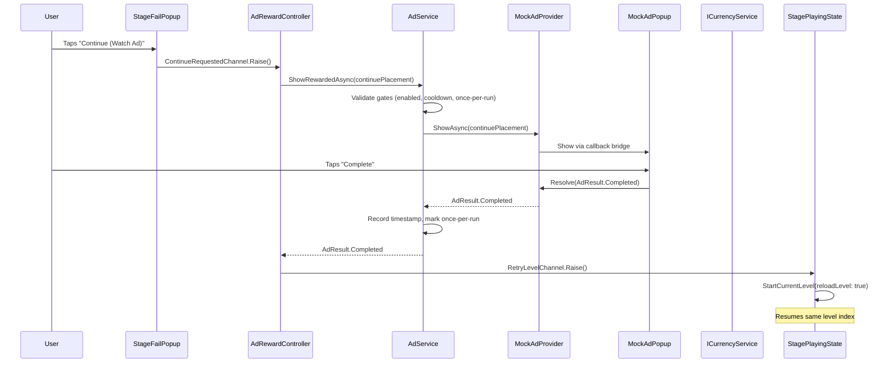
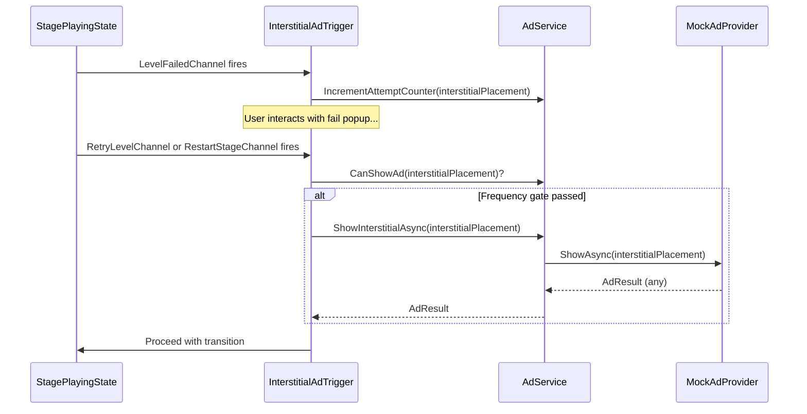

# Ad System - Phase 2: Game Integration (Mock Provider)

## Purpose

Wire the Phase 1 base system into the Knife Toss game. This phase lives in the **Game** assembly and covers:

- DI registration via `AdInstaller`.
- Rewarded ad flow for "Continue" after stage failure.
- Rewarded ad flow for store "Watch Ad" CTA.
- Interstitial triggers on stage complete/fail.
- Banner ad lifecycle management.
- Mock ad popup UI for QA.
- Remote Config overrides for ad settings.
- SRDebugger cheats tab.

All ad calls go through `MockAdProvider` in this phase. No real SDK is involved.

---

## Integration Points

### 1. AdInstaller

Location: `Assets/Scripts/Game/Installers/AdInstaller.cs`

Implements `IInstaller`. Registered in [GameInstaller.cs](Assets/Scripts/Game/Installers/GameInstaller.cs) alongside existing installers.

```csharp
public class AdInstaller : IInstaller
{
    private readonly AdSettings _AdSettings;
    private readonly MockAdSettings _MockAdSettings;
    private readonly AdRequestedEventChannel _RequestedChannel;
    private readonly AdCompletedEventChannel _CompletedChannel;
    private readonly AdFailedEventChannel _FailedChannel;

    public void Install(IContainerBuilder builder)
    {
        builder.RegisterInstance(_AdSettings);
        builder.RegisterInstance(_MockAdSettings);
        builder.RegisterInstance(_RequestedChannel);
        builder.RegisterInstance(_CompletedChannel);
        builder.RegisterInstance(_FailedChannel);

        builder.Register<MockAdProvider>(Lifetime.Singleton).As<IAdProvider>();
        builder.Register<AdService>(Lifetime.Singleton).As<IAdService>();
    }
}
```

**GameInstaller changes:**

- Add `[Header("Ads")]` serialized fields for `AdSettings`, `MockAdSettings`, and ad event channels.
- Add `Install(builder, CreateAdInstaller())` in `Configure()`.
- Add all `AdPlacement` assets as serialized fields and register them as instances.

### 2. AdRewardController (Rewarded Ad -> Continue Level)

Location: `Assets/Scripts/Game/Ads/Controllers/AdRewardController.cs`

Listens for the player requesting to continue after failure, shows a rewarded ad, and if completed, grants the reward and triggers level retry (same level, not stage restart).

**Dependencies (injected):**

- `IAdService`
- `RewardedPlacement` (the "continue" placement asset)
- `ICurrencyService`
- `VoidEventChannel` for continue-requested (new channel, raised by `StageFailPopup`)
- `VoidEventChannel` for retry-level (existing `_RetryLevelClickedChannel`)
- `AdCompletedEventChannel` (to optionally react)

**Flow:**

```
ContinueRequestedChannel fires
  -> Check IAdService.CanShowAd(continuePlacement)
  -> If not available: show feedback (disable button / toast), return
  -> var result = await IAdService.ShowRewardedAsync(continuePlacement)
  -> If result.Success:
       -> ICurrencyService.AddBalance(placement.RewardCurrencyTypeKey, placement.RewardAmount)
          (only if RewardAmount > 0; continue itself doesn't require a currency reward)
       -> Raise _RetryLevelClickedChannel (reuses existing retry flow which reloads current level)
  -> If !result.Success:
       -> No reward, no continue. Player stays on fail popup.
```

**Key insight:** Looking at [StagePlayingState.cs](Assets/Scripts/Game/Flow/Stage/States/StagePlayingState.cs), `OnRetryRequested()` calls `StartCurrentLevel(reloadLevel: true)` which reloads the **current** level (same `CurrentLevelIndex`). This is exactly "Continue" behavior. `OnRestartRequested()` resets to `Machine.Loading` (stage level 0). So wiring the continue ad to the existing retry channel achieves the desired behavior without any flow changes.

### 3. InterstitialAdTrigger

Location: `Assets/Scripts/Game/Ads/Controllers/InterstitialAdTrigger.cs`

Listens to stage-completed and level-failed events, increments the attempt counter on `AdService`, and shows an interstitial when the frequency gate allows.

**Dependencies:**

- `IAdService`
- `InterstitialPlacement` (the interstitial placement asset)
- `StageCompletedEventChannel`
- `LevelFailedEventChannel`

**Timing decision:** Interstitials should be shown **during transitions** (after fail popup dismissed via retry/restart, or after stage completion before menu). This avoids blocking the player mid-decision. The interstitial is awaited so the transition doesn't proceed until the ad is done or times out. This is configurable per placement -- a `BlockTransition` bool on `InterstitialPlacement` controls whether the caller awaits or fires-and-forgets.

**Flow:**

```
StageCompletedChannel or LevelFailedChannel fires
  -> IAdService.IncrementAttemptCounter(interstitialPlacement)
  -> On the NEXT transition (retry/restart/menu):
       -> if IAdService.CanShowAd(interstitialPlacement):
            -> await IAdService.ShowInterstitialAsync(interstitialPlacement)
       -> proceed with transition
```

The trigger hooks into the transition moments rather than the event moments to avoid disrupting the fail popup or completion celebration.

### 4. StageFailPopup Changes

File: [StageFailPopup.cs](Assets/Scripts/Game/UI/Popups/StageFailPopup.cs)

**Add:**

- A third `Button _ContinueButton` serialized field (alongside existing `_RetryButton` and `_RestartStageButton`).
- A `VoidEventChannel _ContinueRequestedChannel` serialized field (new ScriptableObject asset).
- OnEnable/OnDisable wiring for the continue button -> raises `_ContinueRequestedChannel`.
- A method `SetContinueAvailable(bool available)` to show/hide the continue button based on ad availability. Called by `AdRewardController` or `UIController`.

**The popup itself does not know about ads.** It only raises an event. `AdRewardController` handles the ad logic and decides what happens.

### 5. StoreAdCtaView Wiring

File: [StoreAdCtaView.cs](Assets/Scripts/Game/UI/Store/StoreAdCtaView.cs)

The view already has `Setup(int rewardAmount, Action onClicked)` and `SetInteractable(bool)`. It needs a **controller** to bridge it to `IAdService`.

**StoreAdController** (new, in `Assets/Scripts/Game/Ads/Controllers/StoreAdController.cs`):

- Injected with `IAdService`, `RewardedPlacement` (store ad placement), `ICurrencyService`, and the `StoreAdCtaView` reference.
- On initialization: calls `view.Setup(placement.RewardAmount, OnWatchAdClicked)`.
- Periodically or on events: calls `view.SetInteractable(IAdService.CanShowAd(storePlacement))`.
- `OnWatchAdClicked`:

```
  -> view.SetInteractable(false)
  -> var result = await IAdService.ShowRewardedAsync(storePlacement)
  -> if result.Success:
       -> ICurrencyService.AddBalance(placement.RewardCurrencyTypeKey, placement.RewardAmount)
  -> view.SetInteractable(IAdService.CanShowAd(storePlacement))
  

```

The reward amount comes from the `RewardedPlacement` ScriptableObject and can be overridden via Remote Config.

### 6. BannerAdController

Location: `Assets/Scripts/Game/Ads/Controllers/BannerAdController.cs`

Manages banner visibility based on game state:

- Show banner on main menu, store, stages menu.
- Hide banner during gameplay (stage playing).
- Hide banner if ads are disabled.

**Dependencies:**

- `IAdService`
- `BannerPlacement`
- Scene-change or state-change events to toggle visibility.

### 7. MockAdPopup (QA UI)

Location: `Assets/Scripts/Game/Ads/UI/MockAdPopup.cs`

Extends `BasePopup`. Shown when `MockAdProvider` is active and `MockAdSettings.ShowFakePopup` is true.

**UI elements:**

- Dark overlay (full screen).
- Title text: "MOCK AD" with placement key.
- Subtitle: "Interstitial" / "Rewarded" / "Banner" based on placement type.
- Three buttons: "Complete", "Skip", "Simulate Failure".
- Auto-dismiss timer text (counts down from `SimulatedDelaySeconds`).

**MockAdPopupBridge** (new, `Assets/Scripts/Game/Ads/UI/MockAdPopupBridge.cs`):

- Hooks into `MockAdProvider`'s callback (`Func<AdPlacement, UniTaskCompletionSource<AdResult>>`).
- When callback fires: shows `MockAdPopup`, wires button clicks to resolve the `UniTaskCompletionSource` with the corresponding `AdResult`.
- When auto-timer expires: resolves with the configured default outcome.

**Prefab:** A `MockAdPopup` prefab needs to be created in Unity (documented in asset creation section).

### 8. Remote Config Overrides

Using the existing [IRemoteConfigService](Assets/Scripts/Common/Services/RemoteConfig/IRemoteConfigService.cs):

Create an `AdConfigResolver` service that, on initialization:

1. Reads Remote Config values for each placement key (e.g., `ad_continue_cooldown`, `ad_continue_reward_amount`, `ad_interstitial_min_attempts`).
2. If Remote Config values exist, overrides the ScriptableObject defaults at runtime.
3. Reads `ads_enabled` master switch from Remote Config.
4. Reads `ad_store_reward_amount` for the store CTA reward.

This allows server-side tuning of all ad parameters without app updates.

### 9. AdCheats (SRDebugger)

Location: `Assets/Scripts/Debug/Tabs/AdCheatsTab.cs` (under `#if TEST_ENABLED`)

**Options:**

- Toggle ads enabled/disabled.
- Force next ad outcome: Completed / Skipped / Failed / Unavailable / Timeout.
- Reset all cooldowns.
- Reset once-per-run flags.
- Show current cooldown state per placement.
- Force show interstitial / rewarded / banner.
- Toggle mock popup visibility.

Registered in `GameInstaller` under `#if TEST_ENABLED` alongside existing cheats.

---

## DI Wiring Summary

### GameInstaller additions

```csharp
[Header("Ads")]
[SerializeField] private AdSettings _AdSettings;
[SerializeField] private MockAdSettings _MockAdSettings;
[SerializeField] private AdRequestedEventChannel _AdRequestedChannel;
[SerializeField] private AdCompletedEventChannel _AdCompletedChannel;
[SerializeField] private AdFailedEventChannel _AdFailedChannel;
[SerializeField] private RewardedPlacement _ContinuePlacement;
[SerializeField] private RewardedPlacement _StoreAdPlacement;
[SerializeField] private InterstitialPlacement _InterstitialPlacement;
[SerializeField] private BannerPlacement _BannerPlacement;
```

In `Configure()`:

```csharp
Install(builder, CreateAdInstaller());
builder.RegisterInstance(_ContinuePlacement);
builder.RegisterInstance(_StoreAdPlacement);
builder.RegisterInstance(_InterstitialPlacement);
builder.RegisterInstance(_BannerPlacement);
```

### StageInstaller additions

```csharp
[SerializeField] private VoidEventChannel _ContinueRequestedChannel;
```

Wire `_ContinueRequestedChannel` into the stage flow installer / UI installer so `AdRewardController` and `StageFailPopup` can reference it.

Register `AdRewardController` and `InterstitialAdTrigger` as entry points in `StageInstaller` (they are stage-scoped, not global).

### StoreSceneInstaller additions

Register `StoreAdController` with `StoreAdCtaView` reference.

---

## ScriptableObject Assets to Create in Unity Editor


| Asset                      | Type                      | Location                                                          |
| -------------------------- | ------------------------- | ----------------------------------------------------------------- |
| `AdSettings`               | `AdSettings`              | `Assets/Configurations/Systems/Ads/AdSettings.asset`              |
| `MockAdSettings`           | `MockAdSettings`          | `Assets/Configurations/Systems/Ads/MockAdSettings.asset`          |
| `ContinuePlacement`        | `RewardedPlacement`       | `Assets/Configurations/Systems/Ads/ContinuePlacement.asset`       |
| `StoreAdPlacement`         | `RewardedPlacement`       | `Assets/Configurations/Systems/Ads/StoreAdPlacement.asset`        |
| `InterstitialPlacement`    | `InterstitialPlacement`   | `Assets/Configurations/Systems/Ads/InterstitialPlacement.asset`   |
| `BannerPlacement`          | `BannerPlacement`         | `Assets/Configurations/Systems/Ads/BannerPlacement.asset`         |
| `AdRequestedEventChannel`  | `AdRequestedEventChannel` | `Assets/Configurations/Events/Ads/AdRequestedEventChannel.asset`  |
| `AdCompletedEventChannel`  | `AdCompletedEventChannel` | `Assets/Configurations/Events/Ads/AdCompletedEventChannel.asset`  |
| `AdFailedEventChannel`     | `AdFailedEventChannel`    | `Assets/Configurations/Events/Ads/AdFailedEventChannel.asset`     |
| `ContinueRequestedChannel` | `VoidEventChannel`        | `Assets/Configurations/Events/Ads/ContinueRequestedChannel.asset` |
| `MockAdPopup`              | Prefab                    | `Assets/Prefabs/UI/MockAdPopup.prefab`                            |


**Placement asset configuration (defaults):**


| Placement             | CooldownSeconds | MinAttemptsBetweenAds | OncePerRun | RewardAmount | RewardCurrencyTypeKey            |
| --------------------- | --------------- | --------------------- | ---------- | ------------ | -------------------------------- |
| ContinuePlacement     | 0               | 0                     | true       | 0            | (none -- continue is the reward) |
| StoreAdPlacement      | 60              | 0                     | false      | 50           | "coins"                          |
| InterstitialPlacement | 30              | 3                     | false      | N/A          | N/A                              |
| BannerPlacement       | 0               | 0                     | false      | N/A          | N/A                              |


---

## File Structure (Phase 2 additions)

```
Assets/Scripts/Game/Ads/
    Controllers/
        AdRewardController.cs
        InterstitialAdTrigger.cs
        StoreAdController.cs
        BannerAdController.cs
    Services/
        AdConfigResolver.cs       (Remote Config overrides)
    UI/
        MockAdPopup.cs
        MockAdPopupBridge.cs
    Installers/
        AdInstaller.cs

Assets/Scripts/Debug/
    Tabs/
        AdCheatsTab.cs            (#if TEST_ENABLED)
```

**Modified files:**

- [GameInstaller.cs](Assets/Scripts/Game/Installers/GameInstaller.cs) -- add ad installer + serialized fields
- [StageInstaller.cs](Assets/Scripts/Game/Installers/StageInstaller.cs) -- add continue channel, register controllers
- [StageFailPopup.cs](Assets/Scripts/Game/UI/Popups/StageFailPopup.cs) -- add continue button + channel
- [StoreAdCtaView.cs](Assets/Scripts/Game/UI/Store/StoreAdCtaView.cs) -- minor: no code changes needed, wired via new controller

---

## State Flows

### Rewarded Ad (Continue) Sequence




### Interstitial (Stage Fail) Sequence




---

## Risks & Mitigations


| Risk                                                                | Mitigation                                                                                                                                    |
| ------------------------------------------------------------------- | --------------------------------------------------------------------------------------------------------------------------------------------- |
| Continue button visible when ad unavailable, confusing players      | `AdRewardController` checks `CanShowAd` and calls `SetContinueAvailable(false)` on popup. Re-checks on popup show.                            |
| Race condition: player taps continue while ad is loading            | `AdService` internal guard (like `IsPurchaseInProgress` in `PurchaseService`) prevents concurrent show calls. Button disabled during ad flow. |
| Interstitial shown between retry tap and level reload feels jarring | Interstitial is shown BEFORE the transition starts. Short timeout (5s) prevents long blocks. Configurable via placement.                      |
| Remote Config unavailable on first launch                           | ScriptableObject defaults are always valid. RC overrides are best-effort.                                                                     |
| MockAdPopup not dismissed on scene change                           | Popup is destroyed with the scene. `MockAdPopupBridge` handles cleanup in `OnDestroy`.                                                        |


---

## Acceptance Criteria

- Tapping "Continue" on fail popup shows mock ad popup, completing it retries the current level.
- "Continue" button hidden/disabled after one use per run (once-per-run flag).
- "Continue" button hidden when mock provider reports unavailable.
- Store "Watch Ad" button shows mock ad, completing it grants configured coin amount.
- Store "Watch Ad" button respects cooldown (disabled during cooldown).
- Interstitial shows every ~3 stage attempts (configurable via placement asset).
- Interstitial does not block fail popup or completion celebration.
- Banner can be shown/hidden programmatically.
- SRDebugger Ad Cheats tab can force outcomes, reset cooldowns, toggle ads.
- Remote Config values override ScriptableObject defaults when available.
- All flows work with mock provider -- no real SDK required.
- No crashes on rapid button tapping or scene transitions during ad flow.

