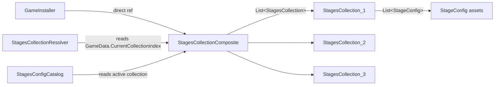

# Addressables Asset Loading System

## Current Architecture

Worlds are loaded via direct ScriptableObject references:



All three `StagesCollection` assets (worlds) and their nested `StageConfig` references are loaded into memory at startup because `StagesCollectionComposite` holds them as direct serialized fields. The goal is to load each world's `StagesCollection` on demand via Addressables and unload it when no longer active.

---

## Part 1: Generic Asset Loading Interfaces

Create framework-level abstractions in `Common/AssetLoading/`.

### `ILoadedAsset<T>` ([Assets/Scripts/Common/AssetLoading/Interfaces/ILoadedAsset.cs](Assets/Scripts/Common/AssetLoading/Interfaces/ILoadedAsset.cs))

```csharp
public interface ILoadedAsset<out T> : IDisposable
{
    T Asset { get; }
    bool IsValid { get; }
}
```

- `Asset` returns the loaded object
- `IsValid` indicates whether the handle still points to a live asset
- `Dispose()` releases the underlying asset (ref-count decrement for Addressables)

### `IAssetLoader` ([Assets/Scripts/Common/AssetLoading/Interfaces/IAssetLoader.cs](Assets/Scripts/Common/AssetLoading/Interfaces/IAssetLoader.cs))

```csharp
public interface IAssetLoader
{
    UniTask<ILoadedAsset<T>> LoadAsync<T>(string address, CancellationToken cancellationToken = default);
}
```

- Generic `T` so callers can load any asset type (ScriptableObject, Prefab, Texture, etc.)
- Uses `UniTask` consistent with the rest of the project
- `CancellationToken` for safe cancellation
- Keyed by string address (Addressables key)

---

## Part 2: Addressables Implementation

### Install Addressables Package

Add `"com.unity.addressables": "2.4.3"` to [Packages/manifest.json](Packages/manifest.json).

### `AddressableLoadedAsset<T>` ([Assets/Scripts/Common/AssetLoading/Addressables/AddressableLoadedAsset.cs](Assets/Scripts/Common/AssetLoading/Addressables/AddressableLoadedAsset.cs))

Wraps `AsyncOperationHandle<T>` from Addressables:

```csharp
public class AddressableLoadedAsset<T> : ILoadedAsset<T>
{
    private AsyncOperationHandle<T> _operationHandle;

    public T Asset => _operationHandle.Result;
    public bool IsValid => _operationHandle.IsValid();

    public AddressableLoadedAsset(AsyncOperationHandle<T> operationHandle)
    {
        _operationHandle = operationHandle;
    }

    public void Dispose()
    {
        if (_operationHandle.IsValid())
            Addressables.Release(_operationHandle);
        _operationHandle = default;
    }
}
```

### `AddressableAssetLoader` ([Assets/Scripts/Common/AssetLoading/Addressables/AddressableAssetLoader.cs](Assets/Scripts/Common/AssetLoading/Addressables/AddressableAssetLoader.cs))

```csharp
public class AddressableAssetLoader : IAssetLoader
{
    public async UniTask<ILoadedAsset<T>> LoadAsync<T>(string address, CancellationToken ct = default)
    {
        var handle = Addressables.LoadAssetAsync<T>(address);
        await handle.ToUniTask(cancellationToken: ct);
        return new AddressableLoadedAsset<T>(handle);
    }
}
```

---

## Part 3: World Loading Integration

### New: `WorldAssetService` ([Assets/Scripts/Game/Level/Services/WorldAssetService.cs](Assets/Scripts/Game/Level/Services/WorldAssetService.cs))

Manages loading/unloading the active `StagesCollection`:

- Holds the currently loaded `ILoadedAsset<StagesCollection>` 
- Exposes a sync `ActiveCollection` property for downstream consumers (`StagesConfigCatalog`, `StagesCollectionResolver`)
- `LoadCollectionAsync(int collectionIndex)` loads the world at the given index and disposes the previous handle
- Implements `IDisposable` to release on shutdown
- Gets the Addressable address/key from `StagesCollectionComposite`

### Modify: `StagesCollectionComposite` ([Assets/Scripts/Game/Level/Configurations/Stage/StagesCollectionComposite.cs](Assets/Scripts/Game/Level/Configurations/Stage/StagesCollectionComposite.cs))

Change from direct references to Addressable keys:

- Replace `List<StagesCollection> Collections` with `List<AssetReferenceT<StagesCollection>> CollectionReferences`
- Keep `CollectionsCount` working off the references list
- Remove `GetCollection(int)` (loading is now async via `WorldAssetService`)
- Add `GetCollectionAddress(int collectionIndex)` that returns the runtime key string from the `AssetReferenceT`
- `GetCumulativeStageNumberDisplay` will need to be reworked since it can no longer iterate all collections synchronously -- it could accept stage counts as parameters or be moved to `WorldAssetService`

### Modify: `StagesCollectionResolver` ([Assets/Scripts/Game/Level/Configurations/Stage/StagesCollectionResolver.cs](Assets/Scripts/Game/Level/Configurations/Stage/StagesCollectionResolver.cs))

- Instead of reading from `StagesCollectionComposite.GetCollection()`, read from `WorldAssetService.ActiveCollection`
- The resolver remains synchronous; the async loading is handled upstream before the resolver is queried

### Modify: `StagesConfigCatalog` ([Assets/Scripts/Game/Level/Catalogs/StagesConfigCatalog.cs](Assets/Scripts/Game/Level/Catalogs/StagesConfigCatalog.cs))

- Change `ActiveCollection` property to read from `WorldAssetService` instead of `StagesCollectionComposite.GetCollection()`

### Modify: `GameInstaller` ([Assets/Scripts/Game/Installers/GameInstaller.cs](Assets/Scripts/Game/Installers/GameInstaller.cs))

- Register `AddressableAssetLoader` as `IAssetLoader` (singleton)
- Register `WorldAssetService` (singleton)
- `StagesCollectionComposite` registration stays the same (it's still a lightweight SO with metadata/references)

### Modify: `StageFlowController` ([Assets/Scripts/Game/Flow/Stage/StageFlowController.cs](Assets/Scripts/Game/Flow/Stage/StageFlowController.cs))

- `LoadStage` needs to await `WorldAssetService.LoadCollectionAsync(collectionIndex)` before entering the stage state machine
- This makes `LoadStage` async (`UniTask`)

### Modify: `IStageFlowController` ([Assets/Scripts/Game/Flow/Interfaces/IStageFlowController.cs](Assets/Scripts/Game/Flow/Interfaces/IStageFlowController.cs))

- Update `LoadStage` signature to return `UniTask` instead of `void`

### Modify callers of `IStageFlowController.LoadStage`

- `GamePlayingState` and any other callers need to await the now-async `LoadStage`

---

## Flow After Changes

```mermaid
sequenceDiagram
    participant GP as GamePlayingState
    participant SFC as StageFlowController
    participant WAS as WorldAssetService
    participant AAL as AddressableAssetLoader
    participant SSM as StageStateMachine

    GP->>SFC: LoadStage(collectionIdx, stageIdx)
    SFC->>WAS: LoadCollectionAsync(collectionIdx)
    WAS->>AAL: LoadAsync&lt;StagesCollection&gt;(address)
    AAL-->>WAS: ILoadedAsset&lt;StagesCollection&gt;
    WAS-->>SFC: ActiveCollection ready
    SFC->>SSM: SetState(Loading)
    Note over SSM: StagesConfigCatalog reads<br/>WorldAssetService.ActiveCollection
```

---

## Unity Editor Setup (Manual Steps)

After code changes, the following must be done in the Unity Editor:

1. Open the Addressables Groups window (Window > Asset Management > Addressables > Groups)
2. Create an Addressables group for each world (e.g., "World1", "World2", "World3")
3. Mark each `StagesCollection_X.asset` as Addressable and assign it to its group
4. Open `StagesCollectionComposite.asset` in the Inspector and assign the `AssetReferenceT<StagesCollection>` slots to point to each world's `StagesCollection` asset
5. Build Addressables content before building the player

---

## File Summary

New files:
- `Assets/Scripts/Common/AssetLoading/Interfaces/ILoadedAsset.cs`
- `Assets/Scripts/Common/AssetLoading/Interfaces/IAssetLoader.cs`
- `Assets/Scripts/Common/AssetLoading/Addressables/AddressableLoadedAsset.cs`
- `Assets/Scripts/Common/AssetLoading/Addressables/AddressableAssetLoader.cs`
- `Assets/Scripts/Game/Level/Services/WorldAssetService.cs`

Modified files:
- `Packages/manifest.json` (add Addressables package)
- `Assets/Scripts/Game/Level/Configurations/Stage/StagesCollectionComposite.cs`
- `Assets/Scripts/Game/Level/Configurations/Stage/StagesCollectionResolver.cs`
- `Assets/Scripts/Game/Level/Catalogs/StagesConfigCatalog.cs`  
- `Assets/Scripts/Game/Installers/GameInstaller.cs`
- `Assets/Scripts/Game/Flow/Stage/StageFlowController.cs`
- `Assets/Scripts/Game/Flow/Interfaces/IStageFlowController.cs`
- `Assets/Scripts/Game/Flow/Game/States/GamePlayingState.cs` (and any other `LoadStage` callers)
