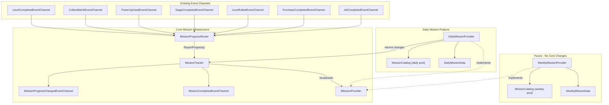
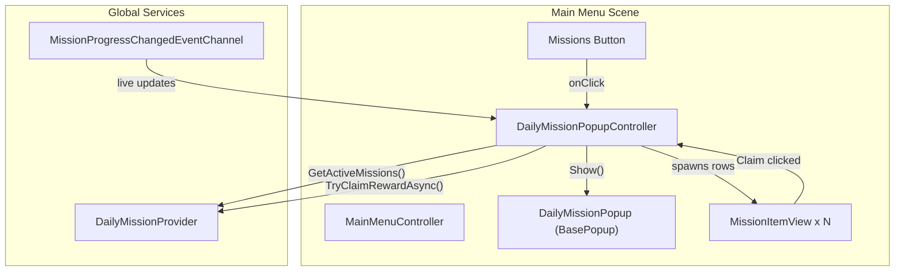

# Daily Mission System (Modular Architecture)

## Design Principle

The system is split into two layers:

- **Core mission infrastructure** (`Assets/Scripts/Game/Missions/`) -- reusable tracker, router, definitions, and events. Knows nothing about "daily" or "weekly."
- **Daily mission feature** (`Assets/Scripts/Game/Missions/Daily/`) -- daily-specific scheduling, refresh, and selection logic. Implements `IMissionProvider` to plug into the core.

Adding weekly missions later means creating `Assets/Scripts/Game/Missions/Weekly/` with a `WeeklyMissionProvider : IMissionProvider` and a `WeeklyMissionData` DTO. The tracker, router, event channels, definition format, and objective keys all stay untouched.




---

## Layer 1: Core Mission Infrastructure

### 1A. Data types

**[Assets/Scripts/Game/Missions/Data/MissionObjectiveKeys.cs](Assets/Scripts/Game/Missions/Data/MissionObjectiveKeys.cs)**

Shared string constants used by configuration assets, providers, and the router. New objective types are added here once and usable by any provider.

```csharp
public static class MissionObjectiveKeys
{
    public const string CompleteLevels = "CompleteLevels";
    public const string HitCollectibles = "HitCollectibles";
    public const string UsePowerUps = "UsePowerUps";
    public const string WatchAd = "WatchAd";
    public const string CompleteStageNoFail = "CompleteStageNoFail";
    public const string PurchaseItem = "PurchaseItem";
}
```

**[Assets/Scripts/Game/Missions/Data/ActiveMissionEntry.cs](Assets/Scripts/Game/Missions/Data/ActiveMissionEntry.cs)**

Persistence DTO reused by any provider. Stored inside each provider's own persistence container (e.g. `DailyMissionData`, future `WeeklyMissionData`).

```csharp
[Serializable]
public class ActiveMissionEntry
{
    public string DefinitionKey;
    public int CurrentCount;
    public bool Claimed;
}
```

- `DefinitionKey` maps to a `MissionDefinition` asset name for runtime lookup (same pattern as `CurrencyBalanceEntry.TypeId`).
- Target count, rewards, and display text are resolved from the matched definition at runtime -- not duplicated in save data.

**[Assets/Scripts/Game/Missions/Data/MissionProgressChange.cs](Assets/Scripts/Game/Missions/Data/MissionProgressChange.cs)**

Return type from `IMissionProvider.ReportProgress()`. Tells the tracker what changed so it can raise the right events.

```csharp
public readonly struct MissionProgressChange
{
    public int MissionIndex { get; }
    public MissionDefinition Definition { get; }
    public int CurrentCount { get; }
    public int RequiredCount { get; }
    public bool JustCompleted { get; }
    // constructor
}
```

### 1B. Configuration ScriptableObjects

**[Assets/Scripts/Game/Missions/Configs/MissionDefinition.cs](Assets/Scripts/Game/Missions/Configs/MissionDefinition.cs)**

Generic -- describes any mission variant regardless of scheduling cadence.

```csharp
[CreateAssetMenu(menuName = "Knife Toss/Missions/Mission Definition")]
public class MissionDefinition : ScriptableObject
{
    [field: SerializeField] public string ObjectiveTypeKey { get; private set; }
    [field: SerializeField] public int TargetCount { get; private set; }
    [field: SerializeField] public string DescriptionFormat { get; private set; }
    [field: SerializeField] public Sprite Icon { get; private set; }
    [field: SerializeField] public List<RewardGrantEntryBase> Rewards { get; private set; } = new();
    [field: SerializeField] public int SelectionWeight { get; private set; } = 1;

    public string GetDescription() => string.Format(DescriptionFormat, TargetCount);
}
```

- `Rewards` uses the existing `[RewardGrantEntryBase](Assets/Scripts/Game/Rewards/Configs/RewardGrantEntryBase.cs)` SO pattern, same as stage completion rewards.
- The same `MissionDefinition` asset can appear in a daily catalog, a weekly catalog, or both.

**[Assets/Scripts/Game/Missions/Configs/MissionCatalog.cs](Assets/Scripts/Game/Missions/Configs/MissionCatalog.cs)**

A generic pool of definitions. Each provider references its own catalog instance (daily pool, weekly pool, etc.).

```csharp
[CreateAssetMenu(menuName = "Knife Toss/Missions/Mission Catalog")]
public class MissionCatalog : ScriptableObject
{
    [field: SerializeField] public List<MissionDefinition> MissionPool { get; private set; } = new();
    [field: SerializeField] public int ActiveMissionCount { get; private set; } = 3;
}
```

### 1C. Provider interface

**[Assets/Scripts/Game/Missions/Interfaces/IMissionProvider.cs](Assets/Scripts/Game/Missions/Interfaces/IMissionProvider.cs)**

The contract every mission source implements. The tracker only knows this interface.

```csharp
public interface IMissionProvider
{
    IReadOnlyList<MissionProgressChange> ReportProgress(string typeKey, int amount);
    IReadOnlyList<MissionSnapshot> GetActiveMissions();
    UniTask<bool> TryClaimRewardAsync(int missionIndex);
    bool HasActiveMissions { get; }
}
```

**[Assets/Scripts/Game/Missions/Data/MissionSnapshot.cs](Assets/Scripts/Game/Missions/Data/MissionSnapshot.cs)**

Immutable view model for UI consumption. Providers produce these from their internal state.

```csharp
public readonly struct MissionSnapshot
{
    public MissionDefinition Definition { get; }
    public int CurrentCount { get; }
    public int RequiredCount { get; }
    public bool Claimed { get; }
    public bool IsCompleted { get; }
    // constructor
}
```

### 1D. Event channels

**[Assets/Scripts/Game/Missions/Events/MissionProgressChangedEventChannel.cs](Assets/Scripts/Game/Missions/Events/MissionProgressChangedEventChannel.cs)** + **[MissionProgressChangedEventData.cs](Assets/Scripts/Game/Missions/Events/MissionProgressChangedEventData.cs)**

```csharp
public readonly struct MissionProgressChangedEventData
{
    public IMissionProvider Source { get; }
    public int MissionIndex { get; }
    public int CurrentCount { get; }
    public int RequiredCount { get; }
}
```

**[Assets/Scripts/Game/Missions/Events/MissionCompletedEventChannel.cs](Assets/Scripts/Game/Missions/Events/MissionCompletedEventChannel.cs)** + **[MissionCompletedEventData.cs](Assets/Scripts/Game/Missions/Events/MissionCompletedEventData.cs)**

```csharp
public readonly struct MissionCompletedEventData
{
    public IMissionProvider Source { get; }
    public int MissionIndex { get; }
    public MissionDefinition Definition { get; }
}
```

Both channels carry the `Source` provider reference so the UI can distinguish daily vs. weekly notifications without type-checking.

### 1E. MissionTracker (global singleton)

**[Assets/Scripts/Game/Missions/Services/MissionTracker.cs](Assets/Scripts/Game/Missions/Services/MissionTracker.cs)**

Thin aggregator. Holds registered providers, broadcasts progress, raises events based on returned changes.

```csharp
public class MissionTracker
{
    private readonly List<IMissionProvider> _Providers = new();
    private readonly MissionProgressChangedEventChannel _ProgressChannel;
    private readonly MissionCompletedEventChannel _CompletedChannel;
    private readonly PlayerDataService _PlayerDataService;

    // RegisterProvider / UnregisterProvider

    public void ReportProgress(string typeKey, int amount)
    {
        foreach (var provider in _Providers)
        {
            var changes = provider.ReportProgress(typeKey, amount);
            foreach (var change in changes)
            {
                _ProgressChannel?.Raise(new MissionProgressChangedEventData(
                    provider, change.MissionIndex, change.CurrentCount, change.RequiredCount));

                if (change.JustCompleted)
                    _CompletedChannel?.Raise(new MissionCompletedEventData(
                        provider, change.MissionIndex, change.Definition));
            }
        }
        _PlayerDataService.RequestSave();
    }

    public IReadOnlyList<MissionSnapshot> GetAllActiveMissions() { /* aggregate */ }
}
```

Key design: the tracker does NOT manage mission state. Each provider owns its own missions. The tracker only:

1. Broadcasts `ReportProgress` to all providers
2. Raises event channels from the returned `MissionProgressChange` list
3. Triggers persistence save

### 1F. MissionProgressRouter (stage-scoped)

**[Assets/Scripts/Game/Missions/Services/MissionProgressRouter.cs](Assets/Scripts/Game/Missions/Services/MissionProgressRouter.cs)**

Follows the `[StagePersistenceConnector](Assets/Scripts/Game/Persistence/Services/StagePersistenceConnector.cs)` pattern. Subscribes to gameplay event channels and calls `MissionTracker.ReportProgress()`.

```csharp
public class MissionProgressRouter : IInitializable, IDisposable
{
    private readonly MissionTracker _Tracker;
    // + all 7 event channels injected via .WithParameter()
    private bool _HasFailedCurrentStage;
}
```

Channel subscriptions and routing:

- `LevelCompletedEventChannel` --> `ReportProgress(CompleteLevels, 1)`
- `CollectibleHitEventChannel` --> `ReportProgress(HitCollectibles, 1)`
- `PowerUpUsedEventChannel` --> `ReportProgress(UsePowerUps, 1)`
- `PurchaseCompletedEventChannel` --> `ReportProgress(PurchaseItem, 1)`
- `AdCompletedEventChannel` --> `ReportProgress(WatchAd, 1)` (only if `Result.RewardEarned`)
- `LevelFailedEventChannel` --> sets `_HasFailedCurrentStage = true`
- `StageCompletedEventChannel` --> if `!_HasFailedCurrentStage`, `ReportProgress(CompleteStageNoFail, 1)`

The router is stage-scoped (disposed/recreated each stage scene load), so `_HasFailedCurrentStage` resets naturally. It knows nothing about daily or weekly -- it only talks to `MissionTracker`.

---

## Layer 2: Daily Mission Feature

### 2A. Persistence

**[Assets/Scripts/Game/Missions/Daily/Data/DailyMissionData.cs](Assets/Scripts/Game/Missions/Daily/Data/DailyMissionData.cs)**

```csharp
[Serializable]
public class DailyMissionData
{
    public string RefreshDateUtc;
    public List<ActiveMissionEntry> ActiveMissions = new();
}
```

Modified: **[PlayerData.cs](Assets/Scripts/Game/Persistence/Data/PlayerData.cs)** -- add field:

```csharp
public DailyMissionData DailyMissions = new DailyMissionData();
```

Modified: **[PlayerDataService.cs](Assets/Scripts/Game/Persistence/Services/PlayerDataService.cs)** -- add null-coalescing in `EnsureDataIntegrity()` and `MigrateFromLegacyStructure()`:

```csharp
_CachedData.DailyMissions ??= new DailyMissionData();
_CachedData.DailyMissions.ActiveMissions ??= new List<ActiveMissionEntry>();
```

### 2B. DailyMissionProvider

**[Assets/Scripts/Game/Missions/Daily/Services/DailyMissionProvider.cs](Assets/Scripts/Game/Missions/Daily/Services/DailyMissionProvider.cs)**

Implements `IMissionProvider` and `IInitializable`. Registered as a global singleton. Self-registers with `MissionTracker` during `Initialize()`.

Responsibilities:

- **Refresh check**: on `Initialize()`, compare `RefreshDateUtc` against today (UTC). If stale, select new missions from the catalog using weighted random (no duplicates), clear old progress, save.
- `**ReportProgress(string typeKey, int amount)`**: iterate own active missions, increment matching unclaimed/uncompleted entries, return `List<MissionProgressChange>` describing what changed.
- `**TryClaimRewardAsync(int missionIndex)`**: validate completed + unclaimed, convert `MissionDefinition.Rewards` via `[RewardGrantEntryBase.TryCreateGrantItem()](Assets/Scripts/Game/Rewards/Configs/RewardGrantEntryBase.cs)` into `IRewardItem` list, call `[IRewardGrantService.GrantAsync(items, title)](Assets/Scripts/Game/Rewards/Services/RewardGrantService.cs)`, mark claimed. Follows the same pattern as `[StageRewardConnector](Assets/Scripts/Game/Rewards/Services/StageRewardConnector.cs)` lines 59-98.
- `**GetActiveMissions()`**: returns `List<MissionSnapshot>` for UI binding.

Dependencies:

- `MissionTracker` (to self-register)
- `MissionCatalog` (daily pool SO instance)
- `PlayerDataService` (persistence)
- `IRewardGrantService` (reward granting)

**Scoping note**: `IRewardGrantService` is currently registered only in stage scope (via `RewardInstaller` in `StageInstaller`). Mission claims happen from the main menu (global scope). Solution: install `RewardInstaller` (with null popup / `NullRewardPresenter`) in `GameInstaller` so `IRewardGrantService` is globally available. A main-menu reward popup can be wired later.

---

## Layer 3: Daily Mission UI

The UI follows the project's established popup patterns:

- `**DailyMissionPopup`** extends `[BasePopup](Assets/Scripts/Game/UI/Common/BasePopup.cs)` (same as `RewardPopup`, `StageFailPopup`)
- `**MissionItemView`** is a row prefab spawned dynamically (same as `RewardItemView` in `RewardPopup`)
- `**DailyMissionPopupController**` is a non-MonoBehaviour orchestrator (same as `SettingsPopupController`)
- Main menu opens the popup via a button (same as how `_StagesButton` works in `MainMenuController`)




### 3A. MissionItemView

**[Assets/Scripts/Game/UI/Missions/MissionItemView.cs](Assets/Scripts/Game/UI/Missions/MissionItemView.cs)**

Row prefab for a single mission inside the popup. Follows the `[RewardItemView](Assets/Scripts/Game/UI/Popups/RewardItemView.cs)` pattern (MonoBehaviour + `Setup()` method).

```csharp
public class MissionItemView : MonoBehaviour
{
    [SerializeField] private Image _Icon;
    [SerializeField] private TextMeshProUGUI _DescriptionText;
    [SerializeField] private TextMeshProUGUI _ProgressText;
    [SerializeField] private Slider _ProgressBar;
    [SerializeField] private Button _ClaimButton;
    [SerializeField] private GameObject _ClaimedOverlay;
    [SerializeField] private Transform _RewardPreviewRoot;
    [SerializeField] private RewardItemView _RewardPreviewPrefab;
}
```

Serialized references (all on the prefab):

- `_Icon` -- mission objective icon (from `MissionDefinition.Icon`)
- `_DescriptionText` -- e.g. "Complete 3 levels"
- `_ProgressText` -- e.g. "2 / 3"
- `_ProgressBar` -- `Slider` with `value = currentCount / targetCount` (optional, gracefully skipped if null)
- `_ClaimButton` -- visible only when completed and unclaimed
- `_ClaimedOverlay` -- visible only when already claimed (checkmark, dimming, etc.)
- `_RewardPreviewRoot` + `_RewardPreviewPrefab` -- small inline reward icons spawned under a horizontal layout (uses existing `RewardItemView` prefab)

Public API:

- `**Setup(MissionSnapshot snapshot, Action<int> onClaimClicked)**` -- populates all fields from the snapshot and wires the claim button callback with the mission index.
- `**Refresh(MissionSnapshot snapshot)**` -- updates progress text/bar and button states without rebuilding rewards. Called by the controller when `MissionProgressChangedEventChannel` fires.

Visual states:

- **In progress**: progress bar and text visible, claim button hidden, claimed overlay hidden
- **Completed (claimable)**: progress bar full, claim button visible and interactable, claimed overlay hidden
- **Claimed**: claim button hidden, claimed overlay visible, progress bar full

### 3B. DailyMissionPopup

**[Assets/Scripts/Game/UI/Missions/DailyMissionPopup.cs](Assets/Scripts/Game/UI/Missions/DailyMissionPopup.cs)**

Extends `[BasePopup](Assets/Scripts/Game/UI/Common/BasePopup.cs)`. Purely a view -- holds serialized references, exposes them to the controller. Does not own any logic.

```csharp
public class DailyMissionPopup : BasePopup
{
    [SerializeField] private TextMeshProUGUI _TitleText;
    [SerializeField] private TextMeshProUGUI _RefreshTimerText;
    [SerializeField] private Transform _MissionItemsRoot;
    [SerializeField] private MissionItemView _MissionItemPrefab;
    [SerializeField] private Button _CloseButton;
}
```

Serialized references:

- `_TitleText` -- "Daily Missions" header
- `_RefreshTimerText` -- countdown to next UTC midnight (e.g. "Resets in 5h 23m")
- `_MissionItemsRoot` -- parent `Transform` under a `VerticalLayoutGroup` where `MissionItemView` rows are spawned
- `_MissionItemPrefab` -- reference to the mission row prefab
- `_CloseButton` -- closes the popup

Properties/accessors for the controller:

- `TextMeshProUGUI TitleText`
- `TextMeshProUGUI RefreshTimerText`
- `Transform MissionItemsRoot`
- `MissionItemView MissionItemPrefab`
- `Button CloseButton`

The popup does NOT pause gameplay (it's on the main menu, `_PauseGameplayWhileVisible = false` in Inspector or override `ShouldPauseGameplayWhileVisible`).

### 3C. DailyMissionPopupController

**[Assets/Scripts/Game/UI/Missions/DailyMissionPopupController.cs](Assets/Scripts/Game/UI/Missions/DailyMissionPopupController.cs)**

Non-MonoBehaviour orchestrator. Follows the `[SettingsPopupController](Assets/Scripts/Game/UI/Controllers/SettingsPopupController.cs)` pattern (injectable via constructor, implements `IDisposable`).

```csharp
public class DailyMissionPopupController : IDisposable
{
    private readonly DailyMissionPopup _Popup;
    private readonly DailyMissionProvider _Provider;
    private readonly MissionProgressChangedEventChannel _ProgressChannel;
    private readonly List<MissionItemView> _SpawnedItems = new();
}
```

Dependencies (constructor-injected):

- `DailyMissionPopup` (scene reference registered via `RegisterComponent`)
- `DailyMissionProvider` (global singleton)
- `MissionProgressChangedEventChannel` (for live progress updates)

Responsibilities:

- `**ShowMissions()**`: query `_Provider.GetActiveMissions()`, clear old items from `_MissionItemsRoot`, spawn `MissionItemView` rows via `Instantiate`, call `Setup(snapshot, OnClaimClicked)` on each, update refresh timer text, call `_Popup.Show()`, subscribe to `_ProgressChannel`.
- `**HideMissions()**`: unsubscribe from `_ProgressChannel`, call `_Popup.Hide()`.
- `**OnClaimClicked(int missionIndex)**`: call `_Provider.TryClaimRewardAsync(missionIndex)`, on success refresh the specific `MissionItemView` to show claimed state.
- `**OnProgressChanged(MissionProgressChangedEventData data)**`: if `data.Source == _Provider`, find the matching `MissionItemView` by index and call `Refresh(updatedSnapshot)`.
- `**UpdateRefreshTimer()**`: calculates time remaining until next UTC midnight and updates `_RefreshTimerText`. Can be called periodically via a coroutine on the popup or a lightweight ticker.
- `**Dispose()**`: unsubscribe from channels, remove close button listener.

Item lifecycle (same pattern as `[RewardPopup.ClearRewardItems()](Assets/Scripts/Game/UI/Popups/RewardPopup.cs)`):

```csharp
private void ClearItems()
{
    for (var i = _Popup.MissionItemsRoot.childCount - 1; i >= 0; i--)
        Object.Destroy(_Popup.MissionItemsRoot.GetChild(i).gameObject);
    _SpawnedItems.Clear();
}
```

### 3D. Main Menu Wiring

**Modified: [MainMenuController.cs](Assets/Scripts/Game/UI/MainMenu/MainMenuController.cs)**

Add a serialized `Button _MissionsButton` field. In `Start()`, wire `onClick` to call `_PopupController.ShowMissions()`. The controller is injected via `[Inject]`.

```csharp
[SerializeField] private Button _MissionsButton;
[Inject] private DailyMissionPopupController _MissionPopupController;
```

In `Start()`:

```csharp
if (_MissionsButton != null)
    _MissionsButton.onClick.AddListener(OnMissionsClicked);
```

Handler:

```csharp
private void OnMissionsClicked()
{
    _MissionPopupController?.ShowMissions();
}
```

In `OnDestroy()`:Assets\Scripts\Game\Installers\MissionInstaller.cs(11,37): error CS0246: The type or namespace name 'IInstaller' could not be found (are you missing a using directive or an assembly reference?)


```csharp
if (_MissionsButton != null)
    _MissionsButton.onClick.RemoveListener(OnMissionsClicked);
```

### 3E. DI Registration for UI

The `DailyMissionPopupController` needs to be registered in the **main menu scope**. Since `MainMenuController` is a MonoBehaviour on the main menu scene and currently uses field injection from the global `GameInstaller` scope, the controller should be registered globally:

In `**DailyMissionInstaller`**, add:

```csharp
builder.Register<DailyMissionPopupController>(Lifetime.Singleton).AsSelf();
```

The `DailyMissionPopup` scene reference is registered via `RegisterComponent` in `GameInstaller` (or a new main-menu installer if one is introduced later):

```csharp
if (_DailyMissionPopup != null)
    builder.RegisterComponent(_DailyMissionPopup).AsSelf();
```

### 3F. Unity Setup for UI (manual steps)

- Create `MissionItemView` prefab with: icon `Image`, description `TMP_Text`, progress `TMP_Text`, progress `Slider`, claim `Button`, claimed overlay `GameObject`, optional reward preview row using existing `RewardItemView` prefab
- Create `DailyMissionPopup` in the main menu scene: panel with title text, refresh timer text, vertical layout group content area, close button, starts inactive
- Add `PopupFadeInAnimation` component to the popup for enter/exit animation (optional, same as other popups)
- Add a "Daily Missions" `Button` to the main menu layout
- Wire serialized references on the popup, the button on `MainMenuController`, and the popup on `GameInstaller`

---

## DI Registration

### New files

**[Assets/Scripts/Game/Installers/MissionInstaller.cs](Assets/Scripts/Game/Installers/MissionInstaller.cs)** -- core infrastructure:

```csharp
public class MissionInstaller : IInstaller
{
    private readonly MissionProgressChangedEventChannel _ProgressChannel;
    private readonly MissionCompletedEventChannel _CompletedChannel;

    public void Install(IContainerBuilder builder)
    {
        if (_ProgressChannel != null) builder.RegisterInstance(_ProgressChannel);
        if (_CompletedChannel != null) builder.RegisterInstance(_CompletedChannel);
        builder.Register<MissionTracker>(Lifetime.Singleton).AsSelf();
    }
}
```

**[Assets/Scripts/Game/Installers/DailyMissionInstaller.cs](Assets/Scripts/Game/Installers/DailyMissionInstaller.cs)** -- daily feature:

```csharp
public class DailyMissionInstaller : IInstaller
{
    private readonly MissionCatalog _DailyCatalog;

    public void Install(IContainerBuilder builder)
    {
        builder.RegisterInstance(_DailyCatalog);
        builder.RegisterEntryPoint<DailyMissionProvider>().AsSelf();
    }
}
```

Separation means adding a future `WeeklyMissionInstaller` requires zero changes to `MissionInstaller`.

### Modified files

**[GameInstaller.cs](Assets/Scripts/Game/Installers/GameInstaller.cs)**:

- Add serialized fields: `MissionCatalog _DailyMissionCatalog`, `MissionProgressChangedEventChannel`, `MissionCompletedEventChannel`
- Conditionally install `MissionInstaller` + `DailyMissionInstaller`
- Install `RewardInstaller` with null popup for global `IRewardGrantService` (needed for mission claims from menu)

**[StageInstaller.cs](Assets/Scripts/Game/Installers/StageInstaller.cs)**:

- Add serialized field for `AdCompletedEventChannel` (or verify it's resolvable from parent scope via `AdInstaller`)
- Register router entry point:

```csharp
builder.RegisterEntryPoint<MissionProgressRouter>()
    .WithParameter(_LevelCompletedEventChannel)
    .WithParameter(_LevelFailedEventChannel)
    .WithParameter(_StageCompletedEventChannel)
    .WithParameter(_CollectibleHitEventChannel)
    .WithParameter(_PowerUpUsedEventChannel)
    .WithParameter(_PurchaseCompletedEventChannel)
    .WithParameter(_AdCompletedEventChannel);
```

---

## File Summary

### New files -- Core infrastructure (11)

- `Assets/Scripts/Game/Missions/Data/MissionObjectiveKeys.cs` -- shared string constants
- `Assets/Scripts/Game/Missions/Data/ActiveMissionEntry.cs` -- persistence DTO (reusable)
- `Assets/Scripts/Game/Missions/Data/MissionProgressChange.cs` -- provider return type
- `Assets/Scripts/Game/Missions/Data/MissionSnapshot.cs` -- UI view model
- `Assets/Scripts/Game/Missions/Configs/MissionDefinition.cs` -- mission variant SO
- `Assets/Scripts/Game/Missions/Configs/MissionCatalog.cs` -- mission pool SO
- `Assets/Scripts/Game/Missions/Interfaces/IMissionProvider.cs` -- provider contract
- `Assets/Scripts/Game/Missions/Services/MissionTracker.cs` -- progress broadcaster
- `Assets/Scripts/Game/Missions/Services/MissionProgressRouter.cs` -- event bridge
- `Assets/Scripts/Game/Missions/Events/MissionProgressChangedEventChannel.cs` + `MissionProgressChangedEventData.cs`
- `Assets/Scripts/Game/Missions/Events/MissionCompletedEventChannel.cs` + `MissionCompletedEventData.cs`
- `Assets/Scripts/Game/Installers/MissionInstaller.cs` -- core DI

### New files -- Daily feature (3)

- `Assets/Scripts/Game/Missions/Daily/Data/DailyMissionData.cs` -- daily persistence DTO
- `Assets/Scripts/Game/Missions/Daily/Services/DailyMissionProvider.cs` -- daily logic
- `Assets/Scripts/Game/Installers/DailyMissionInstaller.cs` -- daily DI

### New files -- UI (3)

- `Assets/Scripts/Game/UI/Missions/MissionItemView.cs` -- mission row prefab MonoBehaviour
- `Assets/Scripts/Game/UI/Missions/DailyMissionPopup.cs` -- BasePopup subclass (view only)
- `Assets/Scripts/Game/UI/Missions/DailyMissionPopupController.cs` -- non-MonoBehaviour orchestrator

### Modified files (5)

- `[Assets/Scripts/Game/Persistence/Data/PlayerData.cs](Assets/Scripts/Game/Persistence/Data/PlayerData.cs)` -- add `DailyMissions` field
- `[Assets/Scripts/Game/Persistence/Services/PlayerDataService.cs](Assets/Scripts/Game/Persistence/Services/PlayerDataService.cs)` -- integrity for `DailyMissions`
- `[Assets/Scripts/Game/Installers/GameInstaller.cs](Assets/Scripts/Game/Installers/GameInstaller.cs)` -- wire `MissionInstaller` + `DailyMissionInstaller` + global `RewardInstaller` + popup component
- `[Assets/Scripts/Game/Installers/StageInstaller.cs](Assets/Scripts/Game/Installers/StageInstaller.cs)` -- register `MissionProgressRouter`
- `[Assets/Scripts/Game/UI/MainMenu/MainMenuController.cs](Assets/Scripts/Game/UI/MainMenu/MainMenuController.cs)` -- add missions button + inject `DailyMissionPopupController`

### Unity manual steps (after code)

- Create `MissionDefinition` SO assets (6) under `Assets/Configurations/Systems/Missions/Definitions/`
- Create `MissionCatalog` SO asset (1) at `Assets/Configurations/Systems/Missions/DailyMissionCatalog.asset`
- Create event channel SO assets (2) under `Assets/Configurations/Events/Missions/`
- Create `MissionItemView` prefab (icon, description text, progress text, progress bar, claim button, claimed overlay, reward preview row)
- Add `DailyMissionPopup` to the main menu scene (panel with title, timer, vertical layout content, close button -- starts inactive)
- Add "Daily Missions" button to the main menu layout
- Wire SO references on `GameInstaller` and `StageInstaller`, popup on `GameInstaller`, button on `MainMenuController`

---

## How adding weekly missions would work (future, no code now)

1. Create `Assets/Scripts/Game/Missions/Weekly/Data/WeeklyMissionData.cs` (refresh date + `List<ActiveMissionEntry>`)
2. Create `Assets/Scripts/Game/Missions/Weekly/Services/WeeklyMissionProvider.cs` implementing `IMissionProvider` with 7-day refresh
3. Add `WeeklyMissionData` field to `PlayerData`
4. Create `WeeklyMissionInstaller` and install it from `GameInstaller`
5. Create a separate `MissionCatalog` SO asset for the weekly pool
6. Zero changes to `MissionTracker`, `MissionProgressRouter`, `MissionDefinition`, `MissionCatalog`, event channels, or `MissionObjectiveKeys`

