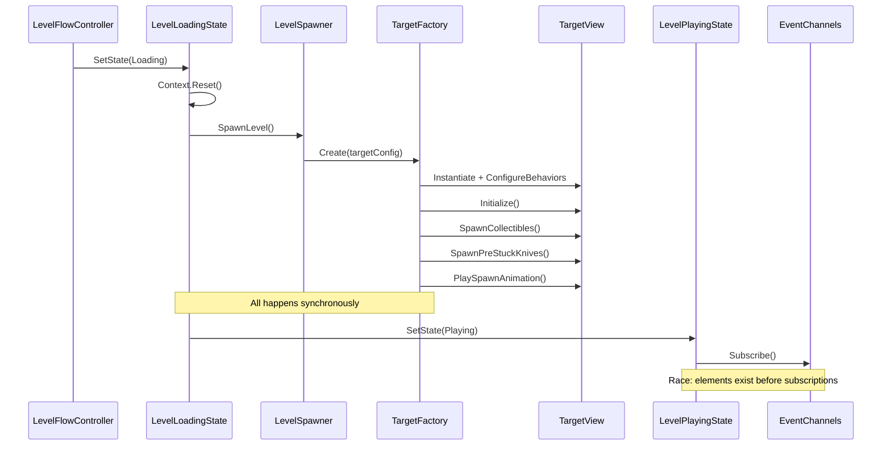
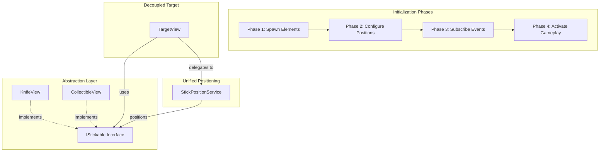

# Level Initialization Flow Refactoring Plan

## Current Architecture Analysis

The current flow has several issues causing race conditions and tight coupling:



### Key Problems Identified

1. **Race conditions in event subscriptions**: Elements are spawned during `LevelLoadingState.Enter()`, but event subscriptions happen in `LevelPlayingState.Enter()`. Any events raised during spawning are lost.

2. **Tight coupling in TargetView**: `TargetView` directly references and manipulates `KnifeView`:
```39:Assets/Scripts/Game/Entities/Target/Views/TargetView.cs
        private List<KnifeView> _StuckKnives = new();
```
```179:189:Assets/Scripts/Game/Entities/Target/Views/TargetView.cs
        public void Stick(KnifeView knife, Vector2 impactPoint)
        {
            if (knife == null)
                return;

            AttachKnife(knife);
            ApplyStickTransform(knife, impactPoint);
            _StuckKnives.Add(knife);

            RegisterHit();
        }
```

3. **Duplicate positioning logic**: Knives and collectibles use different positioning approaches:

   - Knives: `TargetView.PlacePreStuckKnife()` with `StickPositionData`
   - Collectibles: `CollectibleSpawner.CalculatePositionOnTarget()` with different offset model

4. **No initialization phases**: Everything happens in a single synchronous call with no clear phases or guarantees.

---

## Proposed Architecture



---

## Implementation Plan

### 1. Create `IStickable` Interface

Create a common interface for any object that can be attached to a target.

**New file**: [`Assets/Scripts/Common/Interfaces/IStickable.cs`](Assets/Scripts/Common/Interfaces/IStickable.cs)

```csharp
public interface IStickable
{
    Transform Transform { get; }
    float RadiusOffset { get; }
    float RotationOffset { get; }
    void OnAttachedToTarget();
}
```

- `KnifeView` implements `IStickable` (expose `StickPositionData` values)
- `CollectibleView` implements `IStickable` (expose its offset values)

### 2. Create `StickPositionService`

Consolidate all positioning logic into a single service.

**New file**: [`Assets/Scripts/Game/Entities/Target/Services/StickPositionService.cs`](Assets/Scripts/Game/Entities/Target/Services/StickPositionService.cs)

This service will:

- Calculate position on target given angle and offset
- Calculate rotation for stickables
- Handle both runtime sticking and pre-placed elements uniformly

### 3. Decouple `TargetView` from `KnifeView`

Refactor [`TargetView.cs`](Assets/Scripts/Game/Entities/Target/Views/TargetView.cs):

- Change `Stick(KnifeView, Vector2)` to `Stick(IStickable, Vector2)`
- Change `PlacePreStuckKnife(KnifeView, float)` to `PlaceStickable(IStickable, float)`
- Replace `List<KnifeView> _StuckKnives` with `List<IStickable> _StuckObjects`
- Delegate positioning calculations to `StickPositionService`

### 4. Implement Phased Initialization in `LevelLoadingState`

Refactor [`LevelLoadingState.cs`](Assets/Scripts/Game/Flow/Level/States/LevelLoadingState.cs) to use explicit phases:

```csharp
public override void Enter()
{
    Context.Reset();
    if (Context.Config == null) return;
    
    // Phase 1: Spawn all elements (no positioning)
    var spawnedTargets = Context.LevelSpawner.SpawnTargets(config, stageConfig);
    
    // Phase 2: Position all attached elements
    Context.LevelSpawner.PositionAttachedElements(spawnedTargets);
    
    // Phase 3: Finalize (animations, etc.)
    Context.LevelSpawner.FinalizeSpawning(spawnedTargets);
    
    Context.ActiveTargets.AddRange(spawnedTargets);
    Machine.SetState(Machine.Playing);
}
```

### 5. Refactor `TargetFactory` and `LevelSpawner`

Split [`TargetFactory.Create()`](Assets/Scripts/Game/Entities/Target/Factories/TargetFactory.cs) into distinct phases:

- `SpawnTarget()`: Only instantiate and configure behaviors
- `AttachElements()`: Spawn and attach collectibles/knives (positions calculated later)
- `FinalizeTarget()`: Play animations, enable colliders

Refactor [`LevelSpawner.SpawnLevel()`](Assets/Scripts/Game/Level/Spawning/LevelSpawner.cs) to orchestrate the phases.

### 6. Unify Spawner Logic

Merge or align [`CollectibleSpawner`](Assets/Scripts/Game/Entities/Collectible/Spawning/CollectibleSpawner.cs) positioning with `StickPositionService`:

- Remove duplicate position calculation from `CollectibleSpawner`
- Both pre-stuck knives and collectibles use the same positioning service

### 7. Update Collision Handlers

Update [`KnifeHitTargetHandler`](Assets/Scripts/Game/CollisionHandlers/KnifeHitTargetHandler.cs) to use the new `IStickable` abstraction if needed. The handler can remain knife-specific for gameplay logic, but positioning is delegated.

---

## File Changes Summary

| File | Action |

|------|--------|

| `Common/Interfaces/IStickable.cs` | Create new |

| `Game/Entities/Target/Services/StickPositionService.cs` | Create new |

| `Game/Entities/Target/Views/TargetView.cs` | Refactor to use IStickable |

| `Game/Entities/Knife/Views/KnifeView.cs` | Implement IStickable |

| `Game/Entities/Collectible/Views/CollectibleView.cs` | Implement IStickable |

| `Game/Entities/Target/Factories/TargetFactory.cs` | Split into phases |

| `Game/Level/Spawning/LevelSpawner.cs` | Orchestrate phases |

| `Game/Flow/Level/States/LevelLoadingState.cs` | Use phased initialization |

| `Game/Entities/Collectible/Spawning/CollectibleSpawner.cs` | Delegate to StickPositionService |

---

## Benefits

1. **Deterministic initialization**: Clear phases eliminate race conditions
2. **Loose coupling**: `TargetView` no longer depends on `KnifeView`
3. **Single positioning logic**: One service handles all element positioning
4. **Testability**: Phased approach makes unit testing easier
5. **Extensibility**: New stickable types only need to implement `IStickable`