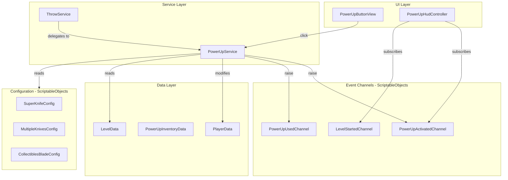

# Power-Up System Implementation

## Overview

Implement a consumable power-up system with three types: **SuperKnife** (instant target shatter), **MultipleKnives** (spread pattern), and **CollectiblesBlade** (auto-collect all collectibles). Power-ups are stored as counts in PlayerData, displayed as HUD buttons, and consumed once per level upon use.

## Project Patterns to Follow

Based on codebase analysis:

- **Event Channels**: Use `ScriptableObject`-based `EventChannel<T>` for decoupled communication (not C# events)
- **DI**: VContainer with `IInstaller` pattern, services registered via `builder.Register<T>(Lifetime.Singleton)`
- **Configuration**: ScriptableObjects with `[CreateAssetMenu]` implementing `IConfigurationProvider<T>` where needed
- **Interfaces**: Injected via VContainer, concrete types registered with `.As<IInterface>()`
- **MonoBehaviour Views**: Use `[Inject]` for dependencies, subscribe to event channels in `OnEnable`/`OnDisable`

## Architecture



## Files to Create

### Event Channels (ScriptableObjects)

- [`Assets/Scripts/Game/PowerUps/Events/PowerUpActivatedEventChannel.cs`](Assets/Scripts/Game/PowerUps/Events/PowerUpActivatedEventChannel.cs) - Extends `EventChannel<PowerUpActivatedEventData>`
- [`Assets/Scripts/Game/PowerUps/Events/PowerUpUsedEventChannel.cs`](Assets/Scripts/Game/PowerUps/Events/PowerUpUsedEventChannel.cs) - Extends `EventChannel<PowerUpUsedEventData>`
- [`Assets/Scripts/Game/PowerUps/Data/PowerUpActivatedEventData.cs`](Assets/Scripts/Game/PowerUps/Data/PowerUpActivatedEventData.cs)
- [`Assets/Scripts/Game/PowerUps/Data/PowerUpUsedEventData.cs`](Assets/Scripts/Game/PowerUps/Data/PowerUpUsedEventData.cs)

### Configuration (ScriptableObjects)

- [`Assets/Scripts/Game/PowerUps/Configs/PowerUpConfigBase.cs`](Assets/Scripts/Game/PowerUps/Configs/PowerUpConfigBase.cs) - Abstract base with `Id`, `Icon`, `Prefab`
- [`Assets/Scripts/Game/PowerUps/Configs/SuperKnifeConfig.cs`](Assets/Scripts/Game/PowerUps/Configs/SuperKnifeConfig.cs) - `ThrowSpeed`
- [`Assets/Scripts/Game/PowerUps/Configs/MultipleKnivesConfig.cs`](Assets/Scripts/Game/PowerUps/Configs/MultipleKnivesConfig.cs) - `Angles[]`, `ThrowSpeed`
- [`Assets/Scripts/Game/PowerUps/Configs/CollectiblesBladeConfig.cs`](Assets/Scripts/Game/PowerUps/Configs/CollectiblesBladeConfig.cs) - `TimeBetweenBlades`, `BladeSpeed`
- [`Assets/Scripts/Game/PowerUps/Configs/PowerUpCatalog.cs`](Assets/Scripts/Game/PowerUps/Configs/PowerUpCatalog.cs) - ScriptableObject holding all available power-up configs

### Interfaces

- [`Assets/Scripts/Game/PowerUps/Interfaces/IPowerUp.cs`](Assets/Scripts/Game/PowerUps/Interfaces/IPowerUp.cs) - Base interface
- [`Assets/Scripts/Game/PowerUps/Interfaces/IPowerUpService.cs`](Assets/Scripts/Game/PowerUps/Interfaces/IPowerUpService.cs) - Service interface

### Services

- [`Assets/Scripts/Game/PowerUps/Services/PowerUpService.cs`](Assets/Scripts/Game/PowerUps/Services/PowerUpService.cs) - Manages activation, execution, consumption

### Data

- [`Assets/Scripts/Game/PowerUps/Data/PowerUpInventoryData.cs`](Assets/Scripts/Game/PowerUps/Data/PowerUpInventoryData.cs) - Serializable inventory counts
- [`Assets/Scripts/Game/PowerUps/Data/PowerUpRuntimeState.cs`](Assets/Scripts/Game/PowerUps/Data/PowerUpRuntimeState.cs) - Tracks per-level usage

### Views (MonoBehaviours)

- [`Assets/Scripts/Game/PowerUps/Views/PowerUpButtonView.cs`](Assets/Scripts/Game/PowerUps/Views/PowerUpButtonView.cs) - Button with icon, count badge, selected state
- [`Assets/Scripts/Game/PowerUps/Views/PowerUpHudController.cs`](Assets/Scripts/Game/PowerUps/Views/PowerUpHudController.cs) - Creates/manages buttons from catalog
- [`Assets/Scripts/Game/PowerUps/Views/SuperKnifeView.cs`](Assets/Scripts/Game/PowerUps/Views/SuperKnifeView.cs) - Marker component for collision detection

### Installer

- [`Assets/Scripts/Game/Installers/PowerUpInstaller.cs`](Assets/Scripts/Game/Installers/PowerUpInstaller.cs) - VContainer installer

## Files to Modify

- [`Assets/Scripts/Game/Persistence/Data/PlayerData.cs`](Assets/Scripts/Game/Persistence/Data/PlayerData.cs) - Add `PowerUpInventory` field
- [`Assets/Scripts/Game/Persistence/Data/PlayerProgressData.cs`](Assets/Scripts/Game/Persistence/Data/PlayerProgressData.cs) - Or add inventory here
- [`Assets/Scripts/Game/KnifeThrower/Services/ThrowService.cs`](Assets/Scripts/Game/KnifeThrower/Services/ThrowService.cs) - Check `IPowerUpService.HasActivePowerUp` before normal throw
- [`Assets/Scripts/Game/CollisionHandlers/KnifeHitTargetHandler.cs`](Assets/Scripts/Game/CollisionHandlers/KnifeHitTargetHandler.cs) - Check for `SuperKnifeView` marker, call `target.ForceDestroy()`
- [`Assets/Scripts/Game/Entities/Target/Views/TargetView.cs`](Assets/Scripts/Game/Entities/Target/Views/TargetView.cs) - Add `ForceDestroy()` method
- [`Assets/Scripts/Game/Installers/GameInstaller.cs`](Assets/Scripts/Game/Installers/GameInstaller.cs) - Add power-up event channels, create `PowerUpInstaller`
- [`Assets/Scripts/Editor/PlayerData/PlayerDataWindow.cs`](Assets/Scripts/Editor/PlayerData/PlayerDataWindow.cs) - Add power-up inventory section

## Implementation Details

### ThrowService Integration

```csharp
// In HandleThrowRequested:
if (_PowerUpService.HasActivePowerUp)
{
    _PowerUpService.ExecuteActivePowerUp(_KnifeThrowerView.SpawnPoint);
    return;
}
// ... normal throw logic
```

### SuperKnife Collision Handling

The `SuperKnifeView` component acts as a marker. In `KnifeHitTargetHandler`:

```csharp
// Check if knife has SuperKnifeView marker
var superKnife = knife.GetComponent<SuperKnifeView>();
if (superKnife != null)
{
    target.ForceDestroy();
    return;
}
```

### CollectiblesBlade Execution

Uses coroutine to spawn blades sequentially:

1. Find all `CollectibleView` instances in scene
2. For each collectible, spawn blade prefab at thrower position
3. Calculate direction toward collectible
4. Launch blade with configured speed
5. Wait `TimeBetweenBlades` before next

### PlayerData Structure

```csharp
[Serializable]
public class PowerUpInventoryData
{
    public int SuperKnifeCount;
    public int MultipleKnivesCount;
    public int CollectiblesBladeCount;
}
```

## Unity Setup Required (Post-Implementation)

1. Create ScriptableObject assets in `Assets/Configurations/PowerUps/`:

   - `SuperKnifeConfig.asset`
   - `MultipleKnivesConfig.asset`
   - `CollectiblesBladeConfig.asset`
   - `PowerUpCatalog.asset`
   - `PowerUpActivatedEventChannel.asset`
   - `PowerUpUsedEventChannel.asset`

2. Create power-up prefabs in `Assets/Prefabs/PowerUps/`:

   - SuperKnife prefab (with `SuperKnifeView` component)
   - MultipleKnives blade prefab
   - CollectiblesBlade prefab

3. Add `PowerUpHudController` to UI hierarchy and configure button prefab

4. Wire up event channels in `GameInstaller` inspector