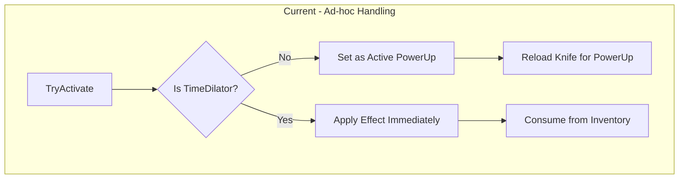
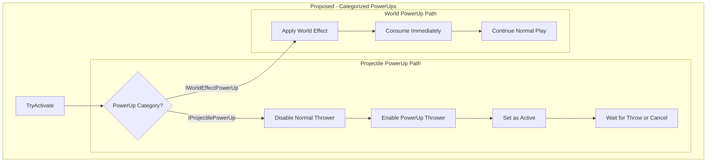
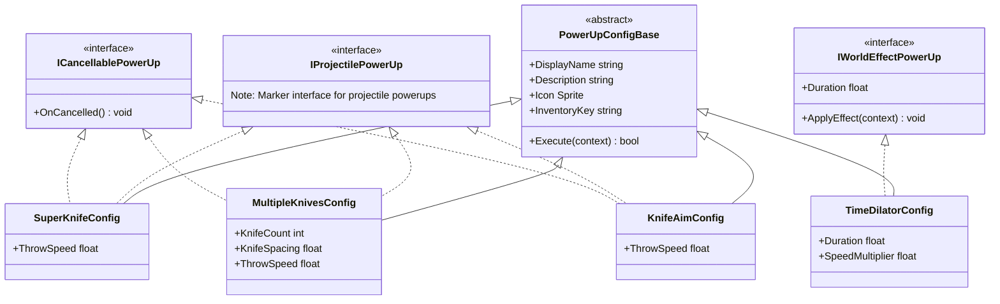
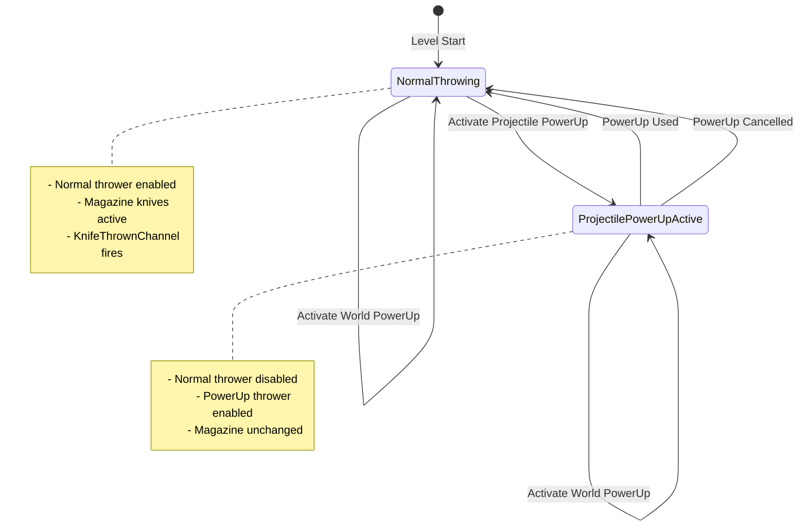
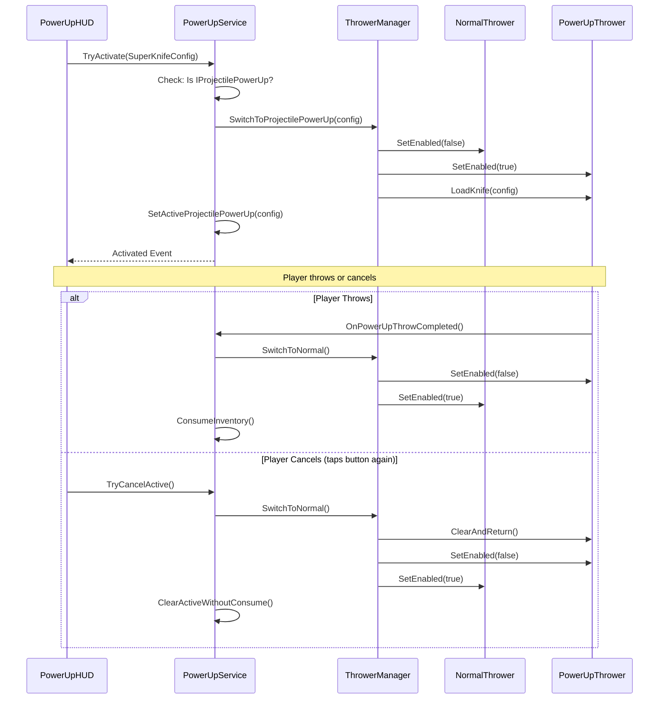
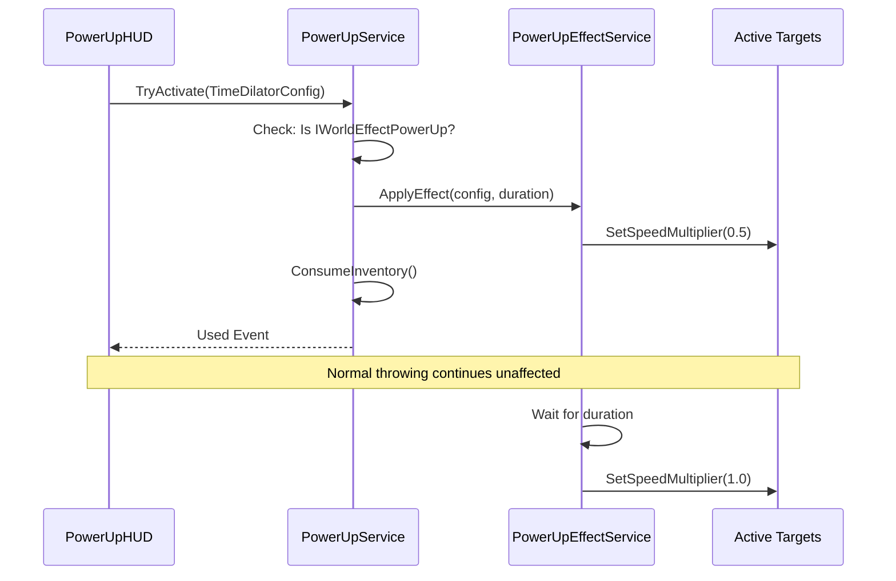

# PowerUp Type Categorization Plan

## Overview

Separate powerups into two distinct categories with different activation behaviors:

- **Projectile PowerUps**: Affect knife throwing, require thrower state switch
- **World PowerUps**: Affect game world/targets, no thrower state change

---

## Problem Analysis

Currently, all powerups flow through the same activation path in `PowerUpService.TryActivate()`. The `TimeDilator` has special handling that applies immediately, but there's no formal categorization system.




**Issues:**

- Type checking with `is TimeDilatorConfig` is not extensible
- No formal contract for powerup behavior categories
- Adding new world effects requires modifying `PowerUpService`
- No cancellation support for projectile powerups

---

## Proposed Architecture




---

## Type Hierarchy




---

## Thrower State Management




---

## Activation Flow: Projectile PowerUp




---

## Activation Flow: World PowerUp




---

## New Interfaces

### IProjectilePowerUp

```csharp
// Assets/Scripts/Game/PowerUps/Interfaces/IProjectilePowerUp.cs
namespace Game.PowerUps.Interfaces
{
    /// <summary>
    /// Marker interface for powerups that affect knife throwing.
    /// When activated, these powerups disable normal throwing and use the powerup thrower.
    /// </summary>
    public interface IProjectilePowerUp
    {
        // Marker interface - Execute() is inherited from PowerUpConfigBase
    }
}
```

### IWorldEffectPowerUp

```csharp
// Assets/Scripts/Game/PowerUps/Interfaces/IWorldEffectPowerUp.cs
namespace Game.PowerUps.Interfaces
{
    /// <summary>
    /// Interface for powerups that affect the game world without changing throw behavior.
    /// These are applied immediately and consumed, allowing normal throwing to continue.
    /// </summary>
    public interface IWorldEffectPowerUp
    {
        /// <summary>
        /// Duration of the world effect in seconds.
        /// </summary>
        float EffectDuration { get; }
        
        /// <summary>
        /// Applies the world effect using the provided service.
        /// </summary>
        void ApplyWorldEffect(PowerUpEffectService effectService);
    }
}
```

### ICancellablePowerUp

```csharp
// Assets/Scripts/Game/PowerUps/Interfaces/ICancellablePowerUp.cs
namespace Game.PowerUps.Interfaces
{
    /// <summary>
    /// Interface for powerups that can be cancelled after activation.
    /// </summary>
    public interface ICancellablePowerUp
    {
        /// <summary>
        /// Called when the powerup is cancelled without being used.
        /// </summary>
        void OnCancelled();
    }
}
```

---

## IThrowerStateManager Interface

```csharp
// Assets/Scripts/Game/KnifeThrower/Interfaces/IThrowerStateManager.cs
namespace Game.KnifeThrower.Interfaces
{
    /// <summary>
    /// Manages the state transitions between normal and powerup throwing.
    /// </summary>
    public interface IThrowerStateManager
    {
        /// <summary>
        /// Whether a projectile powerup is currently active.
        /// </summary>
        bool IsProjectilePowerUpActive { get; }
        
        /// <summary>
        /// Switches to powerup throwing mode.
        /// </summary>
        void ActivateProjectilePowerUp(PowerUpConfigBase config);
        
        /// <summary>
        /// Returns to normal throwing mode after powerup use.
        /// </summary>
        void DeactivateProjectilePowerUp();
        
        /// <summary>
        /// Cancels active powerup and returns to normal throwing.
        /// </summary>
        void CancelProjectilePowerUp();
    }
}
```

---

## Key Changes Summary

### New Files to Create


| File                                 | Purpose                                       |
| ------------------------------------ | --------------------------------------------- |
| `Interfaces/IProjectilePowerUp.cs`   | Marker interface for throw-affecting powerups |
| `Interfaces/IWorldEffectPowerUp.cs`  | Interface for world effect powerups           |
| `Interfaces/ICancellablePowerUp.cs`  | Interface for cancellable powerups            |
| `Interfaces/IThrowerStateManager.cs` | Thrower state management contract             |
| `Services/ThrowerStateManager.cs`    | Implementation of state management            |


### Files to Modify


| File                              | Changes                                                       |
| --------------------------------- | ------------------------------------------------------------- |
| `Configs/SuperKnifeConfig.cs`     | Implement `IProjectilePowerUp`, `ICancellablePowerUp`         |
| `Configs/MultipleKnivesConfig.cs` | Implement `IProjectilePowerUp`, `ICancellablePowerUp`         |
| `Configs/KnifeAimConfig.cs`       | Implement `IProjectilePowerUp`, `ICancellablePowerUp`         |
| `Configs/TimeDilatorConfig.cs`    | Implement `IWorldEffectPowerUp`                               |
| `Services/PowerUpService.cs`      | Use interface checks instead of type checks, add cancellation |
| `Views/PowerUpHudController.cs`   | Handle cancel on second tap of active powerup                 |


---

## PowerUpService Changes

```csharp
public bool TryActivate(PowerUpConfigBase config)
{
    if (config == null || !HasInventory(config))
        return false;

    // World effects apply immediately without affecting thrower
    if (config is IWorldEffectPowerUp worldEffect)
    {
        worldEffect.ApplyWorldEffect(_EffectService);
        ConsumeInventory(config);
        _UsedChannel?.Raise(new PowerUpUsedEventData(config, GetRemainingCount(config)));
        return true;
    }

    // Projectile powerups switch thrower state
    if (config is IProjectilePowerUp)
    {
        _ThrowerStateManager.ActivateProjectilePowerUp(config);
        _RuntimeState.SetActive(config);
        _ActivatedChannel?.Raise(new PowerUpActivatedEventData(config, GetRemainingCount(config)));
        return true;
    }

    return false;
}

public bool TryCancelActive()
{
    if (!HasActivePowerUp)
        return false;
        
    if (_RuntimeState.ActiveConfig is ICancellablePowerUp cancellable)
    {
        cancellable.OnCancelled();
        _ThrowerStateManager.CancelProjectilePowerUp();
        _RuntimeState.Clear();
        _CancelledChannel?.Raise(new PowerUpCancelledEventData(_RuntimeState.ActiveConfig));
        return true;
    }
    
    return false;
}
```

---

## HUD Cancel Behavior

```csharp
// In PowerUpHudController
private void OnButtonClicked(PowerUpConfigBase config)
{
    // If clicking the same powerup that's active, try to cancel
    if (_PowerUpService.ActiveConfig == config)
    {
        _PowerUpService.TryCancelActive();
        return;
    }
    
    // Otherwise activate normally
    _PowerUpService.TryActivate(config);
}
```

---

## Benefits

1. **Extensible**: New powerup types just implement the appropriate interface
2. **Clear Contracts**: Interfaces define expected behavior
3. **Single Responsibility**: Each interface has one purpose
4. **No Type Checking**: Polymorphism replaces `is` checks
5. **Cancellation Support**: Clean cancel flow for projectile powerups
6. **World Effects Isolated**: World powerups don't touch thrower logic at all

