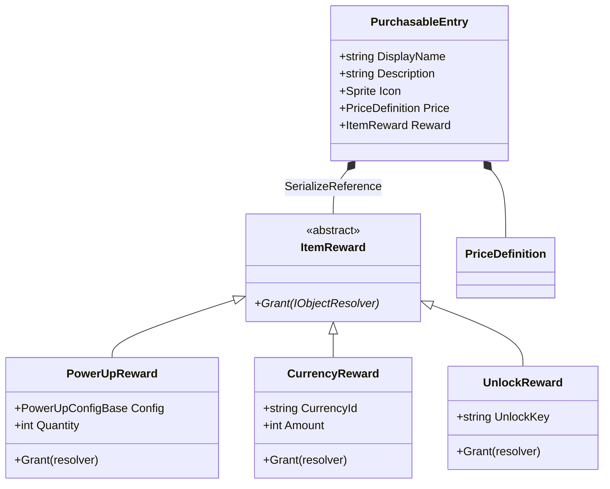
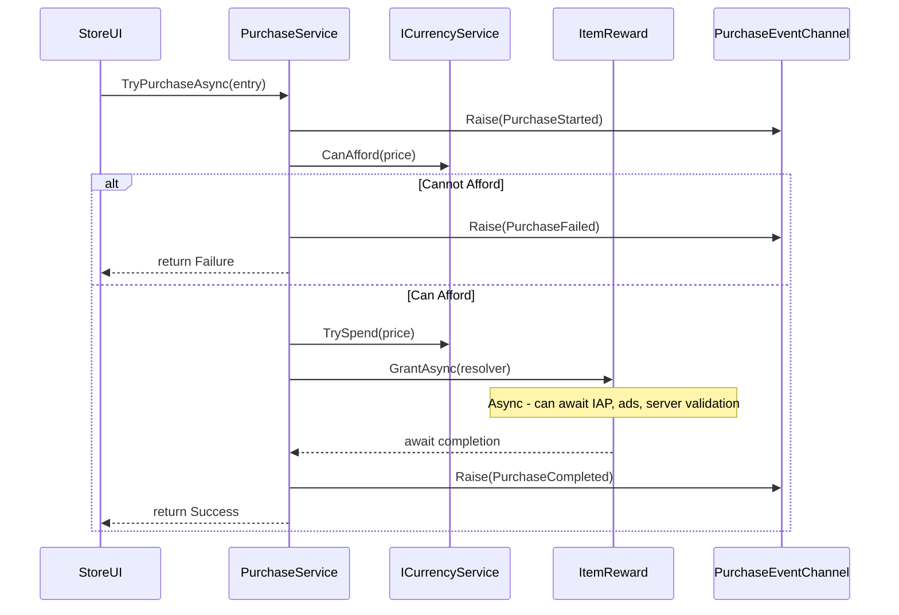

# Purchase System Implementation

## Architecture Summary (What Exists Today)

### Currency System

- `ICurrencyService` ([Assets/Scripts/Game/Economy/Interfaces/ICurrencyService.cs](Assets/Scripts/Game/Economy/Interfaces/ICurrencyService.cs)) - already currency-agnostic with string `currencyId`
- `CurrencyManager` handles balances, raises `CurrencyBalanceChangedEventChannel` on changes
- `CurrencyTypeCatalog` registers available currency types (coins now, gems later)

### Item Definitions

- `PowerUpConfigBase` ([Assets/Scripts/Game/PowerUps/Configs/PowerUpConfigBase.cs](Assets/Scripts/Game/PowerUps/Configs/PowerUpConfigBase.cs)) - has DisplayName, Icon, InventoryKey but **no pricing**
- `PowerUpCatalog` holds all power-up configs

### Inventory System

- `PowerUpInventoryData` ([Assets/Scripts/Game/PowerUps/Data/PowerUpInventoryData.cs](Assets/Scripts/Game/PowerUps/Data/PowerUpInventoryData.cs)) - `IncrementCount(key)` adds items
- `PlayerDataService.SavePowerUpInventory()` persists changes

### Event System

- ScriptableObject-based `EventChannel<T>` pattern for decoupled communication
- `CurrencyBalanceChangedEventChannel` already refreshes currency UI

### Missing Pieces

- No pricing data on items
- No purchase service to orchestrate buy flow
- No purchase events for UI feedback
- No store catalog

---

## New Architecture: Modular Reward System

### Design Principles

1. **Rewards are serializable classes** - use `[SerializeReference]` for inline polymorphism in Unity inspector
2. **Rewards resolve their own dependencies** - pass VContainer's `IObjectResolver`, no growing interface
3. **Unified store catalog** - all purchasable items configured the same way via `PurchasableEntry`
4. **Purely additive extensibility** - new reward types = new class, nothing else changes

### Component Overview




### Purchase Flow (Async)




**Why async?**

- IAP requires store callbacks
- Ad rewards require ad completion
- Server validation may be needed
- Prevents UI blocking during purchase

---

## New Components

### 1. ItemReward Base (Serializable, Async)

```csharp
// Assets/Scripts/Game/Store/Rewards/ItemReward.cs
using System;
using Cysharp.Threading.Tasks;
using VContainer;

namespace Game.Store.Rewards
{
    [Serializable]
    public abstract class ItemReward
    {
        /// <summary>
        /// Grants this reward asynchronously. Each reward type resolves its own services.
        /// </summary>
        public abstract UniTask GrantAsync(IObjectResolver resolver);
    }
}
```

### 2. Concrete Reward Types

```csharp
// Assets/Scripts/Game/Store/Rewards/PowerUpReward.cs
[Serializable]
public class PowerUpReward : ItemReward
{
    [SerializeField] private PowerUpConfigBase _Config;
    [SerializeField] private int _Quantity = 1;
    
    public override UniTask GrantAsync(IObjectResolver resolver)
    {
        var playerData = resolver.Resolve<PlayerDataService>();
        playerData.EnsurePowerUpInventory().IncrementCount(_Config.InventoryKey, _Quantity);
        playerData.SavePowerUpInventory();
        return UniTask.CompletedTask;
    }
}

// Assets/Scripts/Game/Store/Rewards/CurrencyReward.cs
[Serializable]
public class CurrencyReward : ItemReward
{
    [SerializeField] private string _CurrencyId;
    [SerializeField] private int _Amount;
    
    public override UniTask GrantAsync(IObjectResolver resolver)
    {
        var currency = resolver.Resolve<ICurrencyService>();
        currency.AddBalance(_CurrencyId, _Amount);
        return UniTask.CompletedTask;
    }
}

// Example: Future ad-based reward (async)
[Serializable]
public class WatchAdReward : ItemReward
{
    [SerializeReference] private ItemReward _RewardAfterAd;
    
    public override async UniTask GrantAsync(IObjectResolver resolver)
    {
        var adService = resolver.Resolve<IAdService>();
        bool adCompleted = await adService.ShowRewardedAdAsync();
        
        if (adCompleted && _RewardAfterAd != null)
            await _RewardAfterAd.GrantAsync(resolver);
    }
}
```

### 3. PriceDefinition

```csharp
// Assets/Scripts/Game/Store/Data/PriceDefinition.cs
[Serializable]
public class PriceDefinition
{
    [SerializeField] private string _CurrencyId;
    [SerializeField] private int _Amount;
    
    public string CurrencyId => _CurrencyId;
    public int Amount => _Amount;
    public bool IsFree => Amount <= 0 || string.IsNullOrEmpty(_CurrencyId);
}
```

### 4. PurchasableEntry (Unified config for all store items)

```csharp
// Assets/Scripts/Game/Store/Data/PurchasableEntry.cs
[Serializable]
public class PurchasableEntry
{
    [SerializeField] private string _DisplayName;
    [SerializeField] private string _Description;
    [SerializeField] private Sprite _Icon;
    [SerializeField] private PriceDefinition _Price;
    [SerializeReference] private ItemReward _Reward;  // Polymorphic inline!
    
    public string DisplayName => _DisplayName;
    public string Description => _Description;
    public Sprite Icon => _Icon;
    public PriceDefinition Price => _Price;
    public ItemReward Reward => _Reward;
}
```

### 5. StoreCatalog ScriptableObject

```csharp
// Assets/Scripts/Game/Store/Data/StoreCatalog.cs
[CreateAssetMenu(fileName = "StoreCatalog", menuName = "Knife Toss/Store/Catalog")]
public class StoreCatalog : ScriptableObject
{
    [SerializeField] private List<PurchasableEntry> _PowerUps;
    [SerializeField] private List<PurchasableEntry> _CurrencyPacks;
    [SerializeField] private List<PurchasableEntry> _Skins;
    
    public IReadOnlyList<PurchasableEntry> PowerUps => _PowerUps;
    public IReadOnlyList<PurchasableEntry> CurrencyPacks => _CurrencyPacks;
    public IReadOnlyList<PurchasableEntry> Skins => _Skins;
    
    public IEnumerable<PurchasableEntry> AllEntries => 
        _PowerUps.Concat(_CurrencyPacks).Concat(_Skins);
}
```

### 6. PurchaseService (Async)

```csharp
// Assets/Scripts/Game/Store/Interfaces/IPurchaseService.cs
public interface IPurchaseService
{
    bool IsPurchaseInProgress { get; }
    bool CanPurchase(PurchasableEntry entry);
    UniTask<PurchaseResult> TryPurchaseAsync(PurchasableEntry entry);
}

// Assets/Scripts/Game/Store/Services/PurchaseService.cs
public class PurchaseService : IPurchaseService
{
    private readonly ICurrencyService _Currency;
    private readonly IObjectResolver _Resolver;
    private readonly PurchaseStartedEventChannel _StartedChannel;
    private readonly PurchaseCompletedEventChannel _CompletedChannel;
    private readonly PurchaseFailedEventChannel _FailedChannel;
    
    public bool IsPurchaseInProgress { get; private set; }
    
    public PurchaseService(
        ICurrencyService currency,
        IObjectResolver resolver,
        PurchaseStartedEventChannel startedChannel,
        PurchaseCompletedEventChannel completedChannel,
        PurchaseFailedEventChannel failedChannel)
    {
        _Currency = currency;
        _Resolver = resolver;
        _StartedChannel = startedChannel;
        _CompletedChannel = completedChannel;
        _FailedChannel = failedChannel;
    }
    
    public bool CanPurchase(PurchasableEntry entry)
    {
        if (IsPurchaseInProgress) return false;
        if (entry?.Reward == null) return false;
        if (entry.Price.IsFree) return true;
        return _Currency.CanAfford(entry.Price.CurrencyId, entry.Price.Amount);
    }
    
    public async UniTask<PurchaseResult> TryPurchaseAsync(PurchasableEntry entry)
    {
        if (IsPurchaseInProgress)
            return PurchaseResult.PurchaseInProgress;
            
        if (entry?.Reward == null)
            return Fail(entry, PurchaseResult.InvalidItem);
            
        if (!CanPurchase(entry))
            return Fail(entry, PurchaseResult.InsufficientFunds);
        
        try
        {
            IsPurchaseInProgress = true;
            _StartedChannel?.Raise(new PurchaseStartedEventData(entry));
            
            // Spend currency first (if not free)
            if (!entry.Price.IsFree)
                _Currency.TrySpend(entry.Price.CurrencyId, entry.Price.Amount);
            
            // Grant reward (async - may involve IAP, ads, server calls)
            await entry.Reward.GrantAsync(_Resolver);
            
            _CompletedChannel?.Raise(new PurchaseCompletedEventData(entry));
            return PurchaseResult.Succeeded;
        }
        catch (Exception ex)
        {
            // Refund currency on failure
            if (!entry.Price.IsFree)
                _Currency.AddBalance(entry.Price.CurrencyId, entry.Price.Amount);
                
            return Fail(entry, PurchaseResult.Error(ex.Message));
        }
        finally
        {
            IsPurchaseInProgress = false;
        }
    }
    
    private PurchaseResult Fail(PurchasableEntry entry, PurchaseResult result)
    {
        _FailedChannel?.Raise(new PurchaseFailedEventData(entry, result.FailureReason));
        return result;
    }
}
```

### 7. PurchaseResult

```csharp
// Assets/Scripts/Game/Store/Data/PurchaseResult.cs
public readonly struct PurchaseResult
{
    public bool Success { get; }
    public string FailureReason { get; }
    
    private PurchaseResult(bool success, string reason)
    {
        Success = success;
        FailureReason = reason;
    }
    
    public static PurchaseResult Succeeded => new(true, null);
    public static PurchaseResult InsufficientFunds => new(false, "Insufficient funds");
    public static PurchaseResult InvalidItem => new(false, "Invalid item");
    public static PurchaseResult PurchaseInProgress => new(false, "Purchase already in progress");
    public static PurchaseResult Cancelled => new(false, "Purchase cancelled");
    public static PurchaseResult Error(string message) => new(false, message);
}
```

### 8. Purchase Events

```csharp
// Assets/Scripts/Game/Store/Events/PurchaseStartedEventData.cs
public readonly struct PurchaseStartedEventData
{
    public PurchasableEntry Entry { get; }
    public PurchaseStartedEventData(PurchasableEntry entry) => Entry = entry;
}

// Assets/Scripts/Game/Store/Events/PurchaseCompletedEventData.cs
public readonly struct PurchaseCompletedEventData
{
    public PurchasableEntry Entry { get; }
    public PurchaseCompletedEventData(PurchasableEntry entry) => Entry = entry;
}

// Assets/Scripts/Game/Store/Events/PurchaseFailedEventData.cs
public readonly struct PurchaseFailedEventData
{
    public PurchasableEntry Entry { get; }
    public string Reason { get; }
    public PurchaseFailedEventData(PurchasableEntry entry, string reason)
    {
        Entry = entry;
        Reason = reason;
    }
}

// Assets/Scripts/Game/Store/Events/PurchaseStartedEventChannel.cs
[CreateAssetMenu(fileName = "PurchaseStartedEventChannel", menuName = "Knife Toss/Events/Purchase Started")]
public class PurchaseStartedEventChannel : EventChannel<PurchaseStartedEventData> { }

// Assets/Scripts/Game/Store/Events/PurchaseCompletedEventChannel.cs
[CreateAssetMenu(fileName = "PurchaseCompletedEventChannel", menuName = "Knife Toss/Events/Purchase Completed")]
public class PurchaseCompletedEventChannel : EventChannel<PurchaseCompletedEventData> { }

// Assets/Scripts/Game/Store/Events/PurchaseFailedEventChannel.cs
[CreateAssetMenu(fileName = "PurchaseFailedEventChannel", menuName = "Knife Toss/Events/Purchase Failed")]
public class PurchaseFailedEventChannel : EventChannel<PurchaseFailedEventData> { }
```

### 9. SerializeReference Property Drawer (Editor UX)

```csharp
// Assets/Scripts/Editor/Drawers/SerializeReferenceDropdownDrawer.cs
using System;
using System.Linq;
using UnityEditor;
using UnityEngine;

namespace Editor.Drawers
{
    /// <summary>
    /// Draws [SerializeReference] fields with a type dropdown instead of right-click menu.
    /// </summary>
    [CustomPropertyDrawer(typeof(SerializeReferenceDropdownAttribute))]
    public class SerializeReferenceDropdownDrawer : PropertyDrawer
    {
        public override void OnGUI(Rect position, SerializedProperty property, GUIContent label)
        {
            EditorGUI.BeginProperty(position, label, property);
            
            var baseType = fieldInfo.FieldType;
            var derivedTypes = AppDomain.CurrentDomain.GetAssemblies()
                .SelectMany(a => a.GetTypes())
                .Where(t => baseType.IsAssignableFrom(t) && !t.IsAbstract && !t.IsInterface)
                .ToArray();
            
            var typeNames = derivedTypes.Select(t => t.Name).Prepend("(None)").ToArray();
            var currentType = property.managedReferenceValue?.GetType();
            var currentIndex = currentType == null ? 0 : Array.IndexOf(derivedTypes, currentType) + 1;
            
            // Type dropdown
            var dropdownRect = new Rect(position.x, position.y, position.width, EditorGUIUtility.singleLineHeight);
            var newIndex = EditorGUI.Popup(dropdownRect, label.text, currentIndex, typeNames);
            
            if (newIndex != currentIndex)
            {
                property.managedReferenceValue = newIndex == 0 
                    ? null 
                    : Activator.CreateInstance(derivedTypes[newIndex - 1]);
            }
            
            // Draw child properties
            if (property.managedReferenceValue != null)
            {
                EditorGUI.indentLevel++;
                var yOffset = EditorGUIUtility.singleLineHeight + EditorGUIUtility.standardVerticalSpacing;
                var childRect = new Rect(position.x, position.y + yOffset, position.width, position.height - yOffset);
                
                var iterator = property.Copy();
                var endProperty = property.GetEndProperty();
                iterator.NextVisible(true);
                
                while (!SerializedProperty.EqualContents(iterator, endProperty))
                {
                    var height = EditorGUI.GetPropertyHeight(iterator, true);
                    childRect.height = height;
                    EditorGUI.PropertyField(childRect, iterator, true);
                    childRect.y += height + EditorGUIUtility.standardVerticalSpacing;
                    if (!iterator.NextVisible(false)) break;
                }
                EditorGUI.indentLevel--;
            }
            
            EditorGUI.EndProperty();
        }
        
        public override float GetPropertyHeight(SerializedProperty property, GUIContent label)
        {
            var height = EditorGUIUtility.singleLineHeight;
            if (property.managedReferenceValue != null)
            {
                var iterator = property.Copy();
                var endProperty = property.GetEndProperty();
                iterator.NextVisible(true);
                while (!SerializedProperty.EqualContents(iterator, endProperty))
                {
                    height += EditorGUI.GetPropertyHeight(iterator, true) + EditorGUIUtility.standardVerticalSpacing;
                    if (!iterator.NextVisible(false)) break;
                }
            }
            return height;
        }
    }
}

// Assets/Scripts/Game/Store/Attributes/SerializeReferenceDropdownAttribute.cs
using UnityEngine;

namespace Game.Store.Attributes
{
    /// <summary>
    /// Apply to [SerializeReference] fields to show a type dropdown in the inspector.
    /// </summary>
    public class SerializeReferenceDropdownAttribute : PropertyAttribute { }
}
```

**Usage in PurchasableEntry:**

```csharp
[Serializable]
public class PurchasableEntry
{
    [SerializeField] private string _DisplayName;
    [SerializeField] private Sprite _Icon;
    [SerializeField] private PriceDefinition _Price;
    
    [SerializeReference]
    [SerializeReferenceDropdown]  // ← Enables dropdown picker
    private ItemReward _Reward;
}
```

**Inspector Result:**

```
PurchasableEntry
├── Display Name: "Super Knife"
├── Icon: (sprite)
├── Price
│   ├── Currency Id: "coins"
│   └── Amount: 20
└── Reward: [PowerUpReward ▼]    ← Dropdown!
    ├── Config: SuperKnifeConfig
    └── Quantity: 1
```

---

### 10. StoreInstaller

```csharp
// Assets/Scripts/Game/Installers/StoreInstaller.cs
public class StoreInstaller : IInstaller
{
    private readonly StoreCatalog _Catalog;
    private readonly PurchaseStartedEventChannel _StartedChannel;
    private readonly PurchaseCompletedEventChannel _CompletedChannel;
    private readonly PurchaseFailedEventChannel _FailedChannel;
    
    public StoreInstaller(
        StoreCatalog catalog,
        PurchaseStartedEventChannel startedChannel,
        PurchaseCompletedEventChannel completedChannel,
        PurchaseFailedEventChannel failedChannel)
    {
        _Catalog = catalog;
        _StartedChannel = startedChannel;
        _CompletedChannel = completedChannel;
        _FailedChannel = failedChannel;
    }
    
    public void Install(IContainerBuilder builder)
    {
        builder.RegisterInstance(_Catalog);
        builder.RegisterInstance(_StartedChannel);
        builder.RegisterInstance(_CompletedChannel);
        builder.RegisterInstance(_FailedChannel);
        builder.Register<PurchaseService>(Lifetime.Singleton).As<IPurchaseService>();
    }
}
```

---

## Folder Structure

```
Assets/Scripts/Game/Store/
├── Attributes/
│   └── SerializeReferenceDropdownAttribute.cs
├── Data/
│   ├── PriceDefinition.cs
│   ├── PurchasableEntry.cs
│   ├── PurchaseResult.cs
│   └── StoreCatalog.cs
├── Events/
│   ├── PurchaseStartedEventChannel.cs
│   ├── PurchaseStartedEventData.cs
│   ├── PurchaseCompletedEventChannel.cs
│   ├── PurchaseCompletedEventData.cs
│   ├── PurchaseFailedEventChannel.cs
│   └── PurchaseFailedEventData.cs
├── Interfaces/
│   └── IPurchaseService.cs
├── Rewards/
│   ├── ItemReward.cs
│   ├── PowerUpReward.cs
│   └── CurrencyReward.cs
└── Services/
    └── PurchaseService.cs

Assets/Scripts/Editor/Drawers/
└── SerializeReferenceDropdownDrawer.cs
```

---

## Integration Points

- **StoreUI (future)**
  - Injects: `StoreCatalog`, `IPurchaseService`
  - Displays entries from catalog
  - Calls `await IPurchaseService.TryPurchaseAsync(entry)`
  - Listens: `PurchaseStartedEventChannel` (show loading), `PurchaseCompletedEventChannel` (success), `PurchaseFailedEventChannel` (error)
  - Checks `IsPurchaseInProgress` to disable buttons during purchase
- **PurchaseService**
  - Injects: `ICurrencyService`, `IObjectResolver`, all 3 event channels
  - Calls: `ICurrencyService.TrySpend()`, `await reward.GrantAsync(resolver)`
  - Handles errors with automatic currency refund
- **PowerUpReward / CurrencyReward**
  - Resolves own services from `IObjectResolver`
  - Returns `UniTask.CompletedTask` (sync operation, async signature)
- **Future: WatchAdReward, IAPReward**
  - Actually async - awaits ad completion or IAP callback
  - Can wrap another reward (composite pattern)
- **Existing systems unchanged**
  - `ICurrencyService`, `CurrencyManager` - no changes
  - `PlayerDataService` - no changes
  - `PowerUpConfigBase` - no changes (referenced by `PowerUpReward`)

---

## Files to Create

**Rewards:**

- `Assets/Scripts/Game/Store/Rewards/ItemReward.cs` - Abstract async base for all rewards
- `Assets/Scripts/Game/Store/Rewards/PowerUpReward.cs` - Grants power-ups to inventory
- `Assets/Scripts/Game/Store/Rewards/CurrencyReward.cs` - Grants currency

**Data:**

- `Assets/Scripts/Game/Store/Data/PriceDefinition.cs` - Currency + amount
- `Assets/Scripts/Game/Store/Data/PurchasableEntry.cs` - Unified store item config with [SerializeReference]
- `Assets/Scripts/Game/Store/Data/PurchaseResult.cs` - Result struct
- `Assets/Scripts/Game/Store/Data/StoreCatalog.cs` - ScriptableObject catalog

**Interfaces:**

- `Assets/Scripts/Game/Store/Interfaces/IPurchaseService.cs` - Async service interface

**Services:**

- `Assets/Scripts/Game/Store/Services/PurchaseService.cs` - Async service implementation

**Events:**

- `Assets/Scripts/Game/Store/Events/PurchaseStartedEventData.cs` - Started event data
- `Assets/Scripts/Game/Store/Events/PurchaseStartedEventChannel.cs` - Started event channel
- `Assets/Scripts/Game/Store/Events/PurchaseCompletedEventData.cs` - Completed event data
- `Assets/Scripts/Game/Store/Events/PurchaseCompletedEventChannel.cs` - Completed event channel
- `Assets/Scripts/Game/Store/Events/PurchaseFailedEventData.cs` - Failed event data
- `Assets/Scripts/Game/Store/Events/PurchaseFailedEventChannel.cs` - Failed event channel

**Installer:**

- `Assets/Scripts/Game/Installers/StoreInstaller.cs` - DI registration

**Editor (Inspector UX):**

- `Assets/Scripts/Game/Store/Attributes/SerializeReferenceDropdownAttribute.cs` - Attribute to mark fields
- `Assets/Scripts/Editor/Drawers/SerializeReferenceDropdownDrawer.cs` - Dropdown drawer for [SerializeReference]

## Files to Modify

- None - this system is purely additive

---

## Adding New Reward Types (Future)

To add a new reward type (e.g., knife skins):

1. Create new serializable class:

```csharp
// Assets/Scripts/Game/Store/Rewards/UnlockReward.cs
[Serializable]
public class UnlockReward : ItemReward
{
    [SerializeField] private string _UnlockKey;
    
    public override void Grant(IObjectResolver resolver)
    {
        var playerData = resolver.Resolve<PlayerDataService>();
        // Add unlock to player data (requires adding unlock storage to PlayerResourcesData)
        playerData.AddUnlock(_UnlockKey);
    }
}
```

1. Use it in `StoreCatalog` - the `[SerializeReference]` picker will show the new type
2. No changes to `IPurchaseService`, `PurchaseService`, or any other code

---

## Risks and Unknowns

- **UniTask dependency**: Uses `Cysharp.Threading.Tasks.UniTask` for async - already in project (used by SceneLoaderService, FirebaseRemoteConfigService, etc.).
- **[SerializeReference] inspector UX**: Unity's default inspector for `[SerializeReference]` is basic. Consider using Odin Inspector or a custom property drawer for better UX when selecting reward types.
- **Unlock persistence not implemented**: `PlayerResourcesData` currently has `PowerUps` and `Currencies` but no unlocks list. Will need to add when implementing knife skins.
- **Ad-based rewards**: Can create `WatchAdReward` that awaits ad completion, then grants a nested reward.
- **IAP integration**: Real-money purchases would bypass currency spend but still use `ItemReward.GrantAsync()` for delivery. Consider a separate `IAPPurchaseService` or a flag on `PurchasableEntry`.

---

## Test Scenarios Checklist

**Basic purchases:**

- Purchase power-up with sufficient coins - inventory incremented, coins deducted
- Purchase power-up with insufficient coins - returns failure, no changes
- Purchase currency pack - target currency added, source currency deducted
- Free items (price amount = 0) - granted without currency check

**Async behavior:**

- `IsPurchaseInProgress` is true during async operation
- Cannot start second purchase while one is in progress
- On reward failure, currency is refunded automatically

**Events:**

- `PurchaseStartedEventChannel` fires when purchase begins
- `PurchaseCompletedEventChannel` fires on success
- `PurchaseFailedEventChannel` fires on failure with reason

**Persistence:**

- Currency UI updates after purchase (via existing `CurrencyBalanceChangedEventChannel`)
- Changes persist after app restart
- Multiple purchases of same item work correctly

