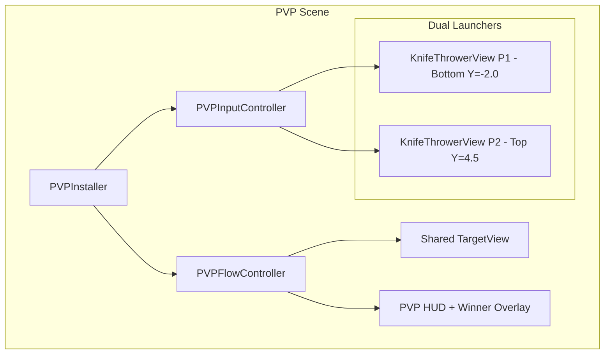
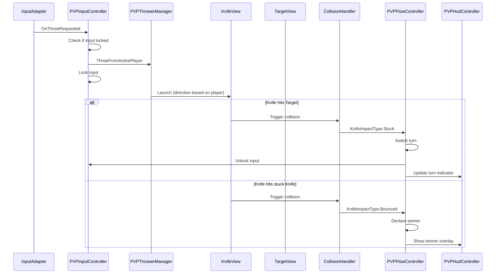

# PVP Mode Implementation Plan

## Overview

Create a new PVP scene with dual launchers (bottom and top), turn-based knife throwing, shared target with collision detection, and winner/rematch UI. Power-ups will be disabled, and target rotation will be configurable via a PVP settings menu.

## Architecture



## Key Components

### 1. PVP Scene Setup

Create a new scene `PVPPlay.unity` based on [`StagePlay.unity`](Assets/Scenes/StagePlay.unity):

- Two `KnifeThrowerView` instances (Player 1 at Y=-2.0, Player 2 at Y=4.5)
- Single target at center (Y=1.25)
- PVP-specific UI canvas with winner overlay

### 2. Core Scripts to Create

**[`PVPFlowController.cs`](PVPFlowController.cs)** - Manages PVP game flow:

- Tracks current turn via `_IsPlayer1Turn` boolean
- Listens to `KnifeImpactEventData` for stuck/bounced outcomes
- On `Bounced`: declares other player as winner
- On `Stuck`: switches turn and unlocks input
- Handles rematch logic (clear target, reset state)

**[`PVPInputController.cs`](PVPInputController.cs)** - Turn-based input routing:

- Wraps the existing `InputAdapter`
- Routes input to active player's `KnifeThrowerView`
- Locks input immediately after throw until knife resolution
- Unlocks on knife stick/fail callback

**[`PVPThrowerManager.cs`](PVPThrowerManager.cs)** - Dual launcher management:

- Holds references to both `KnifeThrowerView` instances
- Provides `ThrowFromActivePlayer(direction, speed)` method
- Flips knife sprite for Player 2 (180-degree rotation)
- Manages knife loading for each player

**[`PVPInstaller.cs`](PVPInstaller.cs)** - VContainer composition root:

- Similar to [`StageInstaller`](Assets/Scripts/Game/Installers/StageInstaller.cs) but without power-up registration
- Registers PVP-specific services
- References both launcher views and PVP UI

**[`PVPSettingsConfig.cs`](PVPSettingsConfig.cs)** - ScriptableObject for PVP configuration:

- Target rotation speed/behavior settings
- Customizable via PVP settings menu

### 3. UI Components

**[`PVPHudController.cs`](PVPHudController.cs)** - PVP-specific HUD:

- Turn indicator ("Player 1's Turn" / "Player 2's Turn")
- Winner overlay panel (hidden by default)
- "Winner: Player X" text display
- "Rematch" and "Exit" buttons

### 4. Collision Handling

Reuse existing collision infrastructure from [`KnifeHitKnifeHandler`](Assets/Scripts/Game/CollisionHandlers/KnifeHitKnifeHandler.cs):

- Knife-knife collision raises `KnifeImpactType.Bounced`
- `PVPFlowController` subscribes to this event
- On bounce, current player loses immediately

### 5. Target Configuration

Leverage existing [`TargetBehaviorFactory`](Assets/Scripts/Game/Entities/Target/Factories/TargetFactory.cs) with PVP-specific config:

- Create `PVPTargetConfig` ScriptableObject
- Expose rotation speed in PVP settings menu
- Target spawned at scene center with configurable behavior

### 6. Menu Integration

Add PVP mode entry to [`MainMenuController`](Assets/Scripts/Game/UI/MainMenu/MainMenuController.cs):

- "PVP Mode" button
- Optional: PVP Settings button for target configuration

## Data Flow



## File Structure

```
Assets/Scripts/Game/
├── PVP/
│   ├── Flow/
│   │   └── PVPFlowController.cs
│   ├── Input/
│   │   └── PVPInputController.cs
│   ├── Services/
│   │   └── PVPThrowerManager.cs
│   ├── Configs/
│   │   └── PVPSettingsConfig.cs
│   ├── UI/
│   │   └── PVPHudController.cs
│   └── Installers/
│       └── PVPInstaller.cs

Assets/Scenes/
└── PVPPlay.unity

Assets/Configurations/
└── PVPSettings.asset
```

## Implementation Notes

- **Sprite Flipping**: Player 2's knives need 180-degree Z rotation so they point downward toward the target
- **Throw Direction**: Player 1 throws `Vector2.up`, Player 2 throws `Vector2.down`
- **Input Lock**: Critical to prevent throwing during knife flight - unlock only after `Stuck` or `Bounced` event
- **No Power-ups**: Exclude `PowerUpInstaller` from `PVPInstaller` for balanced gameplay
- **Target Clearing on Rematch**: Destroy all stuck knives and reset target state

## Unity Setup Instructions

After code is implemented:

1. Duplicate `StagePlay.unity` as `PVPPlay.unity`
2. Replace `StageInstaller` with `PVPInstaller`
3. Add second `KnifeThrowerView` prefab at top of screen (Y=4.5)
4. Configure both throwers' spawn points appropriately
5. Add PVP UI Canvas with winner overlay panel
6. Add `PVPPlay` scene to Build Settings
7. Create `PVPSettings.asset` in Configurations folder
8. Add PVP button to Main Menu