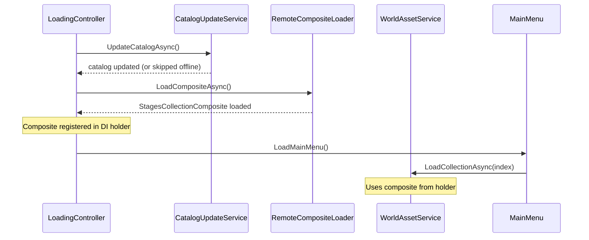

# Remote Composite Loading (No-APK World Updates)

## Current State

The project already has a working Addressables pipeline for loading individual `StagesCollection` world assets on demand via `WorldAssetService`. However, the **composite itself** (`StagesCollectionComposite`) is still a direct serialized reference on the `GameInstaller` prefab — meaning the list of which worlds exist is baked into the APK. Adding a new world still requires shipping a new build.

Key files already in place:
- [Assets/Scripts/Game/Level/Configurations/Stage/StagesCollectionComposite.cs](Assets/Scripts/Game/Level/Configurations/Stage/StagesCollectionComposite.cs) — uses `AssetReferenceT<StagesCollection>` and `_StageSlotCountsPerWorld`
- [Assets/Scripts/Game/Level/Services/WorldAssetService.cs](Assets/Scripts/Game/Level/Services/WorldAssetService.cs) — loads collections via `IAssetLoader`
- [Assets/Scripts/Common/AssetLoading/Addressables/AddressableAssetLoader.cs](Assets/Scripts/Common/AssetLoading/Addressables/AddressableAssetLoader.cs) — wraps `Addressables.LoadAssetAsync`
- [Assets/Scripts/Game/Installers/GameInstaller.cs](Assets/Scripts/Game/Installers/GameInstaller.cs) — registers the composite instance directly via `builder.RegisterInstance(_StagesCollectionComposite)`
- [Assets/Scripts/Game/Flow/Loading/LoadingController.cs](Assets/Scripts/Game/Flow/Loading/LoadingController.cs) — loading scene entry point, currently just yields then loads MainMenu

## Goal

After these changes, the flow becomes:



---

## Part 1: Catalog Update Service

Create a new service that wraps `Addressables.CheckForCatalogUpdates` / `UpdateCatalogs`. This keeps Addressables API isolated behind a testable class.

**New file:** `Assets/Scripts/Common/AssetLoading/UnityAddressables/CatalogUpdateService.cs`

```csharp
public class CatalogUpdateService
{
    private readonly ILogger _Logger;

    public CatalogUpdateService(ILogger logger) { ... }

    public async UniTask UpdateCatalogAsync(CancellationToken ct = default)
    {
        // Addressables.CheckForCatalogUpdates
        // If catalogs available -> Addressables.UpdateCatalogs
        // Log results; swallow errors gracefully for offline fallback
    }
}
```

---

## Part 2: Remote Composite Loader / Holder

Create a service that loads `StagesCollectionComposite` from Addressables by a fixed address and exposes it for downstream consumers.

**New file:** `Assets/Scripts/Game/Level/Services/RemoteCompositeLoader.cs`

```csharp
public class RemoteCompositeLoader : IDisposable
{
    private readonly IAssetLoader _AssetLoader;
    private readonly ILogger _Logger;
    private ILoadedAsset<StagesCollectionComposite> _Lease;

    public StagesCollectionComposite Composite => _Lease?.Asset;

    public async UniTask<bool> LoadAsync(CancellationToken ct = default) { ... }
    public void Dispose() { ... }
}
```

The fixed Addressable address (e.g. `"Config/StagesCollectionComposite"`) should be a const.

---

## Part 3: Modify LoadingController to Orchestrate Startup

[Assets/Scripts/Game/Flow/Loading/LoadingController.cs](Assets/Scripts/Game/Flow/Loading/LoadingController.cs) currently just transitions to MainMenu. It needs to:

1. Run `CatalogUpdateService.UpdateCatalogAsync()`
2. Run `RemoteCompositeLoader.LoadAsync()`
3. Fall back to the baked composite if remote load fails
4. Only then call `LoadMainMenu()`

This makes it the **async bootstrap** entry point.

---

## Part 4: Introduce IStagesCollectionCatalog (Composite Provider)

Instead of injecting `StagesCollectionComposite` directly everywhere, introduce an interface/holder that downstream services read from. This allows the composite instance to be swapped after async load.

**New file:** `Assets/Scripts/Game/Level/Interfaces/IStagesCollectionCatalog.cs`

```csharp
public interface IStagesCollectionCatalog
{
    StagesCollectionComposite Composite { get; }
    int CollectionsCount { get; }
    string GetCollectionLocationKey(int collectionIndex);
    int GetStageSlotCountForWorld(int collectionIndex);
}
```

**New file:** `Assets/Scripts/Game/Level/Services/StagesCollectionCatalogProvider.cs`

Implementation that first exposes the baked fallback, then switches to the remote-loaded composite once `RemoteCompositeLoader` completes.

---

## Part 5: Update Consumers to Use IStagesCollectionCatalog

Replace direct `StagesCollectionComposite` injection with `IStagesCollectionCatalog` in:

- [Assets/Scripts/Game/Level/Services/WorldAssetService.cs](Assets/Scripts/Game/Level/Services/WorldAssetService.cs) — constructor takes `IStagesCollectionCatalog` instead of `StagesCollectionComposite`
- [Assets/Scripts/Game/Flow/Game/GameStateMachine.cs](Assets/Scripts/Game/Flow/Game/GameStateMachine.cs) — replace `StagesCollectionComposite` property with `IStagesCollectionCatalog`
- [Assets/Scripts/Game/Flow/Game/States/GamePlayingState.cs](Assets/Scripts/Game/Flow/Game/States/GamePlayingState.cs) — reads `CollectionsCount` from the catalog interface
- [Assets/Scripts/Game/Installers/StageFlowInstaller.cs](Assets/Scripts/Game/Installers/StageFlowInstaller.cs) — resolves via interface
- [Assets/Scripts/Game/Persistence/Services/PlayerDataService.cs](Assets/Scripts/Game/Persistence/Services/PlayerDataService.cs) — methods accepting `StagesCollectionComposite` parameter switch to `IStagesCollectionCatalog`
- [Assets/Scripts/Game/UI/Stages/StageListController.cs](Assets/Scripts/Game/UI/Stages/StageListController.cs)
- [Assets/Scripts/Game/UI/Stages/StageListPresenter.cs](Assets/Scripts/Game/UI/Stages/StageListPresenter.cs)
- [Assets/Scripts/Game/UI/MainMenu/MainMenuController.cs](Assets/Scripts/Game/UI/MainMenu/MainMenuController.cs)

---

## Part 6: Update GameInstaller Registration

[Assets/Scripts/Game/Installers/GameInstaller.cs](Assets/Scripts/Game/Installers/GameInstaller.cs):

- Keep `_StagesCollectionComposite` serialized field as the **baked fallback**
- Register `CatalogUpdateService` as singleton
- Register `RemoteCompositeLoader` as singleton
- Register `StagesCollectionCatalogProvider` as `IStagesCollectionCatalog` (singleton), injected with the baked composite as fallback
- Remove `builder.RegisterInstance(_StagesCollectionComposite)` (no longer injected directly)

---

## Part 7: Unity Editor Setup Instructions (Manual)

These steps cannot be done in code and must be performed in the Unity Editor:

1. Open `StagesCollectionComposite.asset`, mark it as **Addressable** with address `Config/StagesCollectionComposite`
2. Place it in a **Remote** Addressable group (e.g. `Remote_Config`)
3. Enable **Build Remote Catalog** in AddressableAssetSettings
4. Set **Remote.LoadPath** to your CDN URL in the active Addressables Profile
5. Rebuild Addressables and upload remote artifacts

---

## Summary of New/Modified Files

| Action | File |
|--------|------|
| New | `Assets/Scripts/Common/AssetLoading/UnityAddressables/CatalogUpdateService.cs` |
| New | `Assets/Scripts/Game/Level/Services/RemoteCompositeLoader.cs` |
| New | `Assets/Scripts/Game/Level/Interfaces/IStagesCollectionCatalog.cs` |
| New | `Assets/Scripts/Game/Level/Services/StagesCollectionCatalogProvider.cs` |
| Modify | `Assets/Scripts/Game/Flow/Loading/LoadingController.cs` |
| Modify | `Assets/Scripts/Game/Installers/GameInstaller.cs` |
| Modify | `Assets/Scripts/Game/Level/Services/WorldAssetService.cs` |
| Modify | `Assets/Scripts/Game/Flow/Game/GameStateMachine.cs` |
| Modify | `Assets/Scripts/Game/Flow/Game/States/GamePlayingState.cs` |
| Modify | `Assets/Scripts/Game/Installers/StageFlowInstaller.cs` |
| Modify | `Assets/Scripts/Game/Persistence/Services/PlayerDataService.cs` |
| Modify | `Assets/Scripts/Game/UI/Stages/StageListController.cs` |
| Modify | `Assets/Scripts/Game/UI/Stages/StageListPresenter.cs` |
| Modify | `Assets/Scripts/Game/UI/MainMenu/MainMenuController.cs` |
