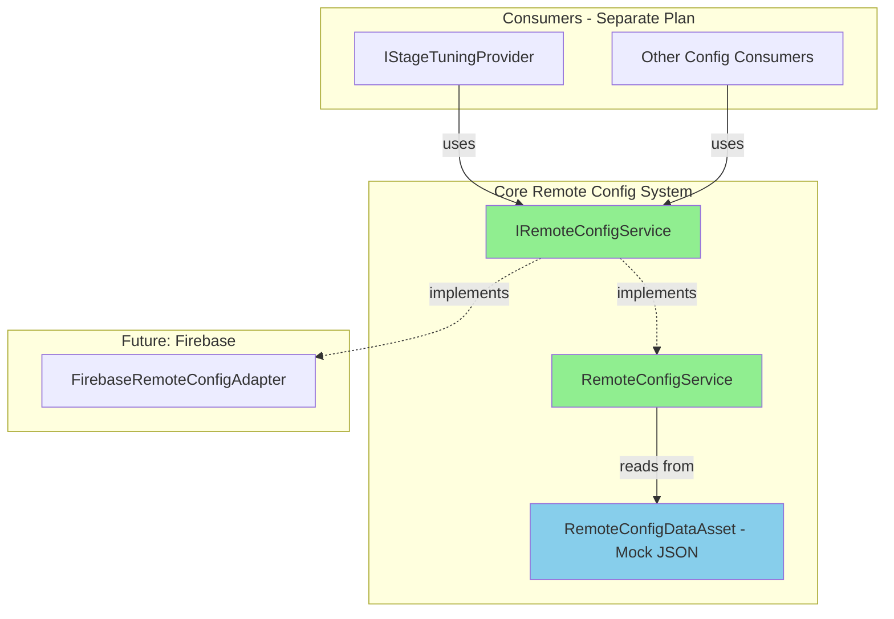
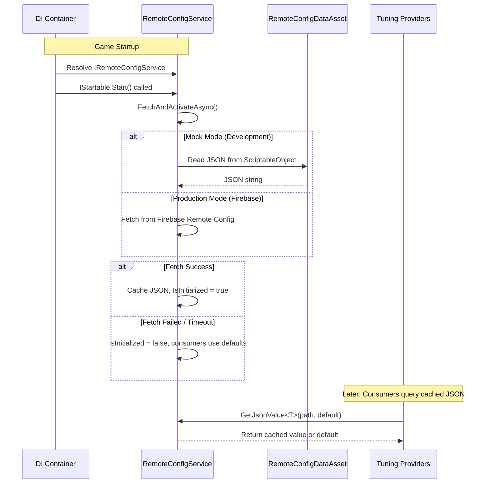

# Remote Configuration System - Core Implementation

## Overview

This plan covers the **core remote config infrastructure only**. The stage/level tuning integration is handled in a separate plan file: `stage_level_tuning_integration.plan.md`.

**Key Design Principles:**

- One production-ready service (not a "mock" service)
- Mock data via ScriptableObject asset (edited manually in Inspector, no editor window)
- Service initializes via `IStartable` (not in installer)
- No deep copying of configs
- Modular, readable code with small focused functions

---

## Architecture Overview




---

## Initialization Flow




## Phase 1: Core Interface & Data Asset

### 1.1 IRemoteConfigService Interface

**Location:** `Assets/Scripts/Common/Services/RemoteConfig/IRemoteConfigService.cs`

**Purpose:** Provider-agnostic interface for fetching and accessing remote configuration.

```csharp
namespace Common.Services.RemoteConfig
{
    /// <summary>
    /// Provider-agnostic interface for remote configuration services.
    /// Fetches JSON configuration and provides typed access to values.
    /// </summary>
    public interface IRemoteConfigService
    {
        /// <summary>
        /// Whether the service has successfully fetched and cached configuration.
        /// </summary>
        bool IsInitialized { get; }
        
        /// <summary>
        /// Fetches configuration from the remote source and caches it.
        /// </summary>
        UniTask<bool> FetchAndActivateAsync();
        
        /// <summary>
        /// Gets a typed value from a JSON path with fallback.
        /// </summary>
        /// <typeparam name="T">Target type (int, float, bool, string).</typeparam>
        /// <param name="jsonPath">Dot-notation path (e.g., "Stages.0.Levels.0.ExtraKnives").</param>
        /// <param name="defaultValue">Fallback if path not found or parse fails.</param>
        T GetValue<T>(string jsonPath, T defaultValue);
    }
}
```

**Design notes:**

- Simple, minimal interface - only what's needed
- Uses `UniTask` for async (consistent with codebase)
- `GetValue<T>` is synchronous (reads from cache, no await needed)

### 1.2 RemoteConfigDataAsset (Mock Data)

**Location:** `Assets/Scripts/Common/Services/RemoteConfig/RemoteConfigDataAsset.cs`

**Purpose:** ScriptableObject holding mock JSON for development. Edit directly in Inspector.

```csharp
namespace Common.Services.RemoteConfig
{
    /// <summary>
    /// ScriptableObject for storing mock remote configuration JSON.
    /// Edit the JSON directly in the Unity Inspector for testing.
    /// </summary>
    [CreateAssetMenu(fileName = "RemoteConfigData", menuName = "Knife Toss/Remote Config/Data Asset")]
    public class RemoteConfigDataAsset : ScriptableObject
    {
        /// <summary>
        /// The raw JSON configuration string.
        /// </summary>
        [field: SerializeField, TextArea(10, 30)]
        [field: Tooltip("JSON configuration data. Edit directly to test remote config behavior.")]
        public string JsonData { get; private set; } = "{}";
        
        /// <summary>
        /// Simulated network delay for testing async behavior.
        /// </summary>
        [field: SerializeField, Range(0, 2000)]
        [field: Tooltip("Simulated network delay in milliseconds for testing.")]
        public int SimulatedDelayMs { get; private set; } = 100;
    }
}
```

**Asset location:** `Assets/Resources/RemoteConfig/RemoteConfigData.asset`

**No editor window** - edit the JSON directly in the Inspector's TextArea field.

### 1.3 Directory Structure

```
Assets/Scripts/Common/Services/RemoteConfig/
├── IRemoteConfigService.cs
├── RemoteConfigService.cs
├── RemoteConfigDataAsset.cs
└── IRemoteConfigDataProvider.cs (optional - for Firebase adapter)
```

## Phase 2: RemoteConfigService Implementation

### 2.1 RemoteConfigSettings (Settings Asset)

**Location:** `Assets/Scripts/Common/Services/RemoteConfig/RemoteConfigSettings.cs`

**Purpose:** Dedicated settings asset for remote config service configuration.

```csharp
namespace Common.Services.RemoteConfig
{
    /// <summary>
    /// Settings for the remote configuration service.
    /// </summary>
    [CreateAssetMenu(fileName = "RemoteConfigSettings", menuName = "Knife Toss/Remote Config/Settings")]
    public class RemoteConfigSettings : ScriptableObject
    {
        /// <summary>
        /// Timeout in seconds for fetching remote configuration.
        /// </summary>
        [field: SerializeField, Range(1, 10)]
        [field: Tooltip("Timeout in seconds for fetching remote configuration.")]
        public float FetchTimeoutSeconds { get; private set; } = 2f;
    }
}
```

**Asset location:** `Assets/Resources/RemoteConfig/RemoteConfigSettings.asset`

### 2.2 RemoteConfigService

**Location:** `Assets/Scripts/Common/Services/RemoteConfig/RemoteConfigService.cs`

**Purpose:** Production-ready service that implements `IRemoteConfigService` and `IStartable`.

**Key features:**

- Implements `IStartable` for automatic initialization (not in installer)
- Works with mock data (development) or Firebase (production) via data provider
- Caches JSON after fetch for fast synchronous access
- Timeout configured via settings asset (no magic numbers)
- Small, focused methods with clear responsibilities

**Implementation outline:**

```csharp
namespace Common.Services.RemoteConfig
{
    /// <summary>
    /// Production-ready remote configuration service.
    /// Fetches JSON configuration and provides typed access with fallback.
    /// Initializes automatically via IStartable.
    /// </summary>
    public class RemoteConfigService : IRemoteConfigService, IStartable
    {
        private readonly IRemoteConfigDataProvider _dataProvider;
        private readonly RemoteConfigSettings _settings;
        
        private string _cachedJson;
        private bool _isInitialized;
        
        public bool IsInitialized => _isInitialized;
        
        public RemoteConfigService(
            IRemoteConfigDataProvider dataProvider,
            RemoteConfigSettings settings)
        {
            _dataProvider = dataProvider;
            _settings = settings;
        }
        
        /// <summary>
        /// Called automatically by DI container on startup.
        /// </summary>
        public void Start()
        {
            InitializeAsync().Forget();
        }
        
        private async UniTaskVoid InitializeAsync()
        {
            await FetchWithTimeout();
        }
        
        private async UniTask FetchWithTimeout()
        {
            var timeout = TimeSpan.FromSeconds(_settings.FetchTimeoutSeconds);
            // Implementation: fetch with timeout, handle failure gracefully
        }
        
        public async UniTask<bool> FetchAndActivateAsync()
        {
            // Implementation: fetch JSON from provider, cache it
        }
        
        public T GetValue<T>(string jsonPath, T defaultValue)
        {
            // Implementation: navigate JSON path, parse value, return default on failure
        }
    }
}
```

**Code structure principles:**

- Each public method delegates to small private helpers
- Clear separation: fetching → caching → parsing → accessing
- Settings via dedicated asset (no magic numbers)
- All failure paths return defaults silently (no exceptions to callers)

### 2.2 IRemoteConfigDataProvider (Abstraction for Data Source)

**Location:** `Assets/Scripts/Common/Services/RemoteConfig/IRemoteConfigDataProvider.cs`

**Purpose:** Abstracts the data source so the same service works with mock or Firebase.

```csharp
namespace Common.Services.RemoteConfig
{
    /// <summary>
    /// Abstracts the source of remote configuration data.
    /// Implement for mock (ScriptableObject) or production (Firebase).
    /// </summary>
    public interface IRemoteConfigDataProvider
    {
        /// <summary>
        /// Fetches the JSON configuration string from the source.
        /// </summary>
        UniTask<string> FetchJsonAsync();
    }
}
```

### 2.3 MockRemoteConfigDataProvider

**Location:** `Assets/Scripts/Common/Services/RemoteConfig/MockRemoteConfigDataProvider.cs`

**Purpose:** Reads JSON from the ScriptableObject asset.

```csharp
namespace Common.Services.RemoteConfig
{
    /// <summary>
    /// Provides remote config JSON from a ScriptableObject for development/testing.
    /// </summary>
    public class MockRemoteConfigDataProvider : IRemoteConfigDataProvider
    {
        private readonly RemoteConfigDataAsset _dataAsset;
        
        public MockRemoteConfigDataProvider(RemoteConfigDataAsset dataAsset)
        {
            _dataAsset = dataAsset;
        }
        
        public async UniTask<string> FetchJsonAsync()
        {
            if (_dataAsset == null)
                return null;
            
            await SimulateNetworkDelay();
            return _dataAsset.JsonData;
        }
        
        private async UniTask SimulateNetworkDelay()
        {
            if (_dataAsset.SimulatedDelayMs > 0)
                await UniTask.Delay(_dataAsset.SimulatedDelayMs);
        }
    }
}
```

**No editor window** - edit `RemoteConfigDataAsset.JsonData` directly in Unity Inspector.

## Phase 3: Dependency Injection Setup

### 3.1 RemoteConfigInstaller

**Location:** `Assets/Scripts/Common/Services/RemoteConfig/RemoteConfigInstaller.cs`

**Purpose:** Dedicated installer for all remote config registrations. Keeps GameInstaller clean.

```csharp
namespace Common.Services.RemoteConfig
{
    /// <summary>
    /// Installer for remote configuration services.
    /// </summary>
    public class RemoteConfigInstaller : IInstaller
    {
        public void Install(IContainerBuilder builder)
        {
            RegisterSettings(builder);
            RegisterDataProvider(builder);
            RegisterService(builder);
        }
        
        private void RegisterSettings(IContainerBuilder builder)
        {
            var settings = Resources.Load<RemoteConfigSettings>("RemoteConfig/RemoteConfigSettings");
            if (settings != null)
            {
                builder.RegisterInstance(settings);
            }
        }
        
        private void RegisterDataProvider(IContainerBuilder builder)
        {
            var dataAsset = Resources.Load<RemoteConfigDataAsset>("RemoteConfig/RemoteConfigData");
            if (dataAsset != null)
            {
                builder.Register<MockRemoteConfigDataProvider>(Lifetime.Singleton)
                    .WithParameter(dataAsset)
                    .As<IRemoteConfigDataProvider>();
            }
        }
        
        private void RegisterService(IContainerBuilder builder)
        {
            builder.Register<RemoteConfigService>(Lifetime.Singleton)
                .As<IRemoteConfigService>()
                .AsImplementedInterfaces();
        }
    }
}
```

### 3.2 Usage in GameInstaller

**File:** `Assets/Scripts/Game/Installers/GameInstaller.cs`

```csharp
protected override void Configure(IContainerBuilder builder)
{
    new RemoteConfigInstaller().Install(builder);
    // ... other registrations
}
```

### 3.3 Asset Locations


| Asset                        | Location                         |
| ---------------------------- | -------------------------------- |
| `RemoteConfigSettings.asset` | `Assets/Resources/RemoteConfig/` |
| `RemoteConfigData.asset`     | `Assets/Resources/RemoteConfig/` |


### 3.4 Update Common.asmdef

**File:** `Assets/Scripts/Common/Common.asmdef`

Add dependencies:

- `UniTask`
- `VContainer`

---

## Fallback & Safety


| Scenario                            | Behavior                                        |
| ----------------------------------- | ----------------------------------------------- |
| Network failure                     | `IsInitialized = false`, consumers use defaults |
| Parse error                         | `GetValue<T>` returns provided default          |
| Missing path                        | `GetValue<T>` returns provided default          |
| Timeout (configurable via settings) | Proceed with `IsInitialized = false`            |
| Null asset                          | Service works but has no data                   |


**No exceptions thrown to callers** - all failure modes return defaults silently.

---

## File Summary

**New files (7 total):**


| File                                                           | Purpose                           |
| -------------------------------------------------------------- | --------------------------------- |
| `Common/Services/RemoteConfig/IRemoteConfigService.cs`         | Core interface                    |
| `Common/Services/RemoteConfig/RemoteConfigService.cs`          | Implementation with IStartable    |
| `Common/Services/RemoteConfig/RemoteConfigSettings.cs`         | Settings asset for timeout config |
| `Common/Services/RemoteConfig/RemoteConfigDataAsset.cs`        | ScriptableObject for mock JSON    |
| `Common/Services/RemoteConfig/IRemoteConfigDataProvider.cs`    | Data source abstraction           |
| `Common/Services/RemoteConfig/MockRemoteConfigDataProvider.cs` | Mock data provider                |
| `Common/Services/RemoteConfig/RemoteConfigInstaller.cs`        | Dedicated DI installer            |


**Assets to create:**


| Asset                        | Location                         |
| ---------------------------- | -------------------------------- |
| `RemoteConfigSettings.asset` | `Assets/Resources/RemoteConfig/` |
| `RemoteConfigData.asset`     | `Assets/Resources/RemoteConfig/` |


**Modified files:**


| File               | Change                                 |
| ------------------ | -------------------------------------- |
| `GameInstaller.cs` | Call `RemoteConfigInstaller.Install()` |
| `Common.asmdef`    | Add UniTask, VContainer dependencies   |


---

## Testing Instructions

1. Create `RemoteConfigData.asset` in `Assets/Resources/RemoteConfig/`
2. In Inspector, paste test JSON into the TextArea field
3. Run game - service initializes via `IStartable`
4. Verify `IRemoteConfigService.IsInitialized` is `true`
5. Test `GetValue<T>` with various paths
6. Test fallback by providing invalid JSON

---

## Next Steps

**Stage/Level Tuning Integration** is covered in a separate plan:
→ `stage_level_tuning_integration.plan.md`

That plan covers:

- `IStageTuningProvider` interface
- Overlay pattern (no deep copy)
- JSON structure for stages/levels/targets
- Integration with flow controllers

