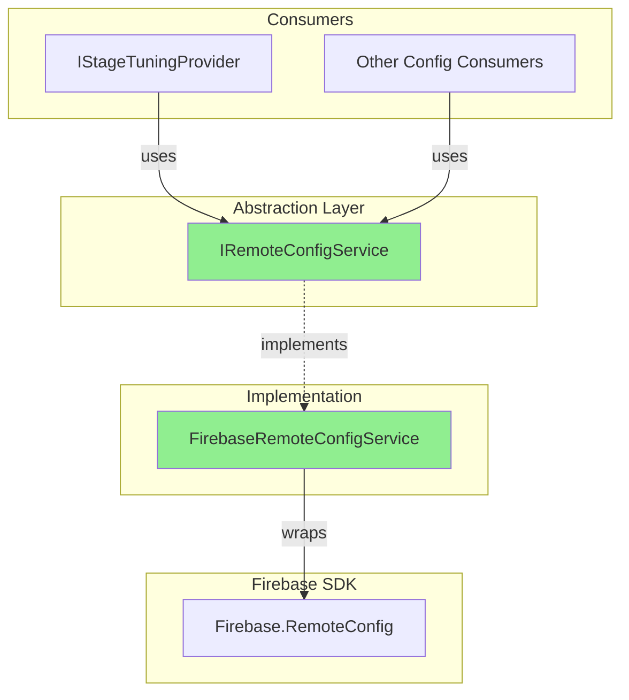
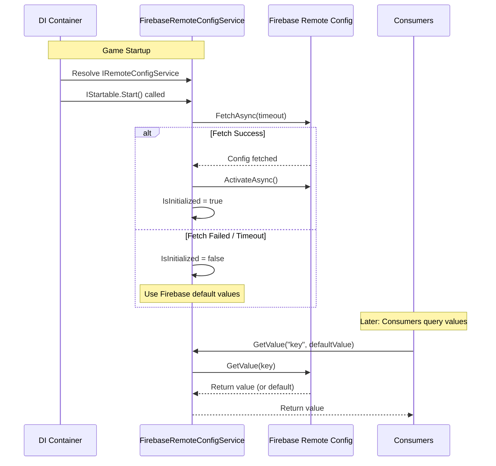

# Remote Configuration System - Core Implementation

## Overview

This plan covers the **core remote config infrastructure** using Firebase Remote Config.

**Key Design Principles:**

- Consumers depend on `IRemoteConfigService` interface (not Firebase directly)
- 4 typed GetValue methods: `int`, `long`, `string`, `bool`
- Service initializes via `IStartable` (not in installer)
- All failure paths return defaults silently
- Use `JsonUtility` for any JSON parsing (handled by consumers, not this system)

---

## Architecture Overview




---

## Initialization Flow




---

## Phase 1: IRemoteConfigService Interface

### 1.1 Interface Definition

**Location:** `Assets/Scripts/Common/Services/RemoteConfig/IRemoteConfigService.cs`

**Purpose:** Abstraction over remote configuration. Consumers depend on this, not Firebase.

```csharp
namespace Common.Services.RemoteConfig
{
    /// <summary>
    /// Abstraction for remote configuration services.
    /// Provides typed access to configuration values.
    /// </summary>
    public interface IRemoteConfigService
    {
        /// <summary>
        /// Whether the service has successfully fetched and activated configuration.
        /// </summary>
        bool IsInitialized { get; }
        
        /// <summary>
        /// Fetches and activates the latest configuration from the remote source.
        /// </summary>
        UniTask<bool> FetchAndActivateAsync();
        
        /// <summary>
        /// Gets an integer value from remote config.
        /// </summary>
        /// <param name="key">The configuration key.</param>
        /// <param name="defaultValue">Fallback if key not found.</param>
        int GetValue(string key, int defaultValue);
        
        /// <summary>
        /// Gets a long value from remote config.
        /// </summary>
        /// <param name="key">The configuration key.</param>
        /// <param name="defaultValue">Fallback if key not found.</param>
        long GetValue(string key, long defaultValue);
        
        /// <summary>
        /// Gets a string value from remote config.
        /// </summary>
        /// <param name="key">The configuration key.</param>
        /// <param name="defaultValue">Fallback if key not found.</param>
        string GetValue(string key, string defaultValue);
        
        /// <summary>
        /// Gets a boolean value from remote config.
        /// </summary>
        /// <param name="key">The configuration key.</param>
        /// <param name="defaultValue">Fallback if key not found.</param>
        bool GetValue(string key, bool defaultValue);
    }
}
```

**Design notes:**

- 4 typed overloads matching Firebase types: `int`, `long`, `string`, `bool`
- No generic `GetValue<T>` - explicit types for clarity
- No JSON type - consumers handle JSON parsing manually with `JsonUtility`

---

## Phase 2: FirebaseRemoteConfigService

### 2.1 Settings Asset

**Location:** `Assets/Scripts/Common/Services/RemoteConfig/RemoteConfigSettings.cs`

```csharp
namespace Common.Services.RemoteConfig
{
    /// <summary>
    /// Settings for the remote configuration service.
    /// </summary>
    [CreateAssetMenu(fileName = "RemoteConfigSettings", menuName = "Knife Toss/Remote Config/Settings")]
    public class RemoteConfigSettings : ScriptableObject
    {
        /// <summary>
        /// Timeout in seconds for fetching remote configuration.
        /// </summary>
        [field: SerializeField, Range(1, 30)]
        [field: Tooltip("Timeout in seconds for fetching remote configuration.")]
        public float FetchTimeoutSeconds { get; private set; } = 5f;
        
        /// <summary>
        /// Minimum interval between fetches in seconds (to avoid throttling).
        /// </summary>
        [field: SerializeField, Range(0, 3600)]
        [field: Tooltip("Minimum interval between fetches in seconds.")]
        public float MinimumFetchIntervalSeconds { get; private set; } = 0f;
    }
}
```

### 2.2 FirebaseRemoteConfigService Implementation

**Location:** `Assets/Scripts/Common/Services/RemoteConfig/FirebaseRemoteConfigService.cs`

```csharp
using Firebase.RemoteConfig;

namespace Common.Services.RemoteConfig
{
    /// <summary>
    /// Remote configuration service using Firebase Remote Config.
    /// Wraps Firebase SDK behind IRemoteConfigService interface.
    /// </summary>
    public class FirebaseRemoteConfigService : IRemoteConfigService, IStartable
    {
        private readonly RemoteConfigSettings _settings;
        private bool _isInitialized;
        
        public bool IsInitialized => _isInitialized;
        
        public FirebaseRemoteConfigService(RemoteConfigSettings settings)
        {
            _settings = settings;
        }
        
        // ─────────────────────────────────────────────────────────────
        // IStartable
        // ─────────────────────────────────────────────────────────────
        
        public void Start()
        {
            InitializeAsync().Forget();
        }
        
        private async UniTaskVoid InitializeAsync()
        {
            await FetchAndActivateAsync();
        }
        
        // ─────────────────────────────────────────────────────────────
        // Fetch & Activate
        // ─────────────────────────────────────────────────────────────
        
        public async UniTask<bool> FetchAndActivateAsync()
        {
            if (!TryGetFirebaseInstance(out var remoteConfig))
                return MarkAsNotInitialized();
            
            SetFetchSettings(remoteConfig);
            
            if (!await TryFetchConfig(remoteConfig))
                return MarkAsNotInitialized();
            
            if (!await TryActivateConfig(remoteConfig))
                return MarkAsNotInitialized();
            
            return MarkAsInitialized();
        }
        
        private bool TryGetFirebaseInstance(out FirebaseRemoteConfig remoteConfig)
        {
            remoteConfig = FirebaseRemoteConfig.DefaultInstance;
            return remoteConfig != null;
        }
        
        private void SetFetchSettings(FirebaseRemoteConfig remoteConfig)
        {
            var configSettings = new ConfigSettings
            {
                FetchTimeoutInMilliseconds = (ulong)(_settings.FetchTimeoutSeconds * 1000),
                MinimumFetchInternalInMilliseconds = (ulong)(_settings.MinimumFetchIntervalSeconds * 1000)
            };
            remoteConfig.SetConfigSettingsAsync(configSettings);
        }
        
        private async UniTask<bool> TryFetchConfig(FirebaseRemoteConfig remoteConfig)
        {
            try
            {
                await remoteConfig.FetchAsync(TimeSpan.FromSeconds(_settings.FetchTimeoutSeconds));
                return true;
            }
            catch
            {
                return false;
            }
        }
        
        private async UniTask<bool> TryActivateConfig(FirebaseRemoteConfig remoteConfig)
        {
            try
            {
                await remoteConfig.ActivateAsync();
                return true;
            }
            catch
            {
                return false;
            }
        }
        
        private bool MarkAsInitialized()
        {
            _isInitialized = true;
            return true;
        }
        
        private bool MarkAsNotInitialized()
        {
            _isInitialized = false;
            return false;
        }
        
        // ─────────────────────────────────────────────────────────────
        // GetValue Methods
        // ─────────────────────────────────────────────────────────────
        
        public int GetValue(string key, int defaultValue)
        {
            return GetConfigValue(key)?.LongValue is long value 
                ? (int)value 
                : defaultValue;
        }
        
        public long GetValue(string key, long defaultValue)
        {
            return GetConfigValue(key)?.LongValue ?? defaultValue;
        }
        
        public string GetValue(string key, string defaultValue)
        {
            return GetConfigValue(key)?.StringValue ?? defaultValue;
        }
        
        public bool GetValue(string key, bool defaultValue)
        {
            return GetConfigValue(key)?.BooleanValue ?? defaultValue;
        }
        
        private ConfigValue GetConfigValue(string key)
        {
            var remoteConfig = FirebaseRemoteConfig.DefaultInstance;
            if (remoteConfig == null)
                return null;
            
            return remoteConfig.GetValue(key);
        }
    }
}
```

**Code organization:**

- IStartable implementation at top
- Fetch & Activate section with small focused methods
- GetValue methods at bottom
- Each method tells a clear story

---

## Phase 3: Dependency Injection

### 3.1 RemoteConfigInstaller

**Location:** `Assets/Scripts/Common/Services/RemoteConfig/RemoteConfigInstaller.cs`

```csharp
namespace Common.Services.RemoteConfig
{
    /// <summary>
    /// Installer for remote configuration services.
    /// </summary>
    public class RemoteConfigInstaller : IInstaller
    {
        public void Install(IContainerBuilder builder)
        {
            RegisterSettings(builder);
            RegisterService(builder);
        }
        
        private void RegisterSettings(IContainerBuilder builder)
        {
            var settings = Resources.Load<RemoteConfigSettings>("RemoteConfig/RemoteConfigSettings");
            if (settings != null)
            {
                builder.RegisterInstance(settings);
            }
        }
        
        private void RegisterService(IContainerBuilder builder)
        {
            builder.Register<FirebaseRemoteConfigService>(Lifetime.Singleton)
                .As<IRemoteConfigService>()
                .AsImplementedInterfaces();
        }
    }
}
```

### 3.2 Usage in GameInstaller

**File:** `Assets/Scripts/Game/Installers/GameInstaller.cs`

```csharp
protected override void Configure(IContainerBuilder builder)
{
    new RemoteConfigInstaller().Install(builder);
    // ... other registrations
}
```

### 3.3 Asset Location


| Asset                        | Location                         |
| ---------------------------- | -------------------------------- |
| `RemoteConfigSettings.asset` | `Assets/Resources/RemoteConfig/` |


### 3.4 Update Common.asmdef

**File:** `Assets/Scripts/Common/Common.asmdef`

Add dependencies:

- `UniTask`
- `VContainer`
- `Firebase.RemoteConfig`

---

## Fallback & Safety


| Scenario                 | Behavior                                                    |
| ------------------------ | ----------------------------------------------------------- |
| Firebase not initialized | `IsInitialized = false`, GetValue returns default           |
| Fetch failed             | `IsInitialized = false`, use Firebase cached/default values |
| Fetch timeout            | `IsInitialized = false`, use Firebase cached/default values |
| Key not found            | GetValue returns provided default                           |


**No exceptions thrown to callers** - all failure modes return defaults silently.

---

## File Summary

**New files (4 total):**


| File                                                          | Purpose                   |
| ------------------------------------------------------------- | ------------------------- |
| `Common/Services/RemoteConfig/IRemoteConfigService.cs`        | Interface abstraction     |
| `Common/Services/RemoteConfig/FirebaseRemoteConfigService.cs` | Firebase implementation   |
| `Common/Services/RemoteConfig/RemoteConfigSettings.cs`        | Settings ScriptableObject |
| `Common/Services/RemoteConfig/RemoteConfigInstaller.cs`       | DI installer              |


**Assets to create:**


| Asset                        | Location                         |
| ---------------------------- | -------------------------------- |
| `RemoteConfigSettings.asset` | `Assets/Resources/RemoteConfig/` |


**Modified files:**


| File               | Change                                 |
| ------------------ | -------------------------------------- |
| `GameInstaller.cs` | Call `RemoteConfigInstaller.Install()` |
| `Common.asmdef`    | Add Firebase.RemoteConfig dependency   |


---

## Testing Instructions

1. Create `RemoteConfigSettings.asset` in `Assets/Resources/RemoteConfig/`
2. Configure Firebase Remote Config in Firebase Console with test parameters
3. Run game - service initializes via `IStartable`
4. Verify `IRemoteConfigService.IsInitialized` is `true`
5. Test `GetValue` methods with various keys
6. Test fallback by using non-existent keys

---

## Usage Example

```csharp
public class SomeService
{
    private readonly IRemoteConfigService _remoteConfig;
    
    public SomeService(IRemoteConfigService remoteConfig)
    {
        _remoteConfig = remoteConfig;
    }
    
    public void DoSomething()
    {
        int extraKnives = _remoteConfig.GetValue("extra_knives", 5);
        bool featureEnabled = _remoteConfig.GetValue("new_feature_enabled", false);
        string welcomeMessage = _remoteConfig.GetValue("welcome_message", "Hello!");
        long bigNumber = _remoteConfig.GetValue("big_number", 1000000L);
    }
}
```

---

## Next Steps

**Stage/Level Tuning Integration** is covered in a separate plan:
→ `stage_level_tuning_integration.plan.md`

That plan covers:

- `IStageTuningProvider` interface
- JSON parsing with `JsonUtility` for hierarchical stage/level data
- Overlay pattern (no deep copy)
- Integration with flow controllers

