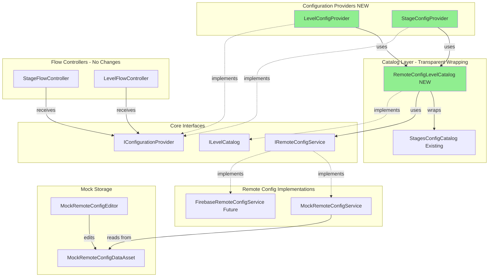
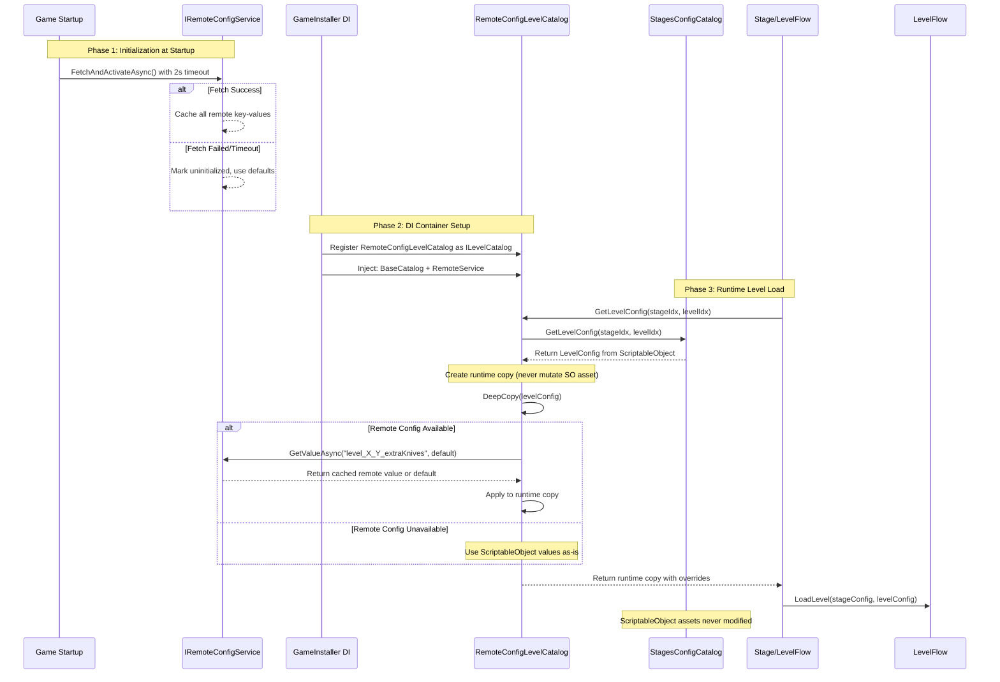

# Remote Configuration System Implementation

## Architecture Overview

The implementation follows the **existing `IConfigurationProvider` pattern** used throughout your codebase. The system will transparently inject remote config values without changing any flow controller logic.

### Component Architecture



### Runtime Fetch & Override Flow



## Existing Pattern Analysis

### How `IConfigurationProvider<T>` is Currently Used

**Example: KnifeThrowConfigAsset**

```csharp
// ScriptableObject implements IConfigurationProvider
public class KnifeThrowConfigAsset : ScriptableObject, IConfigurationProvider<KnifeThrowConfiguration>
{
    [SerializeField] public float ThrowSpeed { get; private set; } = 10f;
    
    public KnifeThrowConfiguration GetConfiguration()
    {
        return new KnifeThrowConfiguration
        {
            ThrowSpeed = ThrowSpeed,
            SpawnPositionOffset = SpawnPositionOffset
        };
    }
}

// Registration in KnifeInstaller
builder.RegisterInstance(_Config).As<IConfigurationProvider<KnifeThrowConfiguration>>();

// Usage in ThrowService (injected)
public ThrowService(IConfigurationProvider<KnifeThrowConfiguration> configProvider)
{
    var config = configProvider.GetConfiguration(); // Returns a data object
}
```

**Key insight:** Services receive `IConfigurationProvider<T>` and call `GetConfiguration()` to get a **data object**, not the ScriptableObject itself.

## Phase 1: Core Architecture

### 1.1 IRemoteConfigService Interface

**Location:** `Assets/Scripts/Common/Services/RemoteConfig/IRemoteConfigService.cs`

**Contract:**

```csharp
namespace Common.Services.RemoteConfig
{
    /// <summary>
    /// Interface for remote configuration services that fetch and provide configuration values.
    /// </summary>
    public interface IRemoteConfigService
    {
        /// <summary>
        /// Gets whether the service has successfully initialized and fetched config.
        /// </summary>
        bool IsInitialized { get; }
        
        /// <summary>
        /// Fetches and activates the latest configuration from the remote source.
        /// </summary>
        /// <returns>True if fetch succeeded, false otherwise.</returns>
        Task<bool> FetchAndActivateAsync();
        
        /// <summary>
        /// Gets a configuration value with type inference and fallback.
        /// </summary>
        /// <typeparam name="T">The type to parse the value as (int, float, bool, string).</typeparam>
        /// <param name="key">The configuration key.</param>
        /// <param name="defaultValue">The fallback value if key not found or parse fails.</param>
        /// <returns>The remote value or the default value.</returns>
        Task<T> GetValueAsync<T>(string key, T defaultValue);
    }
}
```

**Design rationale:** Generic method supports primitives with automatic type conversion. No enums needed - type is inferred from generic parameter.

### 1.2 RemoteConfigEntry

**Location:** `Assets/Scripts/Common/Services/RemoteConfig/RemoteConfigEntry.cs`

```csharp
[Serializable]
public class RemoteConfigEntry
{
    public string Key;
    public string Value;  // stored as string, parsed at runtime via GetValueAsync<T>
}
```

### 1.3 Directory Structure

Create `Assets/Scripts/Common/Services/RemoteConfig/` for all remote config code.

## Phase 2: Mock Implementation & Tooling

### 2.1 MockRemoteConfigDataAsset (ScriptableObject)

**Location:** `Assets/Scripts/Common/Services/RemoteConfig/MockRemoteConfigDataAsset.cs`

**Purpose:** Persistent storage for mock configuration key-value pairs (editor-time editing).

**Structure:**

```csharp
[CreateAssetMenu(fileName = "MockRemoteConfigData", menuName = "Knife Toss/Remote Config/Mock Data")]
public class MockRemoteConfigDataAsset : ScriptableObject
{
    [Tooltip("Configuration key-value pairs for mock remote config.")]
    [field: SerializeField] public List<RemoteConfigEntry> Entries { get; private set; } = new();
    
    [Tooltip("Simulated network delay in milliseconds (0-2000).")]
    [field: SerializeField, Range(0, 2000)] public int SimulatedDelayMs { get; private set; } = 100;
}
```

**Default asset location:** `Assets/Configurations/RemoteConfig/MockRemoteConfigData.asset`

### 2.2 MockRemoteConfigService

**Location:** `Assets/Scripts/Common/Services/RemoteConfig/MockRemoteConfigService.cs`

**Features:**

- Implements `IRemoteConfigService`
- Reads from `MockRemoteConfigDataAsset` 
- Simulates network delay (configurable via asset)
- Type conversion with validation (int, float, bool, string)
- Caches fetched values in `Dictionary<string, string>`
- Thread-safe using `UniTask`

**Implementation outline:**

```csharp
public class MockRemoteConfigService : IRemoteConfigService
{
    private readonly MockRemoteConfigDataAsset _DataAsset;
    private Dictionary<string, string> _Cache;
    private bool _IsInitialized;

    public bool IsInitialized => _IsInitialized;

    public MockRemoteConfigService(MockRemoteConfigDataAsset dataAsset)
    {
        _DataAsset = dataAsset;
        _Cache = new Dictionary<string, string>();
    }

    public async Task<bool> FetchAndActivateAsync()
    {
        if (_DataAsset == null)
        {
            _IsInitialized = false;
            return false;
        }

        // Simulate network delay
        if (_DataAsset.SimulatedDelayMs > 0)
        {
            await UniTask.Delay(_DataAsset.SimulatedDelayMs);
        }

        // Load entries into cache
        _Cache.Clear();
        foreach (var entry in _DataAsset.Entries)
        {
            if (!string.IsNullOrEmpty(entry.Key))
            {
                _Cache[entry.Key] = entry.Value ?? string.Empty;
            }
        }

        _IsInitialized = true;
        return true;
    }

    public async Task<T> GetValueAsync<T>(string key, T defaultValue)
    {
        await UniTask.Yield(); // Maintain async pattern
        
        if (!_IsInitialized || !_Cache.TryGetValue(key, out string rawValue))
        {
            return defaultValue;
        }

        return TryParse<T>(rawValue, defaultValue);
    }

    private T TryParse<T>(string rawValue, T defaultValue)
    {
        // Type-specific parsing logic with fallback
        // Handle int, float, bool, string
    }
}
```

### 2.3 MockRemoteConfigEditor (Editor Window)

**Location:** `Assets/Scripts/Editor/RemoteConfig/MockRemoteConfigEditor.cs`

**Features:**

- Add/Remove configuration keys
- Edit key-value pairs (string values, no type dropdown)
- Search/filter keys
- Visual validation hints
- "Create Asset" button if asset doesn't exist
- Auto-save on changes

**Menu:** `Tools/Remote Config/Mock Config Editor`

**UI Layout:**

- **Header:** Asset reference field + Create Asset button
- **Toolbar:** Add Key button, Search box, Simulated Delay slider
- **Main area:** Scrollable list of entries
  - Key name (text field)
  - Value field (text field)
  - Delete button (red X)
- **Footer:** Save button, Entry count display

**Implementation note:** Use `EditorGUILayout` for UI, `SerializedObject` for asset editing.

## Phase 3: Catalog Wrapper (Core Integration)

### 3.1 RemoteConfigLevelCatalog

**Location:** `Assets/Scripts/Game/Level/Catalogs/RemoteConfigLevelCatalog.cs`

**Purpose:** Wraps `ILevelCatalog` and transparently applies remote config overrides to returned configs.

**Key principle:** **Never mutate ScriptableObject assets.** Always return deep copies with overrides applied.

**Implementation:**

```csharp
namespace Game.Level.Catalogs
{
    /// <summary>
    /// Wraps ILevelCatalog to apply remote configuration overrides to level/stage configs.
    /// Returns runtime copies with overrides applied, never mutates ScriptableObject assets.
    /// </summary>
    public class RemoteConfigLevelCatalog : ILevelCatalog
    {
        private readonly ILevelCatalog _BaseCatalog;
        private readonly IRemoteConfigService _RemoteConfigService;

        public RemoteConfigLevelCatalog(
            ILevelCatalog baseCatalog,
            IRemoteConfigService remoteConfigService)
        {
            _BaseCatalog = baseCatalog;
            _RemoteConfigService = remoteConfigService;
        }

        public int StageCount => _BaseCatalog.StageCount;

        public int GetLevelCount(int stageIndex) => _BaseCatalog.GetLevelCount(stageIndex);

        public StageConfig GetStageConfig(int stageIndex)
        {
            // For now, just pass through (no primitive tuning values in StageConfig)
            return _BaseCatalog.GetStageConfig(stageIndex);
        }

        public LevelConfig GetLevelConfig(int stageIndex, int levelIndex)
        {
            var baseConfig = _BaseCatalog.GetLevelConfig(stageIndex, levelIndex);
            if (baseConfig == null)
                return null;

            // Create deep copy (never mutate original)
            var runtimeCopy = DeepCopyLevelConfig(baseConfig);

            // Apply remote overrides if service is available
            if (_RemoteConfigService?.IsInitialized == true)
            {
                var stageConfig = _BaseCatalog.GetStageConfig(stageIndex);
                string stageKey = stageConfig?.StageName ?? $"stage_{stageIndex}";
                
                ApplyRemoteOverrides(runtimeCopy, stageKey, levelIndex).Forget();
            }

            return runtimeCopy;
        }

        private async UniTaskVoid ApplyRemoteOverrides(LevelConfig config, string stageKey, int levelIndex)
        {
            try
            {
                // Override ExtraKnives
                string key = $"level_{stageKey}_{levelIndex}_extraKnives";
                config.ExtraKnives = await _RemoteConfigService.GetValueAsync(key, config.ExtraKnives);

                // Override target configs
                for (int i = 0; i < config.Targets.Count; i++)
                {
                    string targetKey = $"level_{stageKey}_{levelIndex}_target_{i}";
                    await ApplyTargetOverrides(config.Targets[i], targetKey);
                }
            }
            catch (Exception e)
            {
                Debug.LogWarning($"Failed to apply remote overrides: {e.Message}");
            }
        }

        private async UniTask ApplyTargetOverrides(TargetConfig target, string keyPrefix)
        {
            target.KnivesToBreak = await _RemoteConfigService.GetValueAsync(
                $"{keyPrefix}_knivesToBreak", target.KnivesToBreak);
            target.BaseScale = await _RemoteConfigService.GetValueAsync(
                $"{keyPrefix}_baseScale", target.BaseScale);
            target.InitialRotation = await _RemoteConfigService.GetValueAsync(
                $"{keyPrefix}_initialRotation", target.InitialRotation);
        }

        private LevelConfig DeepCopyLevelConfig(LevelConfig source)
        {
            // Deep copy implementation for LevelConfig
            // Must copy all nested objects (Targets list, TargetConfig, Behaviors, etc.)
        }
    }
}
```

**Key naming convention:**

- Level properties: `level_{stageName}_{levelIndex}_{propertyName}`
  - Example: `level_forest_0_extraKnives`
- Target properties: `level_{stageName}_{levelIndex}_target_{targetIndex}_{propertyName}`
  - Example: `level_forest_0_target_2_knivesToBreak`

### 3.2 Deep Copy Implementation

**Challenge:** `LevelConfig` and `TargetConfig` contain nested objects that must be deep copied.

**Solution:** Implement `DeepCopy()` methods or use serialization-based cloning:

```csharp
private LevelConfig DeepCopyLevelConfig(LevelConfig source)
{
    var copy = new LevelConfig
    {
        KnifeCount = source.KnifeCount,
        ExtraKnives = source.ExtraKnives,
        Targets = new List<TargetConfig>(source.Targets.Count)
    };

    foreach (var target in source.Targets)
    {
        copy.Targets.Add(DeepCopyTargetConfig(target));
    }

    return copy;
}

private TargetConfig DeepCopyTargetConfig(TargetConfig source)
{
    // Copy all primitive fields
    // Deep copy nested collections (Behaviors, Collectibles, PreStuckKnives)
}
```

**Alternative:** Use JSON serialization for deep cloning (Unity's `JsonUtility` or Newtonsoft.Json).

## Phase 4: Configuration Providers (Optional Enhancement)

### 4.1 LevelConfigProvider

**Location:** `Assets/Scripts/Game/Level/Configurations/Level/LevelConfigProvider.cs`

**Purpose:** Implements `IConfigurationProvider<LevelConfig>` for dependency injection.

```csharp
namespace Game.Level.Configurations.Level
{
    /// <summary>
    /// Provides level configuration with remote overrides applied.
    /// </summary>
    public class LevelConfigProvider : IConfigurationProvider<LevelConfig>
    {
        private readonly ILevelCatalog _Catalog;
        private readonly int _StageIndex;
        private readonly int _LevelIndex;

        public LevelConfigProvider(ILevelCatalog catalog, int stageIndex, int levelIndex)
        {
            _Catalog = catalog;
            _StageIndex = stageIndex;
            _LevelIndex = levelIndex;
        }

        public LevelConfig GetConfiguration()
        {
            return _Catalog.GetLevelConfig(_StageIndex, _LevelIndex);
        }
    }
}
```

**Note:** This is optional - flow controllers can continue using `ILevelCatalog` directly as they currently do.

## Phase 5: Dependency Injection Setup

### 5.1 GameInstaller Registration

**File:** `Assets/Scripts/Game/Installers/GameInstaller.cs`

**Changes:**

1. Add serialized field for mock data asset:
```csharp
[Header("Remote Config")]
[SerializeField] private MockRemoteConfigDataAsset _RemoteConfigData;
```

2. Register services in `Configure()`:
```csharp
protected override void Configure(IContainerBuilder builder)
{
    // Existing registrations...
    
    // Remote Config Service
    if (_RemoteConfigData != null)
    {
        builder.Register<MockRemoteConfigService>(Lifetime.Singleton)
            .WithParameter(_RemoteConfigData)
            .As<IRemoteConfigService>();
    }
    
    // Other registrations...
}
```

3. Add startup initialization (implement `IStartable`):
```csharp
protected override void Awake()
{
    base.Awake();
    
    // Existing code...
    
    // Fetch remote config at startup
    InitializeRemoteConfig().Forget();
}

private async UniTaskVoid InitializeRemoteConfig()
{
    var remoteConfig = Container.Resolve<IRemoteConfigService>();
    if (remoteConfig == null)
        return;

    try
    {
        await remoteConfig.FetchAndActivateAsync().Timeout(TimeSpan.FromSeconds(2));
        Debug.Log("Remote config initialized successfully");
    }
    catch (Exception e)
    {
        Debug.LogWarning($"Remote config initialization failed: {e.Message}. Using default values.");
    }
}
```


### 5.2 StageFlowInstaller Registration

**File:** `Assets/Scripts/Game/Installers/StageFlowInstaller.cs`

**Changes:** Replace `StagesConfigCatalog` registration with wrapped version:

```csharp
public void Install(IContainerBuilder builder)
{
    builder.RegisterInstance(_StagesConfig);
    
    // Register base catalog
    builder.Register<StagesConfigCatalog>(Lifetime.Singleton);
    
    // Register wrapped catalog with remote config
    builder.Register<RemoteConfigLevelCatalog>(Lifetime.Singleton)
        .As<ILevelCatalog>()
        .AsSelf();
    
    // Rest of registrations unchanged...
}
```

**Key insight:** Flow controllers receive `ILevelCatalog` interface - they don't care if it's `StagesConfigCatalog` or `RemoteConfigLevelCatalog`.

### 5.3 Update Common.asmdef

**File:** `Assets/Scripts/Common/Common.asmdef`

**Add dependencies:**

```json
{
    "name": "Common",
    "references": [
        "UniTask",
        "VContainer"
    ],
    ...
}
```

## Implementation Safety & Constraints

### Fallback Behavior

- **Network failure:** Use ScriptableObject values
- **Parse error:** Use default parameter value
- **Missing key:** Use default parameter value
- **Timeout:** 2 seconds max on startup fetch, then proceed with defaults
- **Service unavailable:** Catalog wrapper passes through base values unchanged

### ScriptableObject Protection

**CRITICAL:** Original ScriptableObject assets are **NEVER** modified. All modifications happen on runtime copies created in `RemoteConfigLevelCatalog`.

### Asset References

**Not affected:** Sprites, prefabs, and other asset references remain ScriptableObject-only. Only primitive values (int, float, bool, string) are remotely configurable.

### Future Extensibility

- Swap `MockRemoteConfigService` with `FirebaseRemoteConfigService` by changing registration in `GameInstaller`
- No flow controller changes required due to `ILevelCatalog` abstraction
- Editor window remains for offline testing

## File Summary

**New files (8 total):**

1. `Common/Services/RemoteConfig/IRemoteConfigService.cs`
2. `Common/Services/RemoteConfig/RemoteConfigEntry.cs`
3. `Common/Services/RemoteConfig/MockRemoteConfigDataAsset.cs`
4. `Common/Services/RemoteConfig/MockRemoteConfigService.cs`
5. `Game/Level/Catalogs/RemoteConfigLevelCatalog.cs`
6. `Editor/RemoteConfig/MockRemoteConfigEditor.cs`
7. `Configurations/RemoteConfig/` (directory)
8. `Configurations/RemoteConfig/MockRemoteConfigData.asset` (asset instance)

**Modified files (3 total):**

1. `Game/Installers/GameInstaller.cs` (register remote config service, add startup fetch)
2. `Game/Installers/StageFlowInstaller.cs` (register wrapped catalog)
3. `Common/Common.asmdef` (add UniTask and VContainer dependencies)

**Unchanged files (flow controllers remain untouched):**

- `Game/Flow/Level/LevelFlowController.cs` ✅
- `Game/Flow/Stage/StageFlowController.cs` ✅
- `Game/Flow/Level/States/LevelLoadingState.cs` ✅
- `Game/Level/Configurations/Level/LevelConfig.cs` ✅
- `Game/Level/Configurations/Stage/StageConfig.cs` ✅
- `Game/Entities/Target/Data/TargetConfig.cs` ✅

## Testing Instructions (Post-Implementation)

1. **Create mock data asset:** `Assets/Configurations/RemoteConfig/MockRemoteConfigData.asset`
2. **Open editor window:** `Tools/Remote Config/Mock Config Editor`
3. **Add test keys:**

   - `level_Stage1_0_extraKnives` = `10`
   - `level_Stage1_0_target_0_knivesToBreak` = `3`

4. **Assign asset:** In `GameInstaller`, drag MockRemoteConfigData asset to field
5. **Run game:** Verify values from remote config are used
6. **Test fallback:** Remove asset reference, verify ScriptableObject values are used
7. **Performance:** Verify no blocking during level load (fetch happens at startup)

## Key Advantages of This Design

1. ✅ **No flow controller changes** - They continue using `ILevelCatalog` interface
2. ✅ **Follows existing patterns** - Uses same provider pattern as `KnifeThrowConfigAsset`
3. ✅ **Transparent integration** - Catalog wrapper handles all remote config logic
4. ✅ **ScriptableObject safety** - Assets never modified, only runtime copies
5. ✅ **Easy provider swap** - Change DI registration to switch from Mock to Firebase
6. ✅ **No enums** - Type inference via generics
7. ✅ **Startup fetch** - One fetch at game start, not per level