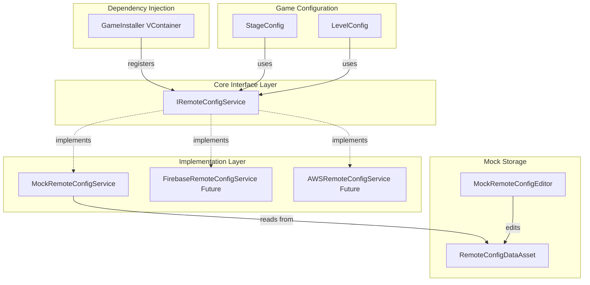
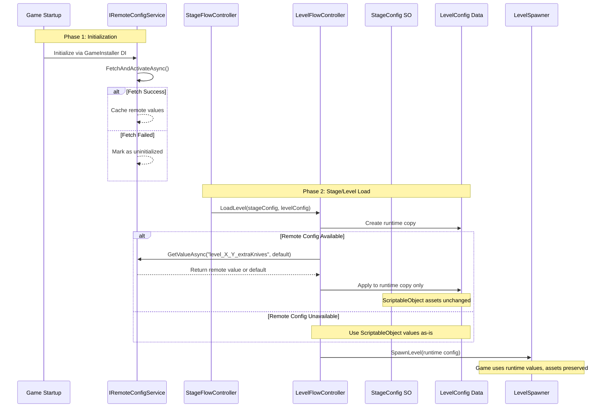

# Remote Configuration System Implementation

## Architecture Overview

The implementation follows the **Adapter Pattern** to decouple game logic from backend providers. The system will support asynchronous configuration fetching with fallback to local Inspector values.

### Component Architecture



### Runtime Fetch & Override Flow



## Phase 1: Core Architecture

### 1.1 IRemoteConfigService Interface

**Location:** `Assets/Scripts/Common/Services/RemoteConfig/IRemoteConfigService.cs`

**Contract:**

- `Task<T> GetValueAsync<T>(string key, T defaultValue)` - Fetch config value with type safety
- `Task<bool> FetchAndActivateAsync()` - Fetch latest config from backend
- `bool IsInitialized { get; }` - Check if service is ready

**Design rationale:** Generic method supports primitives (int, float, bool, string) with automatic type conversion and fallback behavior.

### 1.2 New Directory Structure

Create `Assets/Scripts/Common/Services/RemoteConfig/` for all remote config related code to maintain separation of concerns.

## Phase 2: Mock Implementation & Tooling

### 2.1 RemoteConfigDataAsset (ScriptableObject)

**Location:** `Assets/Scripts/Common/Services/RemoteConfig/MockRemoteConfigDataAsset.cs`

**Purpose:** Persistent storage for mock configuration key-value pairs.

**Structure:**

```csharp
[Serializable]
public class RemoteConfigEntry
{
    public string Key;
    public string Value;  // stored as string, parsed at runtime based on type inference
}

[CreateAssetMenu(...)]
public class MockRemoteConfigDataAsset : ScriptableObject
{
    public List<RemoteConfigEntry> Entries;
}
```

**Type Handling:** Values are stored as strings and automatically parsed to the requested type via `GetValueAsync<T>()`. No enum needed - type is inferred from the generic parameter.

**Storage:** Create default asset at `Assets/Configurations/RemoteConfig/MockRemoteConfigData.asset`

### 2.2 MockRemoteConfigService

**Location:** `Assets/Scripts/Common/Services/RemoteConfig/MockRemoteConfigService.cs`

**Features:**

- Reads from `MockRemoteConfigDataAsset` 
- Simulates network delay (configurable 0-500ms)
- Type conversion with validation
- Caches fetched values in memory
- Thread-safe operations using `UniTask`

**Dependencies:** Requires reference to `MockRemoteConfigDataAsset` injected via constructor

### 2.3 MockRemoteConfigEditor (Editor Window)

**Location:** `Assets/Scripts/Editor/RemoteConfig/MockRemoteConfigEditor.cs`

**Features:**

- Add/Remove configuration keys
- Set value types (int, float, bool, string) via dropdown
- Edit values with type-appropriate controls
- Search/filter keys
- Import/Export JSON functionality
- Visual feedback for changes
- "Create Asset" button if asset doesn't exist

**Menu:** `Tools/Remote Config/Mock Config Editor`

**UI Layout:**

- Header: Asset reference field + Create button
- Toolbar: Add key, Search box
- Main area: Scrollable list of entries
  - Key name (editable)
  - Value field (string input with auto-detection hints)
  - Delete button
- Footer: Save, Import JSON, Export JSON buttons

**Note:** No type dropdown needed - values are stored as strings and parsed based on usage context.

## Phase 3: Integration with Existing Configs

### 3.1 Config Value Override Pattern

**Strategy:** Create runtime copies of config data with remote overrides applied. **CRITICAL: Never mutate the original ScriptableObject assets.**

**Pattern:**

1. Game starts → Remote config fetches values at startup
2. When loading level → Create runtime copy of config data
3. Apply remote overrides to the runtime copy only
4. Use runtime copy for gameplay
5. ScriptableObject assets remain unchanged

### 3.2 StageConfig Integration

**File:** [`Assets/Scripts/Game/Level/Configurations/Stage/StageConfig.cs`](c:\Users\jons1\Documents\Knife-Toss\Assets\Scripts\Game\Level\Configurations\Stage\StageConfig.cs)

**Current structure:** ScriptableObject with `StageName`, `LayoutSettings`, `Levels` (no primitive tuning values identified)

**Integration approach:**

- Currently no primitive tuning values exist in StageConfig
- No changes needed for now - StageConfig remains a pure ScriptableObject
- Future tuning values can be added later if needed

### 3.3 LevelConfig Integration

**File:** [`Assets/Scripts/Game/Level/Configurations/Level/LevelConfig.cs`](c:\Users\jons1\Documents\Knife-Toss\Assets\Scripts\Game\Level\Configurations\Level\LevelConfig.cs)

**Current tunable primitives:**

- `ExtraKnives` (int) - currently inspector-only
- Note: `KnifeCount` is calculated, not directly tunable

**Integration changes:**

LevelConfig is currently `[Serializable]` class, not ScriptableObject, so it's already copied by value. We'll add a static helper method to apply remote overrides to a copy:

```csharp
public static async Task<LevelConfig> CreateWithRemoteOverrides(
    LevelConfig source,
    IRemoteConfigService remoteConfig,
    string stageKey,
    int levelIndex)
{
    // Create a deep copy (implement copy logic)
    var copy = source.DeepCopy();
    
    if (remoteConfig == null || !remoteConfig.IsInitialized)
        return copy;
        
    string key = $"level_{stageKey}_{levelIndex}_extraKnives";
    copy.ExtraKnives = await remoteConfig.GetValueAsync(key, copy.ExtraKnives);
    
    return copy;
}
```

**Key naming convention:** `level_{stageKey}_{levelIndex}_{propertyName}`

- Example: `level_forest_0_extraKnives`

### 3.4 TargetConfig Integration

**File:** [`Assets/Scripts/Game/Entities/Target/Data/TargetConfig.cs`](c:\Users\jons1\Documents\Knife-Toss\Assets\Scripts\Game\Entities\Target\Data\TargetConfig.cs)

**Current tunable primitives:**

- `KnivesToBreak` (int)
- `BaseScale` (float)
- `InitialRotation` (float)

**Integration approach:**

TargetConfig is also `[Serializable]` class. Add static helper for creating override copies:

```csharp
public static async Task<TargetConfig> CreateWithRemoteOverrides(
    TargetConfig source,
    IRemoteConfigService remoteConfig,
    string configKey)
{
    var copy = source.DeepCopy();
    
    if (remoteConfig == null || !remoteConfig.IsInitialized)
        return copy;
        
    copy.KnivesToBreak = await remoteConfig.GetValueAsync(
        $"{configKey}_knivesToBreak", copy.KnivesToBreak);
    copy.BaseScale = await remoteConfig.GetValueAsync(
        $"{configKey}_baseScale", copy.BaseScale);
    copy.InitialRotation = await remoteConfig.GetValueAsync(
        $"{configKey}_initialRotation", copy.InitialRotation);
        
    return copy;
}
```

**Note:** Deep copy implementation needed for nested objects (Behaviors, Collectibles, etc.)

### 3.5 Flow Integration Point

**Location:** Game startup + Level loading

**Two-Phase Approach:**

#### Phase A: Game Startup (GameInstaller/Initialization)

```csharp
// In GameInstaller.Awake() or IStartable
public async void Start()
{
    // Fetch remote config once at startup with timeout
    try 
    {
        await _remoteConfigService
            .FetchAndActivateAsync()
            .Timeout(TimeSpan.FromSeconds(2));
    }
    catch (Exception e)
    {
        Debug.LogWarning($"Remote config fetch failed: {e.Message}");
        // Continue with local values
    }
}
```

#### Phase B: Level Loading (LevelFlowController or LevelLoadingState)

```csharp
// In LoadLevel method
public async void LoadLevel(StageConfig stageConfig, LevelConfig levelConfig)
{
    // Create runtime copy with remote overrides
    var runtimeConfig = await LevelConfig.CreateWithRemoteOverrides(
        levelConfig,
        _remoteConfigService,
        stageConfig.StageName,
        levelIndex);
    
    // Apply to targets as well
    for (int i = 0; i < runtimeConfig.Targets.Count; i++)
    {
        string targetKey = $"level_{stageConfig.StageName}_{levelIndex}_target_{i}";
        runtimeConfig.Targets[i] = await TargetConfig.CreateWithRemoteOverrides(
            runtimeConfig.Targets[i],
            _remoteConfigService,
            targetKey);
    }
    
    // Continue with spawning using runtime config
    _stateMachine.Context.Config = runtimeConfig;
    _stateMachine.SetState(_stateMachine.Loading);
}
```

**Safety measures:**

- Remote config fetched once at startup (not per level)
- 2-second timeout on initial fetch
- All operations use runtime copies, never mutate ScriptableObject assets
- Automatic fallback to ScriptableObject values if service unavailable
- All remote calls wrapped in try-catch

## Phase 4: Dependency Injection Setup

### 4.1 GameInstaller Registration

**File:** [`Assets/Scripts/Game/Installers/GameInstaller.cs`](c:\Users\jons1\Documents\Knife-Toss\Assets\Scripts\Game\Installers\GameInstaller.cs)

**Changes:**

1. Add serialized field: `[SerializeField] private MockRemoteConfigDataAsset _RemoteConfigData;`
2. Register service in `Configure()`:
```csharp
// Remote Config
if (_RemoteConfigData != null)
{
    builder.Register<MockRemoteConfigService>(Lifetime.Singleton)
        .WithParameter(_RemoteConfigData)
        .As<IRemoteConfigService>()
        .AsImplementedInterfaces();
}
```


**Rationale:** Registered in GameInstaller (root scope) so it persists across scenes and is available to all game systems.

### 4.2 Update Common.asmdef

**File:** [`Assets/Scripts/Common/Common.asmdef`](c:\Users\jons1\Documents\Knife-Toss\Assets\Scripts\Common\Common.asmdef)

**Add dependencies:**

- `UniTask` (for async operations)
- `VContainer` (for DI integration)

## Implementation Safety & Constraints

### Fallback Behavior

- **Network failure:** Use Inspector values
- **Parse error:** Use Inspector values  
- **Missing key:** Use defaultValue parameter
- **Timeout:** 2 seconds max wait, then proceed with defaults

### Testing Strategy

1. **Mock Editor**: Test via editor window without network
2. **Runtime Test**: Verify override application during gameplay
3. **Failure Test**: Disconnect asset to ensure fallback works

### Asset References

**Not affected:** Sprites, prefabs, and other asset references remain Inspector-only. Only primitive values (int, float, bool, string) are remotely configurable.

### Future Extensibility

- Swap `MockRemoteConfigService` with `FirebaseRemoteConfigService` by changing registration in GameInstaller
- No game code changes required due to interface abstraction
- Editor window can remain for offline testing

## File Summary

**New files (9 total):**

1. `Common/Services/RemoteConfig/IRemoteConfigService.cs`
2. `Common/Services/RemoteConfig/RemoteConfigEntry.cs` (serializable)
3. `Common/Services/RemoteConfig/MockRemoteConfigDataAsset.cs`
4. `Common/Services/RemoteConfig/MockRemoteConfigService.cs`
5. `Editor/RemoteConfig/MockRemoteConfigEditor.cs`
6. `Configurations/RemoteConfig/MockRemoteConfigData.asset` (asset instance)

**Modified files (5 total):**

1. `Game/Level/Configurations/Level/LevelConfig.cs` (add CreateWithRemoteOverrides + DeepCopy)
2. `Game/Entities/Target/Data/TargetConfig.cs` (add CreateWithRemoteOverrides + DeepCopy)
3. `Game/Flow/Level/LevelFlowController.cs` (apply overrides before loading)
4. `Game/Installers/GameInstaller.cs` (register service + fetch at startup)
5. `Common/Common.asmdef` (add dependencies)

## Testing Instructions (Post-Implementation)

1. **Create mock data:** Use editor window to add test keys
2. **Configure levels:** Add override keys matching convention
3. **Run game:** Verify values are applied from mock service
4. **Test fallback:** Remove asset reference, verify Inspector values are used
5. **Performance:** Verify no noticeable delay during level loading