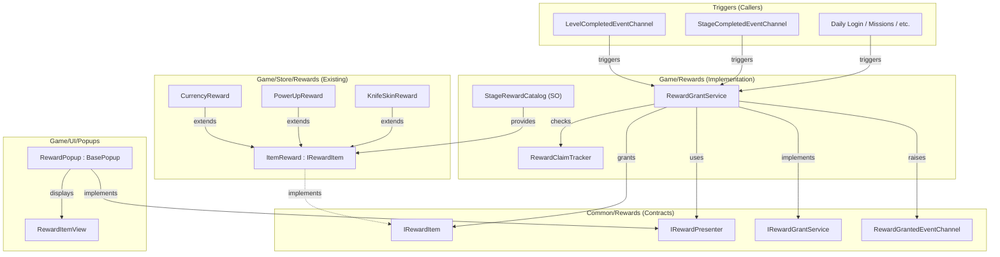

# Reward System Architecture Plan

## Problem

`ItemReward` and its subclasses live in `Game.Store.Rewards`, tightly coupling rewards to the store. Rewards are cross-cutting: they come from level completion, stage completion, daily login, missions, and ads. A separated reward system is needed so all these sources share one granting + presentation pipeline.

## Key Constraint

Moving `ItemReward` to a different namespace would break existing `[SerializeReference]` serialization in `StoreCatalog.asset` and `RewardedPlacement` assets. The plan avoids this by **adding an interface** in Common rather than moving the existing class.

---

## Architecture




---

## Layer 1: Common Reward Contracts (`Assets/Scripts/Common/Rewards/`)

These files define the **contracts** only. Common already references UniTask and VContainer in [Common.asmdef](Assets/Scripts/Common/Common.asmdef).

### `IRewardItem` (new interface)

```csharp
public interface IRewardItem
{
    UniTask GrantAsync(IObjectResolver resolver);
    string DisplayText { get; }
    Sprite Icon { get; }
}
```

- Lives in `Common/Rewards/Interfaces/IRewardItem.cs`
- Existing [ItemReward](Assets/Scripts/Game/Store/Rewards/ItemReward.cs) will implement this interface and gain a `virtual Sprite Icon` property
- Each concrete subclass (`CurrencyReward`, `PowerUpReward`, `KnifeSkinReward`) overrides `Icon` to return the relevant sprite from its config

### `IRewardPresenter` (new interface)

```csharp
public interface IRewardPresenter
{
    UniTask PresentAsync(string title, IReadOnlyList<IRewardItem> rewards);
}
```

- Lives in `Common/Rewards/Interfaces/IRewardPresenter.cs`
- The popup implements this in Game. Any future presenter (toast, HUD animation) can also implement it.

### `IRewardGrantService` (new interface)

```csharp
public interface IRewardGrantService
{
    UniTask GrantAsync(IReadOnlyList<IRewardItem> rewards, string presentationTitle = null);
}
```

- Lives in `Common/Rewards/Interfaces/IRewardGrantService.cs`
- When `presentationTitle` is non-null, the service shows the reward popup after granting
- This is the single entry point any system calls to issue rewards

### `RewardGrantedEventChannel` + `RewardGrantedEventData` (new events)

- `Common/Rewards/Events/RewardGrantedEventChannel.cs` inherits `EventChannel<RewardGrantedEventData>`
- `RewardGrantedEventData` carries a list of display texts (or a snapshot of what was granted)
- Other systems (analytics, HUD animations, missions) can subscribe

---

## Layer 2: Update Existing ItemReward Hierarchy

### [ItemReward.cs](Assets/Scripts/Game/Store/Rewards/ItemReward.cs) (update)

- Add `IRewardItem` implementation
- Add `virtual Sprite Icon => null`
- Rename `GetDisplayText()` to also satisfy `string DisplayText` from the interface (property with getter wrapping the method, or switch to property)

### [CurrencyReward.cs](Assets/Scripts/Game/Store/Rewards/CurrencyReward.cs) (update)

- Override `Icon` to return a sprite. The sprite source needs a reference: add an optional `[SerializeField] Sprite _Icon` field, or resolve it from `CurrencyTypeCatalog`. A simple serialized field is most flexible.

### [PowerUpReward.cs](Assets/Scripts/Game/Store/Rewards/PowerUpReward.cs) (update)

- Override `Icon` to return `Config.Icon` (assuming `PowerUpConfigBase` has one, or add a serialized sprite field)

### [KnifeSkinReward.cs](Assets/Scripts/Game/Store/Rewards/KnifeSkinReward.cs) (update)

- Override `Icon` to return `Config.PreviewSprite` or similar

---

## Layer 3: Reward Configuration (`Assets/Scripts/Game/Rewards/Configs/`)

### `StageRewardCatalog` (new ScriptableObject)

```csharp
[CreateAssetMenu(menuName = "Knife Toss/Systems/Rewards/Stage Reward Catalog")]
public class StageRewardCatalog : ScriptableObject
{
    [field: SerializeField]
    public List<StageRewardEntry> Entries { get; private set; }
}
```

### `StageRewardEntry` (new serializable class)

```csharp
[Serializable]
public class StageRewardEntry
{
    [field: SerializeField] public StageConfig Stage { get; private set; }

    [field: SerializeReference] [field: SerializeReferenceDropdown]
    public List<ItemReward> FirstClearRewards { get; private set; }

    [field: SerializeReference] [field: SerializeReferenceDropdown]
    public List<ItemReward> StageCompleteRewards { get; private set; }
}
```

- Uses direct `StageConfig` references instead of string IDs (follows workspace rule: no IDs)
- `FirstClearRewards`: granted the first time any level within this stage is beaten
- `StageCompleteRewards`: granted once when all levels in the stage are cleared
- `[SerializeReferenceDropdown]` reuses the existing inspector drawer for polymorphic `ItemReward` selection

### Asset location: `Assets/Configurations/Systems/Rewards/StageRewardCatalog.asset`

---

## Layer 4: Persistence (`Assets/Scripts/Game/Persistence/Data/`)

### `RewardClaimData` (new class)

```csharp
[Serializable]
public class RewardClaimData
{
    public List<LevelClaimEntry> ClaimedLevelRewards = new();
    public List<int> ClaimedStageRewards = new();
}

[Serializable]
public class LevelClaimEntry
{
    public int StageIndex;
    public int LevelIndex;
}
```

- Uses indices (not string IDs) to track which level/stage rewards have been claimed
- `ClaimedStageRewards` is a list of stage indices where stage-complete rewards were collected
- `LevelClaimEntry` is a (stageIndex, levelIndex) pair for first-clear tracking

### [PlayerData.cs](Assets/Scripts/Game/Persistence/Data/PlayerData.cs) (update)

- Add field: `public RewardClaimData RewardClaims = new RewardClaimData();`

### [PlayerDataService.cs](Assets/Scripts/Game/Persistence/Services/PlayerDataService.cs) (update)

- Add `EnsureRewardClaimData()` accessor
- Add null-guard in `EnsureDataIntegrity()`

---

## Layer 5: Reward Grant Service (`Assets/Scripts/Game/Rewards/Services/`)

### `RewardGrantService` (new class)

```csharp
public class RewardGrantService : IRewardGrantService
{
    private readonly IObjectResolver _Resolver;
    private readonly IRewardPresenter _Presenter;
    private readonly RewardGrantedEventChannel _GrantedChannel;
    private readonly PlayerDataService _PlayerDataService;

    // Orchestration:
    // 1. Call GrantAsync on each IRewardItem
    // 2. Raise RewardGrantedEventChannel
    // 3. Save via PlayerDataService
    // 4. If title provided, call _Presenter.PresentAsync
}
```

### `RewardClaimTracker` (new class)

```csharp
public class RewardClaimTracker
{
    // Checks and marks claims using RewardClaimData + StageRewardCatalog
    bool IsLevelFirstClearClaimed(int stageIndex, int levelIndex);
    bool IsStageCompleteClaimed(int stageIndex);
    void MarkLevelFirstClearClaimed(int stageIndex, int levelIndex);
    void MarkStageCompleteClaimed(int stageIndex);
}
```

### `StageRewardConnector` (new class, like `StagePersistenceConnector`)

```csharp
public class StageRewardConnector : IInitializable, IDisposable
{
    // Subscribes to LevelCompletedEventChannel and StageCompletedEventChannel
    // On level complete: check if first clear → grant first-clear rewards via RewardGrantService
    // On stage complete: check if first stage complete → grant stage rewards via RewardGrantService
}
```

---

## Layer 6: Reward Popup (`Assets/Scripts/Game/UI/Popups/`)

### Single flexible `RewardPopup` design

One popup handles all reward contexts. Different contexts pass different data.

**Visual layout:**

- Title text (e.g., "Level Complete!", "Stage Cleared!", "Daily Reward")
- Reward items list (vertical layout group)
  - Each item: [Icon] [Display Text] (e.g., coin icon + "+50 COINS")
- "Collect" button at bottom
- Optional future: "Double (Ad)" button

### `RewardPopup : BasePopup` (new class)

```csharp
public class RewardPopup : BasePopup, IRewardPresenter
{
    [SerializeField] private TextMeshProUGUI _TitleText;
    [SerializeField] private Transform _RewardItemsRoot;
    [SerializeField] private RewardItemView _RewardItemPrefab;
    [SerializeField] private Button _CollectButton;

    // Implements IRewardPresenter.PresentAsync
    // Populates reward items from the list
    // Returns UniTask that completes when "Collect" is tapped
}
```

### `RewardItemView` (new MonoBehaviour)

```csharp
public class RewardItemView : MonoBehaviour
{
    [SerializeField] private Image _Icon;
    [SerializeField] private TextMeshProUGUI _Label;

    public void Setup(Sprite icon, string displayText);
}
```

### Do we need multiple/different reward popups?

**No, not initially.** A single `RewardPopup` with parameterized title and reward list is sufficient. Different contexts (first-clear, stage complete, daily login, missions) pass different data. If later a context needs a unique visual treatment (chest-opening animation for stage completion), we can either add a visual mode parameter or subclass `RewardPopup`.

---

## Layer 7: DI Wiring (`Assets/Scripts/Game/Rewards/Installers/`)

### `RewardInstaller`

- Registers `RewardGrantService` as `IRewardGrantService` (Singleton)
- Registers `RewardClaimTracker` (Singleton)
- Registers `StageRewardCatalog` instance
- Registers `RewardGrantedEventChannel` instance
- Stage-scoped: registers `StageRewardConnector` as entry point (in `StageInstaller`)
- Registers `RewardPopup` component as `IRewardPresenter`

---

## New File Tree Summary

```
Assets/Scripts/Common/Rewards/
  Interfaces/
    IRewardItem.cs
    IRewardPresenter.cs
    IRewardGrantService.cs
  Events/
    RewardGrantedEventChannel.cs
    RewardGrantedEventData.cs

Assets/Scripts/Game/Rewards/
  Configs/
    StageRewardCatalog.cs
    StageRewardEntry.cs
  Data/
    RewardClaimData.cs
    LevelClaimEntry.cs
  Services/
    RewardGrantService.cs
    RewardClaimTracker.cs
    StageRewardConnector.cs
  Installers/
    RewardInstaller.cs

Assets/Scripts/Game/UI/Popups/
  RewardPopup.cs
  RewardItemView.cs

Assets/Configurations/Systems/Rewards/
  StageRewardCatalog.asset (created in Unity)
```

## Modified Files

- [ItemReward.cs](Assets/Scripts/Game/Store/Rewards/ItemReward.cs) - implement `IRewardItem`, add `virtual Sprite Icon`
- [CurrencyReward.cs](Assets/Scripts/Game/Store/Rewards/CurrencyReward.cs) - add icon field + override
- [PowerUpReward.cs](Assets/Scripts/Game/Store/Rewards/PowerUpReward.cs) - add icon override
- [KnifeSkinReward.cs](Assets/Scripts/Game/Store/Rewards/KnifeSkinReward.cs) - add icon override
- [PlayerData.cs](Assets/Scripts/Game/Persistence/Data/PlayerData.cs) - add `RewardClaimData` field
- [PlayerDataService.cs](Assets/Scripts/Game/Persistence/Services/PlayerDataService.cs) - add claim data accessor + integrity guard
- [StageInstaller.cs](Assets/Scripts/Game/Installers/StageInstaller.cs) or [GameInstaller.cs](Assets/Scripts/Game/Installers/GameInstaller.cs) - wire reward services

---

## Implementation Order

The order below reflects dependencies: each step builds on the previous.

1. Common interfaces and events (pure contracts, no behavior)
2. Update `ItemReward` hierarchy to implement `IRewardItem` + icon support
3. Persistence additions (`RewardClaimData`, `PlayerData` update)
4. `StageRewardCatalog` configuration ScriptableObject
5. `RewardClaimTracker` service
6. `RewardGrantService` orchestrator
7. `RewardPopup` + `RewardItemView` UI
8. `RewardInstaller` DI wiring
9. `StageRewardConnector` integration with level/stage flow
10. Unity work: create reward popup prefab, create `StageRewardCatalog.asset`, configure per-stage rewards

---

## Unity-Side Work (Instructions, Not Code)

After all scripts are implemented:

- Create a `RewardPopup` prefab with CanvasGroup, Content child, PopupFadeInAnimation, title TextMeshPro, reward list layout group, collect button
- Create `RewardItemView` prefab with Image + TextMeshPro
- Create `StageRewardCatalog.asset` under `Assets/Configurations/Systems/Rewards/`
- Add `StageRewardCatalog` reference to the appropriate installer's serialized fields
- Add `RewardPopup` to the stage scene canvas (starts inactive)
- Wire event channel assets for `RewardGrantedEventChannel`

