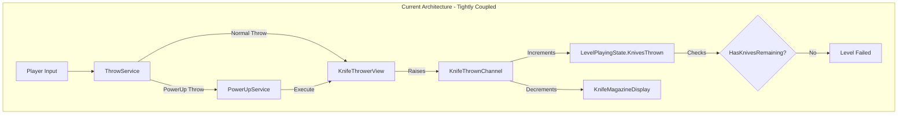
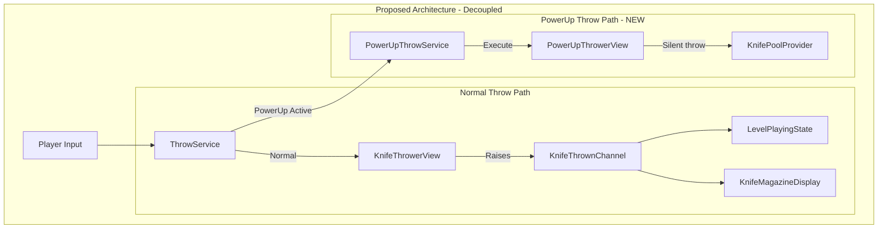
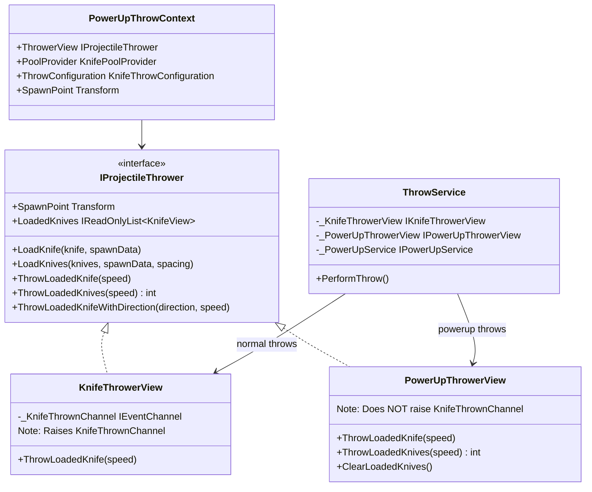
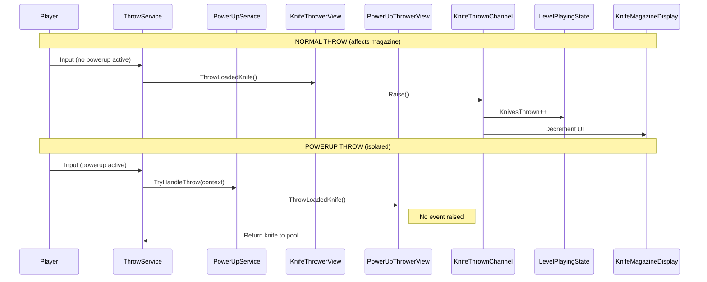

# Separate PowerUp System from Magazine-Based Knife Throwing

## Problem Analysis

The current system tightly couples powerup throws with normal knife throws:




**Core Issues:**

- Both normal and powerup throws use `KnifeThrowerView.ThrowLoadedKnife()` which raises `KnifeThrownChannel`
- `LevelPlayingState` increments `KnivesThrown` on every throw event
- `KnifeMagazineDisplay` decrements for every throw
- Powerup throws consume the limited knife count, causing premature level failure

---

## Proposed Solution Architecture




---

## Detailed Class Architecture




---

## Implementation Strategy

### 1. Extract Common Interface: `IProjectileThrower`

Create a new interface in `Assets/Scripts/Game/KnifeThrower/Interfaces/` that defines the common throwing contract:

```csharp
public interface IProjectileThrower
{
    Transform SpawnPoint { get; }
    IReadOnlyList<KnifeView> LoadedKnives { get; }
    void LoadKnife(KnifeView knife, KnifeSpawnRequestData spawnData);
    void LoadKnives(IReadOnlyList<KnifeView> knives, KnifeSpawnRequestData spawnData, float spacing);
    void ThrowLoadedKnife(float throwSpeed);
    int ThrowLoadedKnives(float throwSpeed);
    void ThrowLoadedKnifeWithDirection(Vector2 direction, float throwSpeed);
}
```

### 2. Create `PowerUpThrowerView`

New MonoBehaviour in `Assets/Scripts/Game/PowerUps/Views/` that:

- Implements `IProjectileThrower`
- Manages its own loaded knives list (separate from magazine)
- Does NOT raise `KnifeThrownChannel` when throwing
- Returns knives to pool after they complete their lifecycle

### 3. Refactor Existing Classes

**[KnifeThrowerView.cs](Assets/Scripts/Game/Entities/Knife/Views/KnifeThrowerView.cs)**

- Implement `IProjectileThrower` (existing interface `IKnifeThrowerView` can extend it)
- Keep existing behavior with `KnifeThrownChannel` event

**[ThrowService.cs](Assets/Scripts/Game/KnifeThrower/Services/ThrowService.cs)**

- Inject `IPowerUpThrowerView` alongside existing `IKnifeThrowerView`
- Route powerup throws to `PowerUpThrowerView`
- Route normal throws to `KnifeThrowerView`
- Remove powerup-specific knife loading from normal throw path

**[PowerUpThrowContext.cs](Assets/Scripts/Game/PowerUps/Data/PowerUpThrowContext.cs)**

- Change `ThrowerView` from `IKnifeThrowerView` to `IProjectileThrower`
- This allows powerups to use the dedicated powerup thrower

### 4. Update PowerUp Configs

The existing powerup configs ([MultipleKnivesConfig](Assets/Scripts/Game/PowerUps/Configs/MultipleKnivesConfig.cs), [SuperKnifeConfig](Assets/Scripts/Game/PowerUps/Configs/SuperKnifeConfig.cs), [KnifeAimConfig](Assets/Scripts/Game/PowerUps/Configs/KnifeAimConfig.cs)) will work unchanged since they use `IProjectileThrower` through the context.

---

## Data Flow: Normal vs PowerUp Throw




---

## Key Files to Modify


| File                                                                | Changes                             |
| ------------------------------------------------------------------- | ----------------------------------- |
| `Assets/Scripts/Game/KnifeThrower/Interfaces/IProjectileThrower.cs` | NEW - Extract common interface      |
| `Assets/Scripts/Game/KnifeThrower/Interfaces/IKnifeThrowerView.cs`  | Extend IProjectileThrower           |
| `Assets/Scripts/Game/PowerUps/Interfaces/IPowerUpThrowerView.cs`    | NEW - PowerUp-specific interface    |
| `Assets/Scripts/Game/PowerUps/Views/PowerUpThrowerView.cs`          | NEW - Isolated powerup throwing     |
| `Assets/Scripts/Game/KnifeThrower/Services/ThrowService.cs`         | Route throws to appropriate thrower |
| `Assets/Scripts/Game/PowerUps/Data/PowerUpThrowContext.cs`          | Use IProjectileThrower              |
| `Assets/Scripts/Game/Installers/PowerUpInstaller.cs`                | Register PowerUpThrowerView         |
| `Assets/Scripts/Game/Installers/StageInstaller.cs`                  | Wire up PowerUpThrowerView          |


---

## Unity Scene Changes Required

After implementing the code changes:

1. Add `PowerUpThrowerView` component to the same GameObject as `KnifeThrowerView` (or a child object)
2. Assign the `SpawnPoint` reference (can share the same spawn point)
3. Wire up the new component in the scene's VContainer scope

---

## Benefits of This Approach

- **Full Separation**: Powerup throws are completely isolated from magazine tracking
- **No Event Pollution**: `KnifeThrownChannel` only fires for magazine knives
- **Backwards Compatible**: Existing level completion/failure logic unchanged
- **Extensible**: Easy to add new powerup types without affecting core throwing
- **Testable**: Each thrower can be unit tested independently
- **Single Responsibility**: Each class has one clear purpose

