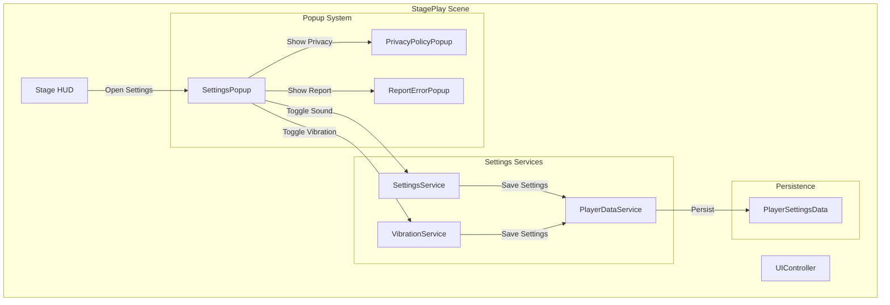
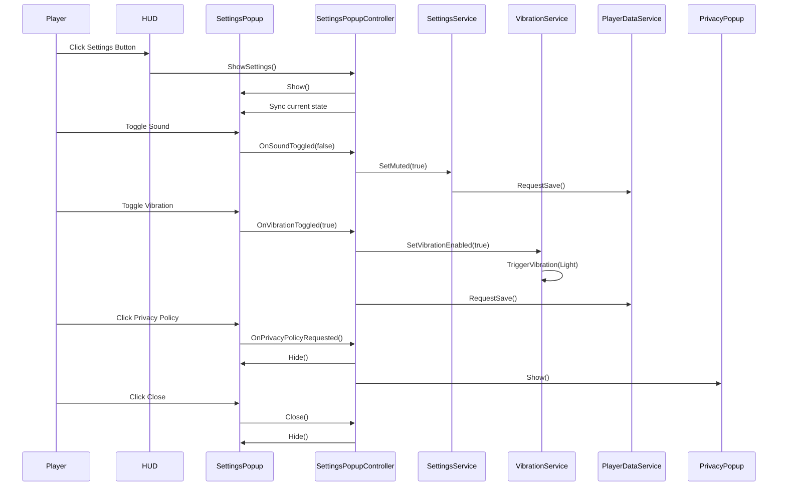

# Settings Menu Popup Implementation Plan

## Overview

Create a comprehensive settings menu popup system for the StagePlay scene that allows players to:

- Toggle sound on/off
- Toggle vibration on/off (Android only)
- View privacy policy
- Report errors

The system will integrate with existing persistence and audio infrastructure while adding new vibration support.

## Architecture



## Key Components

### 1. UI Components

**[`SettingsPopup.cs`](Assets/Scripts/Game/UI/Popups/SettingsPopup.cs)** - Main settings popup:

```csharp
public class SettingsPopup : BasePopup
{
    [SerializeField] private Toggle _SoundToggle;
    [SerializeField] private Toggle _VibrationToggle;
    [SerializeField] private GameObject _VibrationSection;
    [SerializeField] private Button _PrivacyPolicyButton;
    [SerializeField] private Button _ReportErrorButton;
    [SerializeField] private Button _CloseButton;
    
    // Events raised when toggles change
    public event Action<bool> OnSoundToggled;
    public event Action<bool> OnVibrationToggled;
    public event Action OnPrivacyPolicyRequested;
    public event Action OnReportErrorRequested;
}
```

Features:

- Sound toggle with visual feedback
- Vibration toggle (hidden on non-Android platforms)
- Privacy policy button
- Report error button
- Close button to dismiss popup

**[`PrivacyPolicyPopup.cs`](Assets/Scripts/Game/UI/Popups/PrivacyPolicyPopup.cs)** - Privacy policy viewer:

```csharp
public class PrivacyPolicyPopup : BasePopup
{
    [SerializeField] private ScrollRect _ContentScrollRect;
    [SerializeField] private TextMeshProUGUI _PolicyText;
    [SerializeField] private Button _CloseButton;
    
    public void SetContent(string policyText);
}
```

Features:

- Scrollable text area for policy content
- Close button to return to settings
- Configurable content via ScriptableObject or external source

**[`ReportErrorPopup.cs`](Assets/Scripts/Game/UI/Popups/ReportErrorPopup.cs)** - Error reporting interface:

```csharp
public class ReportErrorPopup : BasePopup
{
    [SerializeField] private TMP_InputField _ErrorDescriptionInput;
    [SerializeField] private Button _SubmitButton;
    [SerializeField] private Button _CancelButton;
    [SerializeField] private TextMeshProUGUI _StatusText;
    
    public event Action<string> OnErrorReported;
}
```

Features:

- Multi-line input field for error description
- Submit button with validation
- Cancel button to return to settings
- Status text for feedback (success/error messages)
- Character limit indicator

### 2. Services Layer

**[`VibrationService.cs`](Assets/Scripts/Game/Feedback/Haptics/Services/VibrationService.cs)** - Vibration management:

```csharp
public class VibrationService
{
    public event Action<bool> OnVibrationEnabledChanged;
    
    public bool IsVibrationEnabled { get; private set; }
    public bool IsVibrationSupported { get; }
    
    public void SetVibrationEnabled(bool enabled);
    public void TriggerVibration(VibrationIntensity intensity);
}
```

Features:

- Platform detection (Android only)
- Simple on/off toggle (no intensity settings in menu)
- Vibration intensity controlled programmatically per gameplay event
- State persistence through PlayerDataService
- Event notifications for state changes

**Extended [`SettingsService.cs`](Assets/Scripts/Game/UI/Services/SettingsService.cs)**:

Current implementation only handles mute state. Extend to:

- Integrate with PlayerDataService for persistence
- Coordinate with VibrationService
- Provide unified settings management
```csharp
public class SettingsService
{
    private readonly PlayerDataService _PlayerDataService;
    private readonly VibrationService _VibrationService;
    
    public event Action<bool> OnMuteChanged;
    public bool IsMuted { get; private set; }
    
    public void Initialize();
    public void SetMuted(bool isMuted);
    public void LoadSettings();
    public void SaveSettings();
}
```


**[`SettingsPopupController.cs`](Assets/Scripts/Game/UI/Controllers/SettingsPopupController.cs)** - Popup orchestration:

```csharp
public class SettingsPopupController
{
    private readonly SettingsPopup _SettingsPopup;
    private readonly PrivacyPolicyPopup _PrivacyPopup;
    private readonly ReportErrorPopup _ReportErrorPopup;
    private readonly SettingsService _SettingsService;
    private readonly VibrationService _VibrationService;
    
    public void ShowSettings();
    public void HideSettings();
}
```

Features:

- Manages popup stack (settings -> privacy/report -> back)
- Syncs UI state with service state
- Handles all popup interactions
- Coordinates between popups

### 3. Data Layer

**Extended [`PlayerSettingsData.cs`](Assets/Scripts/Game/Persistence/Data/PlayerSettingsData.cs)**:

```csharp
[Serializable]
public class PlayerSettingsData
{
    public bool IsMuted;
    public bool IsVibrationEnabled = true;
}
```

Persisted through existing [`PlayerDataService`](Assets/Scripts/Game/Persistence/Services/PlayerDataService.cs).

### 4. HUD Integration

**Extended Stage HUD** - Add settings button:

Create or extend existing HUD component with:

- Settings icon button (gear icon)
- Positioned in top-right corner
- Raises event to show settings popup

### 5. Vibration Integration Points

Integrate vibration feedback at key gameplay moments:

- Knife throw (light vibration)
- Knife hit target (medium vibration)
- Level complete (heavy vibration)
- Level failed (medium vibration)

Create vibration feedback services similar to existing audio feedback:

**[`KnifeVibrationFeedbackService.cs`](Assets/Scripts/Game/Feedback/Haptics/Services/KnifeVibrationFeedbackService.cs)**

**[`LevelVibrationFeedbackService.cs`](Assets/Scripts/Game/Feedback/Haptics/Services/LevelVibrationFeedbackService.cs)**

## Data Flow



## File Structure

```
Assets/Scripts/Game/
├── UI/
│   ├── Popups/
│   │   ├── BasePopup.cs (existing)
│   │   ├── StageFailPopup.cs (existing)
│   │   ├── SettingsPopup.cs (new)
│   │   ├── PrivacyPolicyPopup.cs (new)
│   │   └── ReportErrorPopup.cs (new)
│   ├── Controllers/
│   │   ├── UIController.cs (existing - extend)
│   │   └── SettingsPopupController.cs (new)
│   ├── Services/
│   │   └── SettingsService.cs (existing - extend)
│   └── HUD/
│       └── StageHudController.cs (new or extend existing)
├── Feedback/
│   └── Haptics/
│       ├── Services/
│       │   ├── VibrationService.cs (new)
│       │   ├── KnifeVibrationFeedbackService.cs (new)
│       │   └── LevelVibrationFeedbackService.cs (new)
│       ├── Data/
│       │   └── VibrationSettings.cs (new)
│       └── Enums/
│           └── VibrationIntensity.cs (new)
├── Persistence/
│   └── Data/
│       └── PlayerSettingsData.cs (existing - extend)
└── Installers/
    ├── UIInstaller.cs (existing - extend)
    └── StageInstaller.cs (existing - extend)
```

## Implementation Details

### Vibration Implementation (Android)

Use Unity's `Handheld.Vibrate()` API with platform-specific compilation:

```csharp
#if UNITY_ANDROID
    Handheld.Vibrate();
#endif
```

For more control, use Android native plugin:

```csharp
#if UNITY_ANDROID
    AndroidJavaClass unityPlayer = new AndroidJavaClass("com.unity3d.player.UnityPlayer");
    AndroidJavaObject currentActivity = unityPlayer.GetStatic<AndroidJavaObject>("currentActivity");
    AndroidJavaObject vibrator = currentActivity.Call<AndroidJavaObject>("getSystemService", "vibrator");
    vibrator.Call("vibrate", milliseconds);
#endif
```

### Settings Persistence Flow

1. Player changes setting in UI
2. Controller updates service (SettingsService/VibrationService)
3. Service updates runtime state and raises events
4. Service updates PlayerSettingsData through PlayerDataService
5. PlayerDataService persists to disk via FilePlayerDataStore

### Privacy Policy Content

Store policy text in ScriptableObject:

```csharp
[CreateAssetMenu(fileName = "PrivacyPolicyContent", menuName = "Knife Toss/UI/Privacy Policy Content")]
public class PrivacyPolicyContent : ScriptableObject
{
    [TextArea(10, 50)]
    public string PolicyText;
}
```

### Error Reporting

For MVP, implement local logging:

- Save error reports to local file
- Include timestamp, device info, error description
- Future: integrate with backend API or third-party service (Firebase, Sentry)
```csharp
public class ErrorReportService
{
    public void SubmitReport(string description);
    private void SaveLocalReport(ErrorReport report);
}
```


## Installer Integration

**Extended [`UIInstaller.cs`](Assets/Scripts/Game/Installers/UIInstaller.cs)**:

```csharp
public class UIInstaller : IInstaller
{
    private readonly UIController _Controller;
    private readonly StageFailPopup _FailPopup;
    private readonly SettingsPopup _SettingsPopup;
    private readonly PrivacyPolicyPopup _PrivacyPopup;
    private readonly ReportErrorPopup _ReportErrorPopup;
    
    public void Install(IContainerBuilder builder)
    {
        builder.RegisterComponent(_Controller);
        builder.RegisterComponent(_FailPopup);
        builder.RegisterComponent(_SettingsPopup);
        builder.RegisterComponent(_PrivacyPopup);
        builder.RegisterComponent(_ReportErrorPopup);
        builder.Register<SettingsPopupController>(Lifetime.Singleton);
        // ... existing registrations
    }
}
```

**Extended [`GameInstaller.cs`](Assets/Scripts/Game/Installers/GameInstaller.cs)**:

```csharp
protected override void Configure(IContainerBuilder builder)
{
    // ... existing code
    
    // Vibration Service
    builder.Register<VibrationService>(Lifetime.Singleton);
    
    // Extend SettingsService registration
    builder.Register<SettingsService>(Lifetime.Singleton);
}
```

**Extended [`StageInstaller.cs`](Assets/Scripts/Game/Installers/StageInstaller.cs)**:

Add vibration feedback services similar to audio feedback:

```csharp
private HapticsInstaller CreateHapticsInstaller()
{
    return new HapticsInstaller(
        _KnifeThrownEventChannel,
        _KnifeImpactEventChannel,
        _LevelCompletedEventChannel,
        _LevelFailedEventChannel);
}
```

## Unity Scene Setup Instructions

After code implementation:

### StagePlay.unity Modifications

1. **Add Settings Button to HUD**:

   - Create Canvas if not exists
   - Add Button (gear icon) in top-right corner
   - Wire up to UIController or HUD controller

2. **Create Settings Popup Panel**:

   - Add Panel as child of Canvas
   - Set anchors to center, stretch to cover screen
   - Add semi-transparent background overlay
   - Add content panel (white background, rounded corners)
   - Add header text: "Settings"
   - Add Sound toggle with label
   - Add Vibration toggle with label (Android section)
   - Add Privacy Policy button
   - Add Report Error button
   - Add Close button (X icon in top-right)
   - Set initial state to inactive

3. **Create Privacy Policy Popup Panel**:

   - Similar structure to Settings popup
   - Add ScrollRect with TextMeshProUGUI content
   - Add Close button
   - Set initial state to inactive

4. **Create Report Error Popup Panel**:

   - Similar structure to Settings popup
   - Add TMP_InputField (multi-line)
   - Add character count text
   - Add Submit and Cancel buttons
   - Add status text for feedback
   - Set initial state to inactive

5. **Wire Up References**:

   - Assign popup references to UIController
   - Assign button references in popup scripts
   - Create or assign event channels if needed

6. **Configure UIInstaller**:

   - Drag popup GameObjects to StageInstaller inspector
   - Ensure all references are connected

### Asset Creation

1. **Create ScriptableObjects**:

   - `Assets/Configurations/UI/PrivacyPolicyContent.asset`
   - `Assets/Configurations/Feedback/VibrationSettings.asset`

2. **Import UI Icons**:

   - Settings gear icon
   - Close (X) icon
   - Sound on/off icons
   - Vibration icon

## Testing Checklist

- [ ] Settings button appears in StagePlay HUD
- [ ] Settings popup opens/closes correctly
- [ ] Sound toggle mutes/unmutes audio
- [ ] Sound setting persists across sessions
- [ ] Vibration toggle shows only on Android
- [ ] Vibration toggle enables/disables haptics
- [ ] Vibration setting persists across sessions
- [ ] Privacy policy popup opens with scrollable content
- [ ] Privacy policy closes and returns to settings
- [ ] Report error popup opens with input field
- [ ] Error report validates and submits
- [ ] Error report saves locally
- [ ] All popups have proper layering/stacking
- [ ] UI scales properly on different resolutions
- [ ] Settings load correctly on game start

## Future Enhancements

- **Additional Settings**:
  - Music volume slider
  - SFX volume slider
  - Graphics quality options
  - Language selection

- **Error Reporting**:
  - Backend API integration
  - Screenshot attachment
  - Device info auto-collection
  - Email confirmation

- **Vibration**:
  - Custom vibration patterns per event type
  - iOS haptic feedback support with Taptic Engine

- **Privacy Policy**:
  - External URL loading
  - Version tracking
  - Accept/decline flow for first launch

- **Accessibility**:
  - Screen reader support
  - High contrast mode
  - Larger text options
  - Colorblind modes