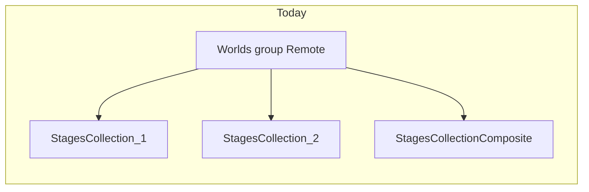
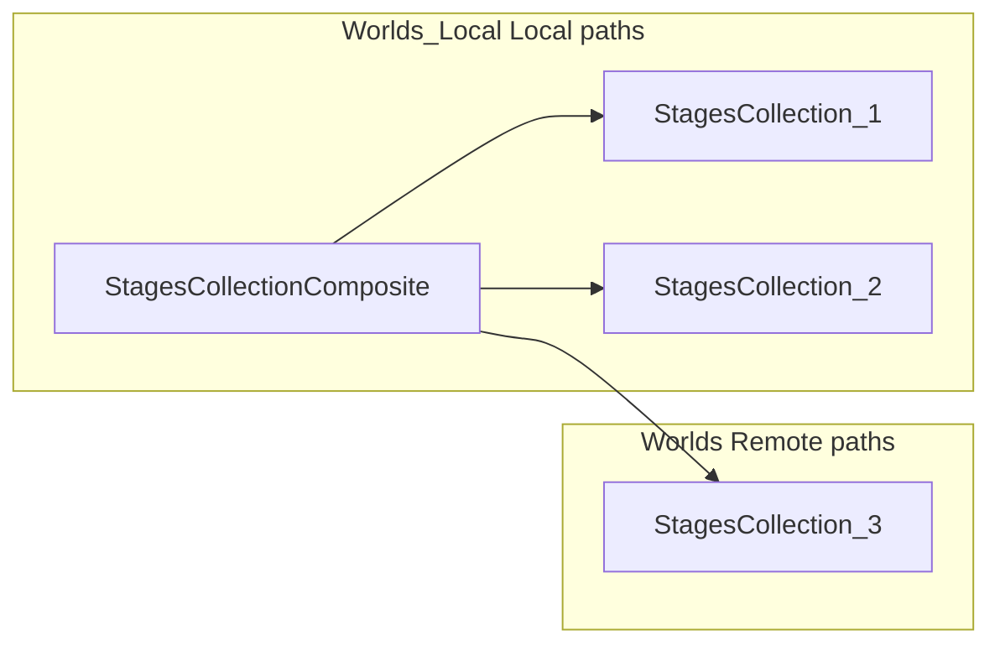

# Split World 1–2 (local build) vs World 3 (remote CDN)

## Goals

- **Worlds 1–2 + composite**: Addressables **local** pathing — bundles ship **inside the player build** (StreamingAssets / packaged catalog path).
- **World 3 only**: Addressables **remote** pathing — bundle built under **`ServerData/[BuildTarget]`**, uploaded to Unity Cloud / CDN, downloaded at runtime when needed.
- Align **[Bundled Asset Group](https://docs.unity3d.com/Packages/com.unity.addressables@latest)** schema choices with **CDN analytics**, **offline behavior**, and **caching** (see glossary below).

## Current state

- Single group **[Worlds](Assets/AddressableAssetsData/AssetGroups/Worlds.asset)** holds `StagesCollection_1`, `StagesCollection_2`, and `StagesCollectionComposite`, all under **[Worlds_BundledAssetGroupSchema](Assets/AddressableAssetsData/AssetGroups/Schemas/Worlds_BundledAssetGroupSchema.asset)** with **Remote** `BuildPath` / `LoadPath`.
- Schema today (**YAML reference**): **`m_IncludeInBuild: 1`**, **`m_UseAssetBundleCache: 1`**, **`m_UseAssetBundleCrc` / `m_UseAssetBundleCrcForCachedBundles: 1`**, **`m_Compression: 1`**, **`m_BundleMode: 0`** (Inspector **Bundle Mode** — default packed behavior for the group), **`m_InternalBundleIdMode: 1`** (stable hashed bundle IDs).
- **[StagesCollectionComposite.asset](Assets/Configurations/Worlds/StagesCollectionComposite.asset)** only references Worlds **1** and **2**; **[StagesCollection_3](Assets/Configurations/Worlds/World3/StagesCollection_3.asset)** exists (`guid` **`f80fd71992597a74b8938fcb8b204fe0`**) but is **not** addressable or listed in the composite yet.

## Target state

- **`Worlds_Local`**: **`Local.BuildPath`** / **`Local.LoadPath`** — same profile variables as **[Default_BundledAssetGroupSchema](Assets/AddressableAssetsData/AssetGroups/Schemas/Default_BundledAssetGroupSchema.asset)**.
- **`Worlds` (remote)**: **`Remote.BuildPath`** / **`Remote.LoadPath`** — **only** World 3 collection (+ dependencies). **`ServerData/Android`** + CDN upload shrink accordingly.

---

## Bundled Asset Group schema — settings glossary (apply per group)

Inspector lives on each group → **Bundled Asset Group** schema. Values below tie to repo YAML field names where useful.

| Inspector area | Meaning / guidance |
|----------------|------------------|
| **Build Path / Load Path** (Pathing) | **Local** → use **`Local.BuildPath`** / **`Local.LoadPath`** (bundles packaged with player). **Remote** → **`Remote.BuildPath`** (disk output for upload) + **`Remote.LoadPath`** (HTTPS prefix baked into catalog). **`Remote.LoadPath`** must be a real URL (not `<undefined>`) when **Build Remote Catalog** is on — see [AddressableAssetSettings.asset](Assets/AddressableAssetsData/AddressableAssetSettings.asset). |
| **Include in Build** (`m_IncludeInBuild`) | If **enabled** on a **remote** group, Unity **also copies** those bundles **into the player build**. Runtime may satisfy loads **without HTTP** to CDN → **Unity Cloud “download” analytics stay near zero** even though content is “remote” on paper. **Recommendation:** **`Worlds_Local`** → **Include in Build ON** (must ship in APK). **`Worlds` remote (W3 only)** → set **OFF** if you want **real CDN downloads** and metrics; **ON** if you want **offline fallback** / first-run without network (APK carries W3 bundle too — larger APK). |
| **Bundle Mode** (`m_BundleMode`) | Controls how entries pack into `.bundle` files (e.g. pack multiple addresses together vs separate bundles — labels vary by Addressables version). After split: prefer **one remote bundle** for W3-only group for simple uploads unless you need finer granularity. |
| **Compression** (`m_Compression`) | LZ4 vs uncompressed (trade APK size / load CPU vs size). Keep consistent with team defaults unless profiling says otherwise. |
| **Use Asset Bundle Cache** (`m_UseAssetBundleCache`) | When **on**, downloaded remote bundles can be **cached on device** — repeat loads often avoid full re-download (Unity still may verify catalog/CRC). Leave **on** unless debugging. |
| **Use Asset Bundle CRC** / **Use CRC for Cached Bundles** | Integrity checks against catalog; slight overhead vs tamper resistance. Typical shipping: **on**. |
| **Internal Bundle Id Mode** (`m_InternalBundleIdMode`) | How bundle internal names/hashes are generated. Project uses hashed mode — avoid changing mid-pipeline without full rebuild + re-upload discipline. |
| **Asset Load Mode** (group / settings) | Usually **Requested Asset And Dependencies** — load requested asset + deps from bundle. |
| **Strip download options** / **Force unique provider** | Advanced; leave defaults unless Unity support/doc recommends changes for your hosting. |

### Build scripts (Editor)

- **Addressables → Build → New Build → Default Build Script** is the usual **packed** full build (local + remote outputs per group pathing). Use this after group/schema/profile changes.
- **Update a Previous Build** / content-update workflows are separate pipelines — not required for the initial local/remote split unless you already rely on content-state builds.

## Profiles vs `AddressableAssetSettings`

- **Manage Profiles** defines **`Remote.BuildPath`**, **`Remote.LoadPath`**, **`Local.*`** — groups reference these by ID.
- **`AddressableAssetSettings`** ([asset](Assets/AddressableAssetsData/AddressableAssetSettings.asset)): **Build Remote Catalog**, catalog **Build & Load Paths** (**Remote** vs Local), **`Remote.LoadPath`** must resolve when remote catalog is built (serialized **`m_Values`** for profile entry **`22d9045e…`** — **not** `<undefined>`).
- After any **`Remote.LoadPath`** change: **New Build** + re-upload remote artifacts so catalog URLs match.

## Runtime behavior (this repo) — caching vs “always download”

- **[AddressableAssetLoader](Assets/Scripts/Common/AssetLoading/Addressables/AddressableAssetLoader.cs)** → **`Addressables.LoadAssetAsync`** — no custom cache layer.
- **[AddressableLoadedAsset](Assets/Scripts/Common/AssetLoading/Addressables/AddressableLoadedAsset.cs)** → **`Dispose`** calls **`Addressables.Release`** — frees handle / refcount; **does not** strip Unity’s **on-disk bundle cache** when **`Use Asset Bundle Cache`** is on.
- **[WorldAssetService](Assets/Scripts/Game/Level/Services/WorldAssetService.cs)**: switching worlds **releases** the previous lease; reloading the **same** index skips reload while lease valid. Repeated loads after release may still hit **cached bundle files** without full network download.

## CDN / Unity Cloud analytics — what “zero downloads” means

- Metrics count **HTTP fetches** to your hosting URLs. If **`Include in Build`** ships the same bundle **inside the APK**, clients often **never** request the remote URL → **downloads ≈ 0** is expected.
- **Catalog / hash** requests may still appear separately from **bundle entry** downloads — check the right dashboard slice.

## Editor testing matrix

| Play Mode Script | Use case |
|------------------|----------|
| **Use Asset Database** | Fast iteration; **no** real bundles / **no** CDN validation. |
| **Use Existing Build** | Validates **packed catalogs + Remote.LoadPath** behavior closest to device (needs **New Build** first). |

---

## Implementation (Unity Editor–first)

Structural changes are safest in **Addressables Groups** UI so GUIDs and schema links stay consistent.

### 1. Create **`Worlds_Local`**

- **Window → Asset Management → Addressables → Groups → Create → Packed Assets**.
- **Bundled Asset Group**: **Build Path / Load Path** = **Local** (mirror **Default** group).
- **Include in Build**: **ON** (built-in worlds must be in player).

### 2. Shrink remote **`Worlds`**

- Remove **`StagesCollection_1`**, **`StagesCollection_2`**, **`StagesCollectionComposite`** from **`Worlds`**.
- Add **`StagesCollection_3`** only.
- Keep **Remote** pathing.
- **Include in Build**: decide **OFF** (CDN-only W3, smaller APK, real download metrics) vs **ON** (offline W3 fallback, larger APK, CDN may show low downloads). Document the choice for publishing.

### 3. Populate **`Worlds_Local`**

- Add **`StagesCollection_1`**, **`StagesCollection_2`**, **`StagesCollectionComposite`** (recommended composite placement — offline menu / list).

### 4. Update **[StagesCollectionComposite.asset](Assets/Configurations/Worlds/StagesCollectionComposite.asset)**

- Third **`AssetReference`** → **`StagesCollection_3`** (drag from Project).
- **`Stage Slot Counts Per World`**: third integer matches World 3 stage count.

### 5. **[GameInstaller.prefab](Assets/Prefabs/GameInstaller.prefab)**

- No reference changes expected — same composite asset; only its **Addressables group** membership moves.

### 6. Build + verify

- **Android** active → **Addressables → New Build**.
- Confirm **local** build output / packaged content includes **`Worlds_Local`** bundles.
- Confirm **`ServerData/Android`** contains **remote catalog + W3 bundle(s)** only (plus whatever Addressables emits for remote catalog).
- Upload remote folder to Unity Cloud.
- **Device / Use Existing Build**: W1/W2 without CDN bundle fetch; W3 triggers remote load when **`Include in Build`** is **OFF** for remote group.
- **`RemoteCompositeLoader`**: composite on **Local** still loads via Addressables from **packaged** catalog — not contradictory.

### 7. Documentation

- Extend **[Addressables-Android-Remote-Worlds.md](Assets/_Docs/Addressables-Android-Remote-Worlds.md)** with: hybrid local/remote groups, **`Include in Build`** vs CDN analytics, pointer to this plan’s glossary, **`Remote.LoadPath`** serialization pitfall.

---

## Code impact

- **None required** for **`WorldAssetService`** / **`RemoteCompositeLoader`** if loading stays **`AssetReference`** / GUID — Addressables resolves **Local vs Remote** per catalog entry.

## Risks / checks

- **`Remote.LoadPath` `<undefined>`** in **[AddressableAssetSettings.asset](Assets/AddressableAssetsData/AddressableAssetSettings.asset)** breaks remote catalog build — fix profile + save project before CI/player builds.
- **`Include in Build`** on remote W3 duplicates bytes (APK + CDN) — intentional trade-off.
- Full **New Build** + **re-upload** after **`Remote.LoadPath`** or bundle-mode changes.
- Avoid orphan schemas if deleting groups — use Unity UI cleanup.
