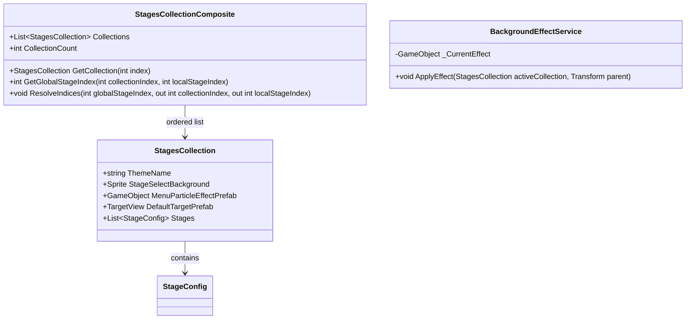

# Stage Collection Theming Architecture

## Current State

- A single [`StagesCollection`](Assets/Scripts/Game/Level/Configurations/Stage/StagesCollection.cs) ScriptableObject holds ALL stages in one flat list
- [`StagesConfigCatalog`](Assets/Scripts/Game/Level/Configurations/Stage/StagesConfigCatalog.cs) wraps it and implements `ILevelCatalog`
- [`MainMenuController`](Assets/Scripts/Game/UI/MainMenu/MainMenuController.cs) reads `StageLayoutSettings.BackgroundSprite` from the current stage to set the main menu background image
- [`StagesMenuController`](Assets/Scripts/Game/UI/Stages/StagesMenuController.cs) and [`StageListController`](Assets/Scripts/Game/UI/Stages/StageListController.cs) iterate all stages from the single collection
- VContainer (DI) is used throughout; `GameInstaller` is the persistent root scope
- A `Background_Leave` particle prefab already exists under `BackgroundEffectHolder` in the MainMenu scene (manually placed)

## Target Architecture



## Scripts to Create

### 1. `StagesCollectionComposite` (ScriptableObject)
**Path:** `Assets/Scripts/Game/Level/Configurations/Stage/StagesCollectionComposite.cs`

- Holds an ordered `List<StagesCollection>`
- Provides `CollectionCount`, `GetCollection(int index)`
- Provides mapping utilities: given a global stage index, resolves which collection and local stage index it maps to (and vice versa)
- The ordering in the list defines the display/progression order of worlds
- `CreateAssetMenu` attribute for easy creation

### 2. `BackgroundEffectService`
**Path:** `Assets/Scripts/Game/Flow/Game/BackgroundEffectService.cs`

- Registered as a singleton in `GameInstaller` (persists across scenes)
- Exposes `ApplyEffect(StagesCollection activeCollection, Transform parent)`
- On call: destroys any existing effect instance, then instantiates the collection's `MenuParticleEffectPrefab` under the given parent
- Does NOT use `DontDestroyOnLoad` on the particle itself -- instead, since the service is a singleton in the persistent `GameInstaller` scope, it tracks the instance reference. The MainMenu scene calls it on Start; when the scene unloads, the effect is destroyed with the scene. When returning to MainMenu, it re-instantiates.
- This avoids `DontDestroyOnLoad` complexity entirely -- the effect lives and dies with the MainMenu scene, and is re-created correctly on every MainMenu load.

**Alternative (if you still want DontDestroyOnLoad):** The service creates a persistent root GameObject once, marks it DontDestroyOnLoad, and parents effects under it. On collection change, it destroys children before instantiating the new effect. I recommend against this because particle effects should not persist into the StagePlay scene.

### 3. `StagesCollectionResolver`
**Path:** `Assets/Scripts/Game/Level/Configurations/Stage/StagesCollectionResolver.cs`

- Pure C# class (no MonoBehaviour) injected via DI
- Takes `StagesCollectionComposite` + `PlayerDataService`
- Provides `GetActiveCollection()` which determines the current collection from the player's global stage index
- Provides `GetActiveCollectionIndex()`
- Used by MainMenuController and StagesMenuController to know which theme to display

## Scripts to Modify

### 4. [`StagesCollection.cs`](Assets/Scripts/Game/Level/Configurations/Stage/StagesCollection.cs) -- Add Theme Fields

```csharp
[Header("Theme")]
[field: SerializeField] public string ThemeName { get; private set; }
[field: SerializeField] public Sprite StageSelectBackground { get; private set; }
[field: SerializeField] public GameObject MenuParticleEffectPrefab { get; private set; }
```

### 5. [`StagesConfigCatalog.cs`](Assets/Scripts/Game/Level/Configurations/Stage/StagesConfigCatalog.cs) -- Accept Composite

- Change constructor to accept `StagesCollectionComposite` instead of a single `StagesCollection`
- Flatten stages across all collections for backward-compatible `ILevelCatalog` interface
- Add `GetCollectionForStage(int globalStageIndex)` method returning the `StagesCollection` that owns a given stage

### 6. [`MainMenuController.cs`](Assets/Scripts/Game/UI/MainMenu/MainMenuController.cs)

- Inject `StagesCollectionResolver` and `BackgroundEffectService`
- In `Start()`, call `BackgroundEffectService.ApplyEffect(activeCollection, backgroundEffectHolder)` where `backgroundEffectHolder` is a serialized Transform reference pointing to the existing `BackgroundEffectHolder` object in the scene
- `UpdateBackground()` now reads from the active collection's `StageSelectBackground` or the stage's `LayoutSettings.BackgroundSprite` (keep existing per-stage background for the main menu image)

### 7. [`StagesMenuController.cs`](Assets/Scripts/Game/UI/Stages/StagesMenuController.cs) and [`StageListController.cs`](Assets/Scripts/Game/UI/Stages/StageListController.cs)

- Change the `_StagesCollection` field to `StagesCollectionComposite`
- Iterate all collections, displaying each as a "world row" with its themed background, title, and grouped stages
- Each world row shows the `StageSelectBackground` sprite as that row's background image (matching the reference image layout)

### 8. [`GameInstaller.cs`](Assets/Scripts/Game/Installers/GameInstaller.cs)

- Add serialized `StagesCollectionComposite` field
- Register `StagesCollectionComposite` as an instance
- Register `StagesCollectionResolver` as singleton
- Register `BackgroundEffectService` as singleton

### 9. [`StageFlowInstaller.cs`](Assets/Scripts/Game/Installers/StageFlowInstaller.cs)

- Change `StagesCollection` parameter to resolve the appropriate collection from `StagesCollectionComposite` using the current stage index
- Or keep `StagesConfigCatalog` wrapping the composite directly (preferred -- single catalog for all stages)

### 10. [`StageInstaller.cs`](Assets/Scripts/Game/Installers/StageInstaller.cs)

- Replace `_StagesConfig` (single `StagesCollection`) with the composite, or resolve from parent scope

## Migration Steps

1. Create the `StagesCollectionComposite` ScriptableObject script
2. Add theme fields to `StagesCollection`
3. In Unity Editor:
   - Create a new `StagesCollectionComposite` asset at `Assets/Configurations/Gameplay/StagesCollectionComposite.asset`
   - Split the current `StagesCollection.asset` (which has 10 stages) into multiple collection assets (e.g., 4 stages each for 2-3 worlds), OR keep the existing one as "World 1" and create new ones for future worlds
   - Assign theme fields (background sprites, particle prefabs) to each collection
   - Wire the composite into `GameInstaller` prefab
4. Update all serialized references from `StagesCollection` to `StagesCollectionComposite` where needed
5. Update the StagesMenu UI to render world rows

## Asset Locations

| Asset | Path |
|-------|------|
| StagesCollectionComposite script | `Assets/Scripts/Game/Level/Configurations/Stage/StagesCollectionComposite.cs` |
| StagesCollectionResolver script | `Assets/Scripts/Game/Level/Configurations/Stage/StagesCollectionResolver.cs` |
| BackgroundEffectService script | `Assets/Scripts/Game/Flow/Game/BackgroundEffectService.cs` |
| Composite asset | `Assets/Configurations/Gameplay/StagesCollectionComposite.asset` |
| Per-world collection assets | `Assets/Configurations/Gameplay/Collections/World1_EnchantedForest.asset`, etc. |

## Risks and Edge Cases

- **Global vs Local Stage Index:** The biggest risk. Currently `GameData.CurrentStageIndex` is a flat index (0-9). After the change, it must map correctly to collection + local index. The `StagesCollectionResolver` handles this mapping. All code reading `CurrentStageIndex` (especially `PlayerDataService` persistence) must still work with the flattened global index to avoid breaking save data.
- **Save Data Migration:** Existing players have a saved "highest stage index" that's a flat number. The composite's flattened ordering must match the old ordering exactly for backward compatibility. Adding new worlds at the end is safe; reordering existing stages would break saves.
- **Missing Prefab/Image:** `BackgroundEffectService.ApplyEffect` should gracefully handle null prefabs (just skip instantiation). Same for null `StageSelectBackground` in the stages menu.
- **No DontDestroyOnLoad on effects:** Since we're NOT using DontDestroyOnLoad, the particle effect is created fresh each time MainMenu loads. This is clean and avoids duplicate/leak issues entirely.
- **Scene Reload:** If the player returns to MainMenu from gameplay, the effect is re-instantiated from the (potentially new) active collection. No stale references.
- **StagesMenu scrolling:** The current scroll-to-current-stage logic assumes a flat list. After grouping into world rows, the scroll logic needs to target the active world row instead.

## Suggestions

- **Keep the global flat index for persistence** -- the composite provides the mapping, but saved data stays as a simple integer.
- **Skip DontDestroyOnLoad for particles** -- particles should only live in the MainMenu scene. Re-instantiating on each visit is simple, correct, and avoids every `DontDestroyOnLoad` pitfall.
- **Future expansion:** The `StagesCollection` theme fields are easily extendable (add audio themes, color palettes, reward chest sprites per world, etc.) without touching the composite or resolver.
- **Consider a world-row prefab** for the StagesMenu that encapsulates: themed background image, world title, horizontal stage list, and world reward chest. Each row is instantiated per collection.
