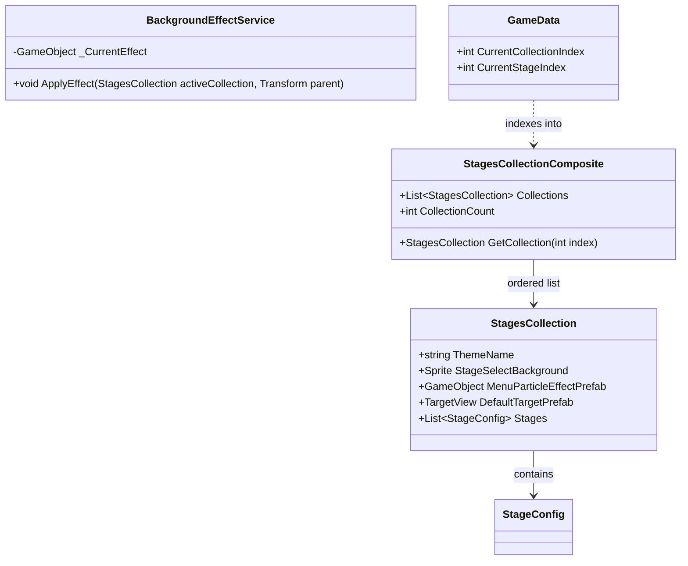

# Stage Collection Theming Architecture

## Current State

- A single [`StagesCollection`](Assets/Scripts/Game/Level/Configurations/Stage/StagesCollection.cs) ScriptableObject holds ALL stages in one flat list
- [`StagesConfigCatalog`](Assets/Scripts/Game/Level/Configurations/Stage/StagesConfigCatalog.cs) wraps it and implements `ILevelCatalog`
- [`MainMenuController`](Assets/Scripts/Game/UI/MainMenu/MainMenuController.cs) reads `StageLayoutSettings.BackgroundSprite` from the current stage to set the main menu background image
- [`StagesMenuController`](Assets/Scripts/Game/UI/Stages/StagesMenuController.cs) and [`StageListController`](Assets/Scripts/Game/UI/Stages/StageListController.cs) iterate all stages from the single collection
- VContainer (DI) is used throughout; `GameInstaller` is the persistent root scope
- A `Background_Leave` particle prefab already exists under `BackgroundEffectHolder` in the MainMenu scene (manually placed)

## Target Architecture

The progression model changes from a single flat list to a two-level hierarchy: **Composite -> Collections -> Stages**. `GameData` stores both `CurrentCollectionIndex` and `CurrentStageIndex` (local to the collection).



## Scripts to Create

### 1. `StagesCollectionComposite` (ScriptableObject)
**Path:** `Assets/Scripts/Game/Level/Configurations/Stage/StagesCollectionComposite.cs`

- Holds an ordered `List<StagesCollection>`
- Provides `CollectionCount`, `GetCollection(int index)`
- The ordering in the list defines the display/progression order of worlds
- `CreateAssetMenu` attribute for easy creation
- No global-to-local index mapping needed -- `GameData` directly stores collection index + local stage index

### 2. `BackgroundEffectService`
**Path:** `Assets/Scripts/Game/Flow/Game/BackgroundEffectService.cs`

- Registered as a singleton in `GameInstaller` (persists across scenes)
- Exposes `ApplyEffect(StagesCollection activeCollection, Transform parent)`
- On call: destroys any existing effect instance, then instantiates the collection's `MenuParticleEffectPrefab` under the given parent
- Does NOT use `DontDestroyOnLoad` on the particle itself -- instead, since the service is a singleton in the persistent `GameInstaller` scope, it tracks the instance reference. The MainMenu scene calls it on Start; when the scene unloads, the effect is destroyed with the scene. When returning to MainMenu, it re-instantiates.
- This avoids `DontDestroyOnLoad` complexity entirely -- the effect lives and dies with the MainMenu scene, and is re-created correctly on every MainMenu load.

**Alternative (if you still want DontDestroyOnLoad):** The service creates a persistent root GameObject once, marks it DontDestroyOnLoad, and parents effects under it. On collection change, it destroys children before instantiating the new effect. I recommend against this because particle effects should not persist into the StagePlay scene.

### 3. `StagesCollectionResolver`
**Path:** `Assets/Scripts/Game/Level/Configurations/Stage/StagesCollectionResolver.cs`

- Pure C# class (no MonoBehaviour) injected via DI
- Takes `StagesCollectionComposite` + `GameData`
- Provides `GetActiveCollection()` which reads `GameData.CurrentCollectionIndex` and returns the matching `StagesCollection`
- Used by MainMenuController and StagesMenuController to resolve the current theme

## Scripts to Modify

### 4. [`StagesCollection.cs`](Assets/Scripts/Game/Level/Configurations/Stage/StagesCollection.cs) -- Add Theme Fields

```csharp
[Header("Theme")]
[field: SerializeField] public string ThemeName { get; private set; }
[field: SerializeField] public Sprite StageSelectBackground { get; private set; }
[field: SerializeField] public GameObject MenuParticleEffectPrefab { get; private set; }
```

### 5. [`StagesConfigCatalog.cs`](Assets/Scripts/Game/Level/Configurations/Stage/StagesConfigCatalog.cs) -- Accept Composite

- Change constructor to accept `StagesCollectionComposite` + `GameData`
- `ILevelCatalog` methods now operate on the **active collection** (resolved via `GameData.CurrentCollectionIndex`)
- `StageCount` returns stages in the active collection only; `GetStageConfig(int stageIndex)` returns from the active collection
- This keeps the interface clean: all stage play logic works within one collection at a time

### 6. [`MainMenuController.cs`](Assets/Scripts/Game/UI/MainMenu/MainMenuController.cs)

- Inject `StagesCollectionResolver` and `BackgroundEffectService`
- Remove old `_StagesCollection` serialized field; use resolver instead
- In `Start()`, call `BackgroundEffectService.ApplyEffect(resolver.GetActiveCollection(), backgroundEffectHolder)` where `backgroundEffectHolder` is a serialized Transform reference
- `UpdateBackground()` reads from the active collection's stage (via `GameData.CurrentStageIndex` within the active collection)

### 7. [`StagesMenuController.cs`](Assets/Scripts/Game/UI/Stages/StagesMenuController.cs) and [`StageListController.cs`](Assets/Scripts/Game/UI/Stages/StageListController.cs)

- Change the `_StagesCollection` field to `StagesCollectionComposite`
- Iterate all collections, displaying each as a "world row" with its themed background, title, and grouped stages
- Each world row shows the `StageSelectBackground` sprite as that row's background image (matching the reference image layout)

### 8. [`GameInstaller.cs`](Assets/Scripts/Game/Installers/GameInstaller.cs)

- Add serialized `StagesCollectionComposite` field
- Register `StagesCollectionComposite` as an instance
- Register `StagesCollectionResolver` as singleton
- Register `BackgroundEffectService` as singleton

### 9. [`StageFlowInstaller.cs`](Assets/Scripts/Game/Installers/StageFlowInstaller.cs)

- Change constructor to accept `StagesCollectionComposite` instead of `StagesCollection`
- Pass composite to `StagesConfigCatalog` registration

### 10. [`StageInstaller.cs`](Assets/Scripts/Game/Installers/StageInstaller.cs)

- Replace `_StagesConfig` (single `StagesCollection`) serialized field with `StagesCollectionComposite`
- Pass composite to `StageFlowInstaller`

### 11. [`GameData.cs`](Assets/Scripts/Game/Flow/Game/GameData.cs)

- Add `CurrentCollectionIndex` property alongside existing `CurrentStageIndex`
- `CurrentStageIndex` becomes local to the active collection (no longer a global flat index)
- Update `Reset()` to zero both

### 12. [`PlayerDataService.cs`](Assets/Scripts/Game/Persistence/Services/PlayerDataService.cs)

- Persist `CurrentCollectionIndex` alongside `CurrentStageIndex`
- `IsStageUnlocked` / `GetHighestStageIndex` work per-collection
- Progression advances through stages within a collection, then moves to the next collection

## Setup Steps (Unity Editor)

1. Create a `StagesCollectionComposite` asset at `Assets/Configurations/Gameplay/StagesCollectionComposite.asset`
2. The existing `StagesCollection.asset` becomes "World 1" -- assign theme fields (name, background sprite, particle prefab)
3. Create additional `StagesCollection` assets for new worlds (World 2, 3, etc.)
4. Add all collections to the composite's list in desired progression order
5. Wire the composite into `GameInstaller` prefab (replace old `StagesCollection` references)
6. Remove the manually-placed `Background_Leave` prefab from the MainMenu scene (the service now handles instantiation)

## Asset Locations

| Asset | Path |
|-------|------|
| StagesCollectionComposite script | `Assets/Scripts/Game/Level/Configurations/Stage/StagesCollectionComposite.cs` |
| StagesCollectionResolver script | `Assets/Scripts/Game/Level/Configurations/Stage/StagesCollectionResolver.cs` |
| BackgroundEffectService script | `Assets/Scripts/Game/Flow/Game/BackgroundEffectService.cs` |
| Composite asset | `Assets/Configurations/Gameplay/StagesCollectionComposite.asset` |
| Per-world collection assets | `Assets/Configurations/Gameplay/Collections/World1_EnchantedForest.asset`, etc. |

## Design Notes

- **No DontDestroyOnLoad on effects:** Particle effects live and die with the MainMenu scene. `BackgroundEffectService` re-instantiates on each MainMenu load -- clean, no duplicates, no leaks.
- **Null safety:** `BackgroundEffectService.ApplyEffect` gracefully skips when prefab is null. Same for null `StageSelectBackground` in stages menu.
- **Per-collection progression:** `GameData` stores `(CurrentCollectionIndex, CurrentStageIndex)`. All stage flow logic (play, complete, advance) operates within a single collection. When the last stage of a collection is completed, progression advances to the next collection.
- **World-row prefab:** The StagesMenu should use a world-row prefab that encapsulates: themed background image, world title, horizontal stage list, and world reward chest. One row is instantiated per collection from the composite.
- **Future expansion:** `StagesCollection` theme fields are easily extendable (audio themes, color palettes, reward chest sprites per world, etc.) without touching the composite or resolver.
