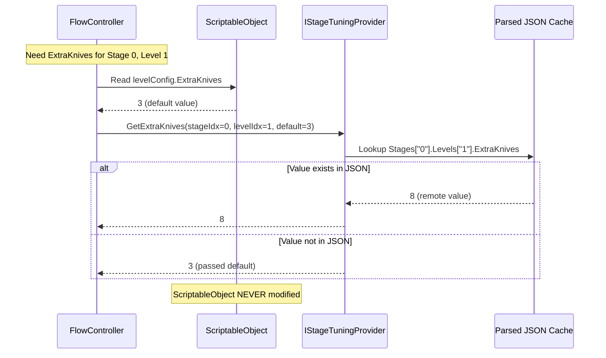

# Stage/Level Tuning Integration

## Overview

This plan integrates the core remote config system with stage and level tuning.

**Prerequisites:** Complete `remote_config_system_f24d3bee.plan.md` first.

**Key Principles:**
- **No deep copy** - ScriptableObjects are never copied or modified
- **Overlay pattern** - Pass default value, get remote value OR default back
- **Hierarchical JSON** - Mirrors game structure (Stages → Levels → Targets)
- **Sparse overrides** - Only specify values you want to change

---

## JSON Structure

```json
{
  "Stages": {
    "0": {
      "Levels": {
        "0": {
          "ExtraKnives": 5,
          "Targets": {
            "0": { "KnivesToBreak": 3, "BaseScale": 1.0, "InitialRotation": 0.0 },
            "1": { "KnivesToBreak": 5, "BaseScale": 1.2 }
          }
        },
        "1": {
          "ExtraKnives": 8
        }
      }
    },
    "1": {
      "Levels": {
        "0": { "ExtraKnives": 12 }
      }
    }
  }
}
```

**Key format:**
- `Stages["0"]` → Stage index 0
- `Levels["0"]` → Level index 0  
- `Targets["0"]` → Target index 0
- **Missing = use ScriptableObject default**

---

## Architecture

```mermaid
graph TB
    subgraph remoteConfig [Remote Config System - From Other Plan]
        IRemoteConfigDataProvider[IRemoteConfigDataProvider]
    end
    
    subgraph tuning [Stage Tuning Layer]
        IStageTuningProvider[IStageTuningProvider]
        StageTuningProvider[StageTuningProvider]
        StageTuningData[StageTuningData Classes]
    end
    
    subgraph consumers [Consumers]
        StageFlow[StageFlowController]
        LevelFlow[LevelFlowController]
    end
    
    subgraph assets [ScriptableObject Assets]
        LevelConfig[LevelConfig]
        TargetConfig[TargetConfig]
    end
    
    IRemoteConfigDataProvider -->|provides JSON| StageTuningProvider
    IStageTuningProvider -.implements.-> StageTuningProvider
    StageTuningProvider -->|parses into| StageTuningData
    
    StageFlow -->|GetExtraKnives(idx, idx, default)| IStageTuningProvider
    LevelFlow -->|GetKnivesToBreak(idx, idx, idx, default)| IStageTuningProvider
    
    LevelConfig -->|default value| StageFlow
    TargetConfig -->|default value| LevelFlow
    
    style IStageTuningProvider fill:#90EE90
    style StageTuningProvider fill:#90EE90
```

---

## Overlay Flow (No Deep Copy)



---

## Phase 1: Data Classes

### 1.1 StageTuningData

**Location:** `Assets/Scripts/Game/Services/Tuning/Data/StageTuningData.cs`

**Purpose:** Strongly-typed classes matching the JSON structure for deserialization.

```csharp
namespace Game.Services.Tuning.Data
{
    /// <summary>
    /// Root container for all stage tuning data from remote config.
    /// </summary>
    [Serializable]
    public class StageTuningRoot
    {
        public Dictionary<string, StageTuningData> Stages;
    }
    
    /// <summary>
    /// Tuning data for a single stage.
    /// </summary>
    [Serializable]
    public class StageTuningData
    {
        public Dictionary<string, LevelTuningData> Levels;
    }
    
    /// <summary>
    /// Tuning data for a single level within a stage.
    /// </summary>
    [Serializable]
    public class LevelTuningData
    {
        public int? ExtraKnives;
        public Dictionary<string, TargetTuningData> Targets;
    }
    
    /// <summary>
    /// Tuning data for a single target within a level.
    /// </summary>
    [Serializable]
    public class TargetTuningData
    {
        public int? KnivesToBreak;
        public float? BaseScale;
        public float? InitialRotation;
    }
}
```

**Design notes:**
- Nullable types (`int?`, `float?`) indicate "not specified in JSON"
- Dictionary keys are strings (`"0"`, `"1"`) matching JSON format
- No enum types per project rules

---

## Phase 2: IStageTuningProvider Interface

### 2.1 Interface Definition

**Location:** `Assets/Scripts/Game/Services/Tuning/IStageTuningProvider.cs`

```csharp
namespace Game.Services.Tuning
{
    /// <summary>
    /// Provides tuned values for stages and levels with remote config overlay.
    /// Pass ScriptableObject default, get remote value or default back.
    /// </summary>
    public interface IStageTuningProvider
    {
        /// <summary>
        /// Whether tuning data has been loaded and parsed successfully.
        /// </summary>
        bool IsReady { get; }
        
        /// <summary>
        /// Gets the tuned ExtraKnives value for a level.
        /// </summary>
        /// <param name="stageIndex">Stage index (0-based).</param>
        /// <param name="levelIndex">Level index within stage (0-based).</param>
        /// <param name="defaultValue">ScriptableObject default value.</param>
        /// <returns>Remote value if exists, otherwise defaultValue.</returns>
        int GetExtraKnives(int stageIndex, int levelIndex, int defaultValue);
        
        /// <summary>
        /// Gets the tuned KnivesToBreak value for a target.
        /// </summary>
        int GetKnivesToBreak(int stageIndex, int levelIndex, int targetIndex, int defaultValue);
        
        /// <summary>
        /// Gets the tuned BaseScale value for a target.
        /// </summary>
        float GetBaseScale(int stageIndex, int levelIndex, int targetIndex, float defaultValue);
        
        /// <summary>
        /// Gets the tuned InitialRotation value for a target.
        /// </summary>
        float GetInitialRotation(int stageIndex, int levelIndex, int targetIndex, float defaultValue);
    }
}
```

**Usage pattern:**

```csharp
// In flow controller - always pass SO value as default
int extraKnives = _tuningProvider.GetExtraKnives(
    stageIndex, 
    levelIndex, 
    levelConfig.ExtraKnives  // SO default
);
```

---

## Phase 3: StageTuningProvider Implementation

### 3.1 Implementation

**Location:** `Assets/Scripts/Game/Services/Tuning/StageTuningProvider.cs`

```csharp
namespace Game.Services.Tuning
{
    /// <summary>
    /// Provides stage/level tuning values with remote config overlay.
    /// Gets JSON directly from IRemoteConfigDataProvider and parses it.
    /// </summary>
    public class StageTuningProvider : IStageTuningProvider, IAsyncStartable
    {
        private readonly IRemoteConfigDataProvider _dataProvider;
        private StageTuningRoot _tuningData;
        private bool _isReady;
        
        public bool IsReady => _isReady;
        
        public StageTuningProvider(IRemoteConfigDataProvider dataProvider)
        {
            _dataProvider = dataProvider;
        }
        
        public async UniTask StartAsync(CancellationToken cancellation)
        {
            await FetchAndParseTuningData();
        }
        
        // ─────────────────────────────────────────────────────────────
        // Public: Getters
        // ─────────────────────────────────────────────────────────────
        
        public int GetExtraKnives(int stageIndex, int levelIndex, int defaultValue)
        {
            var levelData = FindLevelData(stageIndex, levelIndex);
            return levelData?.ExtraKnives ?? defaultValue;
        }
        
        public int GetKnivesToBreak(int stageIndex, int levelIndex, int targetIndex, int defaultValue)
        {
            var targetData = FindTargetData(stageIndex, levelIndex, targetIndex);
            return targetData?.KnivesToBreak ?? defaultValue;
        }
        
        public float GetBaseScale(int stageIndex, int levelIndex, int targetIndex, float defaultValue)
        {
            var targetData = FindTargetData(stageIndex, levelIndex, targetIndex);
            return targetData?.BaseScale ?? defaultValue;
        }
        
        public float GetInitialRotation(int stageIndex, int levelIndex, int targetIndex, float defaultValue)
        {
            var targetData = FindTargetData(stageIndex, levelIndex, targetIndex);
            return targetData?.InitialRotation ?? defaultValue;
        }
        
        // ─────────────────────────────────────────────────────────────
        // Private: Fetch & Parse
        // ─────────────────────────────────────────────────────────────
        
        private async UniTask FetchAndParseTuningData()
        {
            var json = await FetchJsonFromProvider();
            if (string.IsNullOrEmpty(json))
            {
                MarkAsNotReady();
                return;
            }
            
            if (!TryDeserializeJson(json, out StageTuningRoot data))
            {
                MarkAsNotReady();
                return;
            }
            
            CacheTuningData(data);
        }
        
        private async UniTask<string> FetchJsonFromProvider()
        {
            if (_dataProvider == null)
                return null;
            
            return await _dataProvider.FetchJsonAsync();
        }
        
        private bool TryDeserializeJson(string json, out StageTuningRoot data)
        {
            data = null;
            // Use JsonUtility or Newtonsoft.Json
            // Return false on parse error
        }
        
        private void CacheTuningData(StageTuningRoot data)
        {
            _tuningData = data;
            _isReady = true;
        }
        
        private void MarkAsNotReady()
        {
            _tuningData = null;
            _isReady = false;
        }
        
        // ─────────────────────────────────────────────────────────────
        // Private: Lookup Helpers
        // ─────────────────────────────────────────────────────────────
        
        private LevelTuningData FindLevelData(int stageIndex, int levelIndex)
        {
            if (!_isReady || _tuningData?.Stages == null)
                return null;
            
            var stageKey = stageIndex.ToString();
            if (!_tuningData.Stages.TryGetValue(stageKey, out var stageData))
                return null;
            
            if (stageData?.Levels == null)
                return null;
            
            var levelKey = levelIndex.ToString();
            stageData.Levels.TryGetValue(levelKey, out var levelData);
            return levelData;
        }
        
        private TargetTuningData FindTargetData(int stageIndex, int levelIndex, int targetIndex)
        {
            var levelData = FindLevelData(stageIndex, levelIndex);
            if (levelData?.Targets == null)
                return null;
            
            var targetKey = targetIndex.ToString();
            levelData.Targets.TryGetValue(targetKey, out var targetData);
            return targetData;
        }
    }
}
```

**Code organization:**
- Public methods at top (interface contract)
- Private parsing section (clearly labeled)
- Private lookup section (clearly labeled)
- Small, focused methods that tell a story

---

## Phase 4: Dependency Injection

### 4.1 Registration

**File:** `Assets/Scripts/Game/Installers/StageFlowInstaller.cs`

```csharp
public void Install(IContainerBuilder builder)
{
    // Existing registrations...
    
    RegisterTuningProvider(builder);
}

private void RegisterTuningProvider(IContainerBuilder builder)
{
    builder.Register<StageTuningProvider>(Lifetime.Singleton)
        .As<IStageTuningProvider>()
        .AsImplementedInterfaces(); // Includes IAsyncStartable
}
```

**Note:** `StageTuningProvider` implements `IAsyncStartable`, so it fetches and parses JSON automatically at startup.

---

## Phase 5: Flow Controller Integration

### 5.1 Usage in Flow Controllers

Flow controllers inject `IStageTuningProvider` and use it when reading tunable values.

**Example in LevelFlowController:**

```csharp
public class LevelFlowController
{
    private readonly IStageTuningProvider _tuningProvider;
    
    public LevelFlowController(IStageTuningProvider tuningProvider, /* other deps */)
    {
        _tuningProvider = tuningProvider;
    }
    
    private void SetupLevel(int stageIndex, int levelIndex, LevelConfig levelConfig)
    {
        // Get tuned value (remote OR ScriptableObject default)
        int extraKnives = _tuningProvider.GetExtraKnives(
            stageIndex, 
            levelIndex, 
            levelConfig.ExtraKnives
        );
        
        // Use extraKnives...
    }
    
    private void SetupTarget(int stageIndex, int levelIndex, int targetIndex, TargetConfig targetConfig)
    {
        int knivesToBreak = _tuningProvider.GetKnivesToBreak(
            stageIndex, levelIndex, targetIndex,
            targetConfig.KnivesToBreak
        );
        
        float baseScale = _tuningProvider.GetBaseScale(
            stageIndex, levelIndex, targetIndex,
            targetConfig.BaseScale
        );
        
        // Use tuned values...
    }
}
```

**Key points:**
- ScriptableObject is read for its default value
- Default is passed to tuning provider
- Provider returns remote value OR the passed default
- **ScriptableObject is NEVER modified**

---

## File Summary

**New files (4 total):**

| File | Purpose |
|------|---------|
| `Game/Services/Tuning/IStageTuningProvider.cs` | Interface for tuning access |
| `Game/Services/Tuning/StageTuningProvider.cs` | Implementation with JSON parsing |
| `Game/Services/Tuning/Data/StageTuningData.cs` | Data classes for JSON structure |

**Modified files:**

| File | Change |
|------|--------|
| `StageFlowInstaller.cs` | Register `StageTuningProvider` |
| `LevelFlowController.cs` | Inject and use `IStageTuningProvider` |
| `StageFlowController.cs` | Inject and use `IStageTuningProvider` (if needed) |

---

## Testing Instructions

1. Complete core remote config system first
2. Add test JSON to `RemoteConfigData.asset`:

```json
{
  "Stages": {
    "0": {
      "Levels": {
        "0": {
          "ExtraKnives": 99,
          "Targets": {
            "0": { "KnivesToBreak": 1 }
          }
        }
      }
    }
  }
}
```

3. Run game, load Stage 0, Level 0
4. Verify ExtraKnives is 99 (from remote)
5. Verify Target 0 KnivesToBreak is 1 (from remote)
6. Verify Target 1+ uses ScriptableObject defaults (not in JSON)

---

## Advantages

| Benefit | Description |
|---------|-------------|
| ✅ No deep copy | Pass default, get value back |
| ✅ Sparse overrides | Only specify what changes |
| ✅ Type safety | Typed getter methods |
| ✅ Clean separation | Tuning logic isolated from flow |
| ✅ Testable | Mock `IStageTuningProvider` in tests |
| ✅ Firebase ready | Same JSON works in production |
