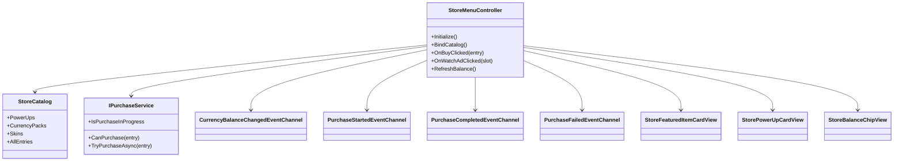
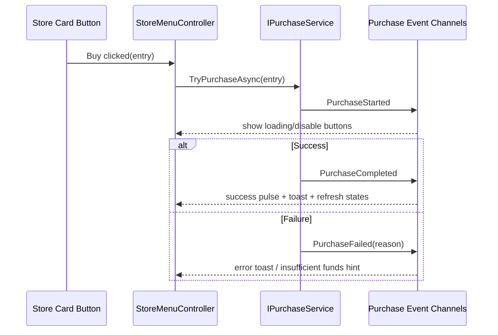

# Store UI Implementation Plan

## Goal

Build a Store scene UI that closely matches the reference image and is fully connected to the new purchase system (`StoreCatalog`, `IPurchaseService`, purchase event channels).

---

## Visual Breakdown From Reference

### Primary Structure (Top to Bottom)

1. **Decorative panel frame**
  - Stone/metal framed container centered on screen.
2. **Top banner title**
  - "STORE" ribbon/header centered.
3. **Top-right currency balance chip**
  - Coin icon + current balance (e.g., `210`).
4. **Featured weapon row (3 cards)**
  - Large vertical cards with weapon art and price button/pill.
5. **Power-up section panel**
  - 4 circular icon cards in a row.
  - Each has a coin price pill.
  - Each has a secondary `Watch Ad +50` button.
6. **Bottom CTA row**
  - Left: wide ad CTA (`Watch Ad to earn +50`).
  - Right: large `CLOSE` button.
7. **Ambient style**
  - Dark fantasy tones, blue highlights, beveled buttons, glow accents.

---

## UI Element Inventory

### A. Scene-Level Containers

- `StoreRoot`
- `StoreFramePanel`
- `StoreContentLayout`
- `TopHeaderRow`
- `FeaturedItemsRow`
- `PowerUpSection`
- `BottomActionsRow`

### B. Reusable Visual Components

- `CoinValuePillView`
  - Coin icon + value label.
- `StoreBalanceChipView`
  - Styled chip for current balance.
- `StoreFeaturedItemCardView`
  - Icon/art, optional glow, price CTA.
- `StorePowerUpCardView`
  - Circular icon, price pill, ad button.
- `StoreAdCtaView`
  - Video icon + label + reward amount.
- `PrimaryButtonView`
  - Used for `CLOSE` and other main actions.

### C. Overlays/Transient UI

- `PurchaseLoadingOverlay`
- `PurchaseToastView` (success/error)
- `InsufficientFundsHint`

---

## Runtime Architecture




---

## Purchase Interaction Flow




---

## Script Architecture

### 1. Scene Controller

- `Assets/Scripts/Game/UI/Store/StoreMenuController.cs`
- Responsibilities:
  - Read and map `StoreCatalog` sections to UI slots.
  - Bind button callbacks (`buy`, `watch ad`, `close`).
  - Gate interactions during `IsPurchaseInProgress`.
  - Subscribe to purchase and currency event channels.
  - Update top balance chip and card affordability state.

### 2. Views

- `StoreFeaturedItemCardView.cs`
  - `Setup(PurchasableEntry entry, Action<PurchasableEntry> onBuy)`
- `StorePowerUpCardView.cs`
  - `Setup(PurchasableEntry buyEntry, Action<PurchasableEntry> onBuy, Action onWatchAd)`
- `StoreBalanceChipView.cs`
  - `SetBalance(int amount)`
- `StoreAdCtaView.cs`
  - `Setup(int rewardAmount, Action onClick)`

### 3. Optional Presentation Helpers

- `StorePurchaseFeedbackPresenter.cs`
  - Centralized logic for loading overlay, toasts, and animations.

---

## Data Mapping Strategy

Use catalog categories directly:

- `CurrencyPacks` -> top featured row (max 3 visible in reference layout).
- `PowerUps` -> lower circular card row (4 visible in reference layout).
- `Skins` -> optional future tab/section (not shown initially).

If entry count exceeds visible slots:

- v1: use first N entries matching layout.
- v2: add horizontal scroll/carousel.

---

## Layout and Responsiveness

### Anchoring Rules

- Root panel centered with fixed max width and height ratio.
- Content sections use vertical layout group with spacing tokens.
- Card rows use horizontal layout + preferred width constraints.

### Aspect Ratio Targets

- Primary target: portrait mobile (reference).
- Support: 16:9 portrait and taller devices.
- Keep bottom action row pinned and never clipped.

### Sizing Tokens (suggested)

- Panel width: ~88% of screen.
- Featured card width: 28-30% each in 3-column row.
- Power-up circle icons: uniform square + circular mask.
- Bottom buttons: ad CTA 60%, close button 35%.

---

## Animation and Feedback Plan

1. **Scene intro**
  - Panel fade/slide in.
  - Stagger featured cards.
2. **Button press**
  - Quick scale down/up.
3. **Successful purchase**
  - Card glow pulse and small coin burst.
4. **Failed purchase**
  - Light shake + message.
5. **In progress**
  - Disable buy controls + spinner overlay.

---

## Dependency Injection and Scene Wiring

Use existing `StoreSceneInstaller`:

- Ensure these references are assigned:
  - `StoreCatalog`
  - `PurchaseStartedEventChannel`
  - `PurchaseCompletedEventChannel`
  - `PurchaseFailedEventChannel`

Extend installer to also register scene UI components:

- `StoreMenuController`
- Optional feedback presenter(s)

Example addition in `StoreSceneInstaller.Configure`:

```csharp
builder.RegisterComponent(_StoreMenuController);
builder.RegisterComponent(_StorePurchaseFeedbackPresenter);
```

---

## Files to Create

### UI Scripts

- `Assets/Scripts/Game/UI/Store/StoreMenuController.cs`
- `Assets/Scripts/Game/UI/Store/StoreFeaturedItemCardView.cs`
- `Assets/Scripts/Game/UI/Store/StorePowerUpCardView.cs`
- `Assets/Scripts/Game/UI/Store/StoreBalanceChipView.cs`
- `Assets/Scripts/Game/UI/Store/StoreAdCtaView.cs`
- `Assets/Scripts/Game/UI/Store/StorePurchaseFeedbackPresenter.cs` (optional but recommended)

### Optional Scene Installer Update

- `Assets/Scripts/Game/Installers/StoreSceneInstaller.cs` (add scene references registration)

### Prefabs

- `Assets/Prefabs/UI/Store/StoreFeaturedItemCard.prefab`
- `Assets/Prefabs/UI/Store/StorePowerUpCard.prefab`
- `Assets/Prefabs/UI/Store/CoinValuePill.prefab`
- `Assets/Prefabs/UI/Store/StoreAdCta.prefab`

---

## Files to Modify

- `Assets/Scripts/Game/Installers/StoreSceneInstaller.cs`
  - Add serialized references for store scene UI components.
  - Register those components in DI.

---

## Implementation Phases

### Phase 1: Skeleton + Static Visual

- Build scene hierarchy and static art placement.
- Match reference spacing and proportions.

### Phase 2: Prefabs + Data Binding

- Build reusable item card prefabs.
- Bind featured and power-up rows from `StoreCatalog`.

### Phase 3: Purchase Integration

- Hook buy buttons to `IPurchaseService`.
- Implement lock states during active purchase.

### Phase 4: Feedback + Polish

- Add events-driven toasts/animations.
- Final pass on responsive behavior.

---

## QA Checklist

### Visual

- Header, balance chip, rows, and bottom actions visually match reference composition.
- No clipping on common portrait resolutions.

### Functional

- Featured item buy deducts currency and grants reward.
- Power-up buy deducts currency and grants inventory.
- Insufficient balance shows clear error feedback.
- Buttons disable while purchase is in progress.
- Close button exits store scene/popup correctly.

### Event Integrity

- Started/completed/failed events map to correct visual feedback.
- Balance chip updates immediately on currency change.

---

## Risks and Notes

- Reference uses custom art-heavy frame/button assets; if missing, temporary placeholders needed.
- Ad flow is UI-only in this phase unless ad service integration is available.
- If more than reference count entries are needed, add pagination/tab strategy in a follow-up plan.

