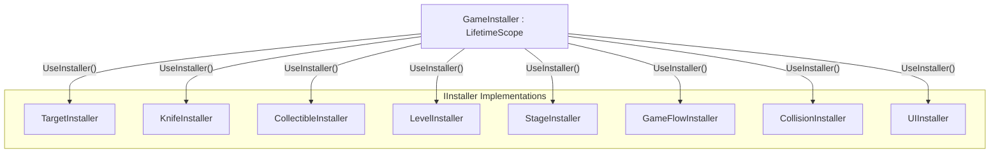

# VContainer IInstaller Refactoring

## VContainer IInstaller Pattern

Each installer implements `IInstaller` interface:

```csharp
public interface IInstaller
{
    void Install(IContainerBuilder builder);
}
```

Installers are wired via `builder.UseInstaller()` extension method.

## Architecture



---

## 1. TargetInstaller

```csharp
public class TargetInstaller : IInstaller
{
    private readonly GameObject _DefaultTargetPrefab;

    public TargetInstaller(GameObject defaultTargetPrefab)
    {
        _DefaultTargetPrefab = defaultTargetPrefab;
    }

    public void Install(IContainerBuilder builder)
    {
        builder.Register<RotationBehaviorFactory>(Lifetime.Singleton);
        builder.Register<TargetFactory>(Lifetime.Singleton)
            .WithParameter(_DefaultTargetPrefab);
    }
}
```

---

## 2. KnifeInstaller

```csharp
public class KnifeInstaller : IInstaller
{
    private readonly KnifeThrowConfigAsset _Config;
    private readonly KnifeThrowerView _View;
    private readonly KnifeImpactEventChannel _ImpactChannel;

    public KnifeInstaller(
        KnifeThrowConfigAsset config,
        KnifeThrowerView view,
        KnifeImpactEventChannel impactChannel)
    {
        _Config = config;
        _View = view;
        _ImpactChannel = impactChannel;
    }

    public void Install(IContainerBuilder builder)
    {
        builder.RegisterInstance(_Config).As<IConfigurationProvider<KnifeThrowConfiguration>>();
        builder.Register<InputAdapter>(Lifetime.Singleton).As<IPlayerThrowInputListener>();
        builder.RegisterEntryPoint<ThrowService>().As<IThrowService>();
        builder.RegisterComponent(_View).As<IKnifeThrowerView>();
        builder.RegisterInstance(_ImpactChannel).As<IEventChannel<KnifeImpactEventData>>();
    }
}
```

---

## 3. CollectibleInstaller

```csharp
public class CollectibleInstaller : IInstaller
{
    private readonly CollectibleHitEventChannel _HitChannel;

    public CollectibleInstaller(CollectibleHitEventChannel hitChannel)
    {
        _HitChannel = hitChannel;
    }

    public void Install(IContainerBuilder builder)
    {
        builder.Register<CollectibleSpawner>(Lifetime.Singleton);
        builder.RegisterInstance(_HitChannel).As<IEventChannel<CollectibleHitEventData>>();
    }
}
```

---

## 4. LevelInstaller

```csharp
public class LevelInstaller : IInstaller
{
    private readonly Transform _LevelRoot;
    private readonly LevelCompletedEventChannel _CompletedChannel;
    private readonly LevelFailedEventChannel _FailedChannel;

    public LevelInstaller(
        Transform levelRoot,
        LevelCompletedEventChannel completedChannel,
        LevelFailedEventChannel failedChannel)
    {
        _LevelRoot = levelRoot;
        _CompletedChannel = completedChannel;
        _FailedChannel = failedChannel;
    }

    public void Install(IContainerBuilder builder)
    {
        builder.Register<LevelSpawner>(Lifetime.Singleton)
            .WithParameter(_LevelRoot)
            .As<ILevelSpawner>();
        builder.Register<LevelData>(Lifetime.Singleton);
        builder.Register<LevelStateMachine>(Lifetime.Singleton);
        builder.RegisterEntryPoint<LevelFlowController>().As<ILevelFlowController>();
        builder.RegisterInstance(_CompletedChannel);
        builder.RegisterInstance(_FailedChannel);
    }
}
```

---

## 5. StageInstaller

```csharp
public class StageInstaller : IInstaller
{
    private readonly StagesConfigAsset _StagesConfig;
    private readonly StageCompletedEventChannel _StageCompletedChannel;
    private readonly ReturnToMenuEventChannel _ReturnToMenuChannel;
    private readonly VoidEventChannel _RetryChannel;
    private readonly VoidEventChannel _RestartChannel;

    public StageInstaller(
        StagesConfigAsset stagesConfig,
        StageCompletedEventChannel stageCompletedChannel,
        ReturnToMenuEventChannel returnToMenuChannel,
        VoidEventChannel retryChannel,
        VoidEventChannel restartChannel)
    {
        _StagesConfig = stagesConfig;
        _StageCompletedChannel = stageCompletedChannel;
        _ReturnToMenuChannel = returnToMenuChannel;
        _RetryChannel = retryChannel;
        _RestartChannel = restartChannel;
    }

    public void Install(IContainerBuilder builder)
    {
        builder.RegisterInstance(_StagesConfig);
        builder.Register<StagesConfigCatalog>(Lifetime.Singleton).As<ILevelCatalog>().AsSelf();
        builder.Register<StageData>(Lifetime.Singleton).WithParameter(0);
        builder.Register(CreateStageStateMachine, Lifetime.Singleton);
        builder.RegisterEntryPoint<StageFlowController>().As<IStageFlowController>();
        builder.RegisterInstance(_StageCompletedChannel);
        builder.RegisterInstance(_ReturnToMenuChannel);
    }

    private StageStateMachine CreateStageStateMachine(IObjectResolver resolver)
    {
        return new StageStateMachine(
            resolver.Resolve<StageData>(),
            resolver.Resolve<ILevelFlowController>(),
            resolver.Resolve<ILevelCatalog>(),
            resolver.Resolve<LevelCompletedEventChannel>(),
            resolver.Resolve<LevelFailedEventChannel>(),
            _StageCompletedChannel,
            _RetryChannel,
            _RestartChannel);
    }
}
```

---

## 6. GameFlowInstaller

```csharp
public class GameFlowInstaller : IInstaller
{
    private readonly GameSettings _Settings;

    public GameFlowInstaller(GameSettings settings)
    {
        _Settings = settings;
    }

    public void Install(IContainerBuilder builder)
    {
        builder.RegisterInstance(_Settings);
        builder.RegisterInstance(CreateLogger()).As<ILogger>();
        builder.Register<GameData>(Lifetime.Singleton);
        builder.Register<GameStateMachine>(Lifetime.Singleton).As<IGameStateMachine>();
        builder.Register(CreateGameFlowController, Lifetime.Singleton).AsImplementedInterfaces();
    }

    private GameFlowController CreateGameFlowController(IObjectResolver resolver)
    {
        return new GameFlowController(resolver.Resolve<IGameStateMachine>());
    }

    private ILogger CreateLogger()
    {
#if TEST_ENV
        ILogHandler handlerBase = new TestEnvLogHandler(...);
        return new Logger(handlerBase) { logEnabled = true };
#else
        return Debug.unityLogger;
#endif
    }
}
```

---

## 7. CollisionInstaller

```csharp
public class CollisionInstaller : IInstaller
{
    private readonly CollisionEventChannel _CollisionChannel;

    public CollisionInstaller(CollisionEventChannel collisionChannel)
    {
        _CollisionChannel = collisionChannel;
    }

    public void Install(IContainerBuilder builder)
    {
        builder.RegisterInstance(_CollisionChannel).As<IEventChannel<CollisionData>>();
        builder.RegisterEntryPoint<CollisionHandlerHandlerRouter>().As<ICollisionHandlerRouter>();
        builder.Register<KnifeHitTargetHandler>(Lifetime.Singleton);
        builder.Register<KnifeHitKnifeHandler>(Lifetime.Singleton);
        builder.Register<KnifeHitCollectibleHandler>(Lifetime.Singleton);
        builder.RegisterEntryPoint<CollisionHandlerRegistrar>();
    }
}
```

---

## 8. UIInstaller

```csharp
public class UIInstaller : IInstaller
{
    private readonly UIController _Controller;
    private readonly StageFailPopup _FailPopup;

    public UIInstaller(UIController controller, StageFailPopup failPopup)
    {
        _Controller = controller;
        _FailPopup = failPopup;
    }

    public void Install(IContainerBuilder builder)
    {
        builder.RegisterComponent(_Controller);
        builder.RegisterComponent(_FailPopup);
    }
}
```

---

## Final GameInstaller

```csharp
public class GameInstaller : LifetimeScope
{
    [SerializeField] private GameSettings _GameSettings;
    [SerializeField] private KnifeThrowConfigAsset _KnifeThrowConfig;
    [SerializeField] private StagesConfigAsset _StagesConfig;
    
    [Header("Event Channels")]
    [SerializeField] private CollisionEventChannel _CollisionEventChannel;
    [SerializeField] private KnifeImpactEventChannel _KnifeImpactEventChannel;
    [SerializeField] private CollectibleHitEventChannel _CollectibleHitEventChannel;
    [SerializeField] private LevelCompletedEventChannel _LevelCompletedEventChannel;
    [SerializeField] private LevelFailedEventChannel _LevelFailedEventChannel;
    [SerializeField] private StageCompletedEventChannel _StageCompletedEventChannel;
    [SerializeField] private ReturnToMenuEventChannel _ReturnToMenuEventChannel;
    [SerializeField] private VoidEventChannel _RetryLevelClickedChannel;
    [SerializeField] private VoidEventChannel _RestartStageClickedChannel;
    
    [Header("Scene References")]
    [SerializeField] private KnifeThrowerView _KnifeThrowerView;
    [SerializeField] private Transform _LevelRoot;
    [SerializeField] private StageFailPopup _StageFailPopup;
    [SerializeField] private UIController _UIController;

    protected override void Configure(IContainerBuilder builder)
    {
        builder.UseInstaller(CreateTargetInstaller());
        builder.UseInstaller(CreateKnifeInstaller());
        builder.UseInstaller(CreateCollectibleInstaller());
        builder.UseInstaller(CreateLevelInstaller());
        builder.UseInstaller(CreateStageInstaller());
        builder.UseInstaller(CreateGameFlowInstaller());
        builder.UseInstaller(CreateCollisionInstaller());
        builder.UseInstaller(CreateUIInstaller());
    }

    private TargetInstaller CreateTargetInstaller()
    {
        return new TargetInstaller(_StagesConfig.DefaultTargetPrefab);
    }

    private KnifeInstaller CreateKnifeInstaller()
    {
        return new KnifeInstaller(_KnifeThrowConfig, _KnifeThrowerView, _KnifeImpactEventChannel);
    }

    private CollectibleInstaller CreateCollectibleInstaller()
    {
        return new CollectibleInstaller(_CollectibleHitEventChannel);
    }

    private LevelInstaller CreateLevelInstaller()
    {
        return new LevelInstaller(_LevelRoot, _LevelCompletedEventChannel, _LevelFailedEventChannel);
    }

    private StageInstaller CreateStageInstaller()
    {
        return new StageInstaller(
            _StagesConfig,
            _StageCompletedEventChannel,
            _ReturnToMenuEventChannel,
            _RetryLevelClickedChannel,
            _RestartStageClickedChannel);
    }

    private GameFlowInstaller CreateGameFlowInstaller()
    {
        return new GameFlowInstaller(_GameSettings);
    }

    private CollisionInstaller CreateCollisionInstaller()
    {
        return new CollisionInstaller(_CollisionEventChannel);
    }

    private UIInstaller CreateUIInstaller()
    {
        return new UIInstaller(_UIController, _StageFailPopup);
    }
}
```

---

## Files to Create

| File | Location |

|------|----------|

| TargetInstaller.cs | `Assets/Scripts/Game/Installers/` |

| KnifeInstaller.cs | `Assets/Scripts/Game/Installers/` |

| CollectibleInstaller.cs | `Assets/Scripts/Game/Installers/` |

| LevelInstaller.cs | `Assets/Scripts/Game/Installers/` |

| StageInstaller.cs | `Assets/Scripts/Game/Installers/` |

| GameFlowInstaller.cs | `Assets/Scripts/Game/Installers/` |

| CollisionInstaller.cs | `Assets/Scripts/Game/Installers/` |

| UIInstaller.cs | `Assets/Scripts/Game/Installers/` |

## Files to Delete

- [InfrastructureInstaller.cs](Assets/Scripts/Game/Installers/InfrastructureInstaller.cs) - unused