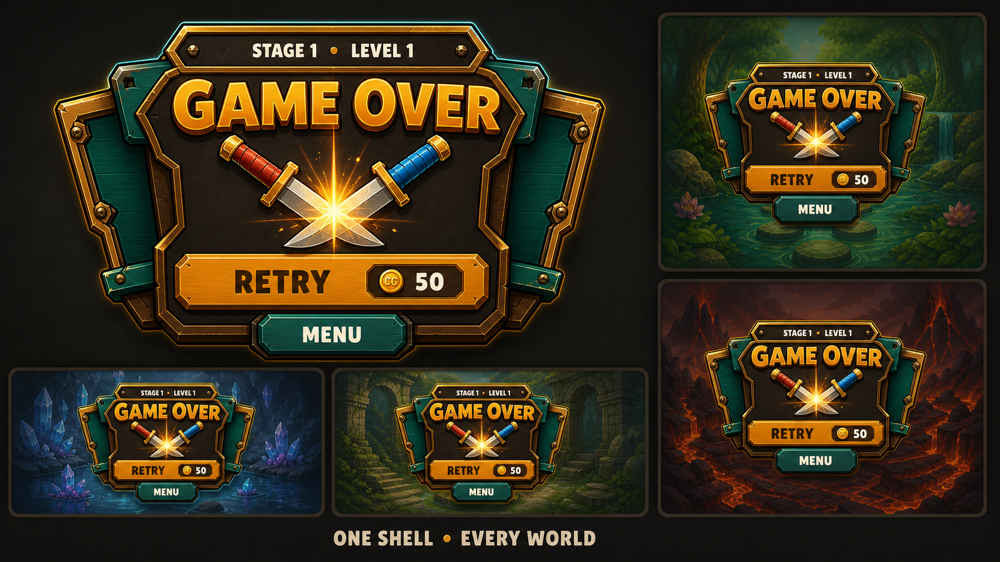
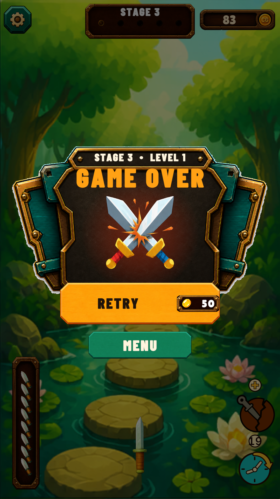

# Phase 5 Failure Popup Reference

## Approved content and behavior contract

The failure popup contains these player-facing elements only:

- `STAGE {n} • LEVEL {n}` from authoritative live stage data.
- `GAME OVER`.
- The crossed-knives collision animation and impact glow.
- `RETRY` with the configured live coin cost.
- `MENU`.

There is no failure-description sentence, `Knife Collision` label, `Start Over` action,
second retry action, or decorative copy. Retry is not free: it raises the existing paid-retry
request, spends the configured per-level coin cost through the existing currency transaction,
and reloads only after that transaction succeeds. Menu returns to Main Menu.

## Approved world-neutral art direction

`Captures/FAIL502_NeutralPopupConcept.png` is the product-owner-selected direction from
2026-08-16. It supersedes the earlier tall parchment popup and every forest-specific popup
exploration. The first, large concept on the board is the source of truth.

The reusable popup shell must not inherit a gameplay world's scenery. It contains no leaves,
vines, flowers, roots, lava, fire, water, shells, crystals, snow, or other biome identity. The
same shell is intended to sit unchanged over Verdant Forest, Ember Peaks, Crystal Lagoon, and
Elder Grove. World identity remains in the dimmed gameplay behind the modal.

The shell instead follows the completed Main Menu and Store language:

- Compact layered shield silhouette rather than a tall rectangular frame.
- Dark charcoal/leather center surface with offset deep-teal side plates.
- Warm gold/brass bevels, rivets, crisp dark outlines, and restrained cyan edge light.
- Bold live cream/orange typography.
- Orange/gold primary action and teal secondary action.
- Energy from silhouette, overlap, scale, glow, and motion rather than biome decoration.

## Implemented Unity composition

The production result is assembled in `Assets/Scenes/StagePlay.unity` while retaining the
`Assets/Prefabs/UI/PopupTemplate.prefab` link. The former `popup_frame.png` visual is no longer
used by StageFailPopup.

The new shell source is
`Assets/Art/UI/Failure/NeutralGameOverShell_Source.png`. It was generated with the built-in
image-generation workflow from the approved concept plus the final Main Menu and Store
screens. The generator returned the neutral preview checker as RGB pixels instead of alpha,
so production uses `Assets/Shaders/UI/GeneratedCheckerboardKey.shader` through
`Assets/Art/UI/Failure/NeutralGameOverShell.mat` to recover transparent exterior pixels while
preserving the colored shell and its soft shadow. The shader is local to this generated source;
shared production sprites are not modified.

All wording remains live Unity UI rather than baked artwork:

- Stage/level and `GAME OVER` use `BarlowCondensed-ExtraBold SDF`.
- The shared `Assets/Prefabs/UI/Buttons/FailureActionButton.prefab` owns hit area, press/state
  presentation, motion, and its live label.
- Retry uses the approved compound surface at
  `Assets/Art/UI/Failure/FailureRetryButton_Source.png`: thick charcoal backing, gold/brass
  bevels, a dimensional orange face, and a built-in dark cost pocket.
- Menu uses `Assets/Art/UI/Core/ButtonSecondary.png` with a darker teal tint.
- Retry still nests the existing `Assets/Prefabs/UI/Store/PricePillView.prefab`, but its duplicate
  fill and border layers are hidden so only the shared live coin icon and amount occupy the
  surface's integrated pocket. The cost remains a runtime value rather than a baked `50`.

The action collection is permanently bounded to Retry and Menu, so pooling or virtualization
does not apply. Both instances retain their shared prefab link and 48 dp touch-target padding.

## Knife motion and liveliness

The accepted crossed-knives animation remains in
`Assets/Art/UI/Failure/FailureKnivesAnimation.png` as sixteen ordered 512×512 frames. The two
knives approach independently, collide, play the orange impact, and hold the final pose. It
runs on unscaled time after a 0.08-second delay at 0.028 seconds per frame. The detailed frame
recipe remains in `FAIL502_KnifeAnimationProduction.md`.

The shell is revealed by the existing popup transition. Progress, title, impact glow, knives,
Retry, and Menu use staggered `UiElementAnimator` presentation. Only the glow, knives, and
primary action receive restrained settled heartbeat motion; the shell itself stays stable for
readability.

## Validation evidence

- `Captures/FAIL502_NeutralShell_FirstPass.png` records the initial integration review that
  exposed a checker-alpha halo and an incorrectly high progress label. Both were corrected.
- `Captures/FAIL502_NeutralShell_Implemented.png` records the corrected Play Mode composition
  with live `STAGE 3 • LEVEL 1`, `GAME OVER`, paid Retry cost `50`, Menu, and the neutral shell.
- `Captures/FAIL502_NeutralShell_Motion.mp4` records the initial neutral-shell integration before
  the Retry visual redesign. Its 90 source frames established the popup/knife motion baseline.
- `Captures/FAIL502_RetryButton_Redesign_Final.png` records the corrected compound Retry CTA:
  large live label, integrated live price, no duplicate pill frame, and no white extraction halo.
- `Captures/FAIL502_RetryButton_Redesign_Motion.mp4` is the updated three-second, 1080×1920,
  30 fps/90-frame Play Mode recording. Contact-sheet review confirms the larger CTA enters and
  settles without clipping, texture crawl, or layout wobble while the knife impact still advances.
- `Tools/Toss Madness/UI/Validate Approved Failure Popup` verifies the shell/material,
  authoritative live labels, no legacy baked failure atlas, two shared action-prefab instances,
  shared price-pill link, ordered knife frames, input-safe glow, paid-retry channel, installer
  recovery bindings, and PopupTemplate link.
- `StageFailPopupProductionTests` covers the same scene/prefab contract plus one-based progress,
  configured cost presentation/spend, duplicate-input protection, and knife frame order/final
  hold.
- The complete EditMode run passed 195/195 tests after the final neutral-shell integration.

## Generated-art provenance

The approved concept board was generated from the direction: create several polished mobile
Game Over popup references that match Toss Madness Main Menu and Store art, stay neutral across
all gameplay worlds, and show only live stage/level, `GAME OVER`, crossed knives, paid Retry,
and Menu. The product owner selected the first, large concept. Its original generator output was
`exec-d0577462-13e6-4f98-bd33-d60c7a69fb9f.png`; the project copy is
`Captures/FAIL502_NeutralPopupConcept.png`.

The production shell was generated from the selected concept with the direction: isolate the
compact charcoal, teal, and gold popup shell as a clean front-facing UI asset; preserve the
layered shield silhouette, bevels, rivets, cyan rim light, inner surface, and soft shadow; remove
all text, buttons, knives, currency, gameplay scenery, and biome motifs. The final generator
output was `exec-af9629c5-39db-4c51-9cdd-3e76e40992e3.png`; the project source is
`Assets/Art/UI/Failure/NeutralGameOverShell_Source.png`.

The Retry surface was generated from the selected large concept with the direction: isolate one
front-facing compound Retry button in the same painterly arcade style; use a thick charcoal outer
backing, gold/brass beveled trim, vivid orange face, and an empty dark inset cost pocket; leave a
large blank label area; include no text, number, coin, popup shell, scenery, or biome motif. The
built-in generator output was `exec-17b55639-4634-4aa7-a722-9e1c24585c37.png`. The production
copy was tightly cropped and its generated neutral preview pixels were converted to true alpha at
`Assets/Art/UI/Failure/FailureRetryButton_Source.png`; all wording and price content remain live.

All project-bound outputs are stored under `Assets/Art/UI/Failure` and
`Assets/_Docs/Phase5VisualAudit/Captures`; no runtime asset depends on a file outside the
repository.
