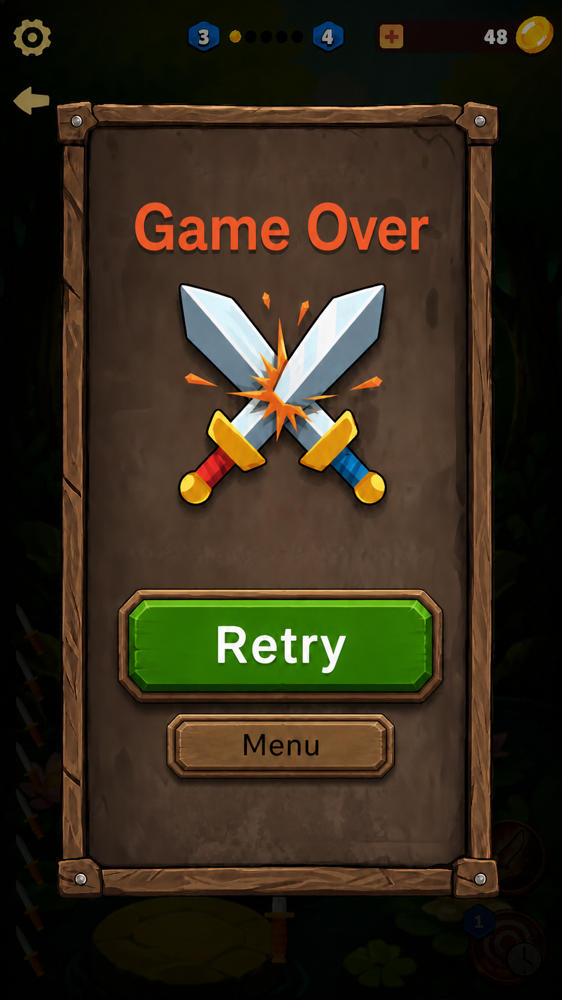
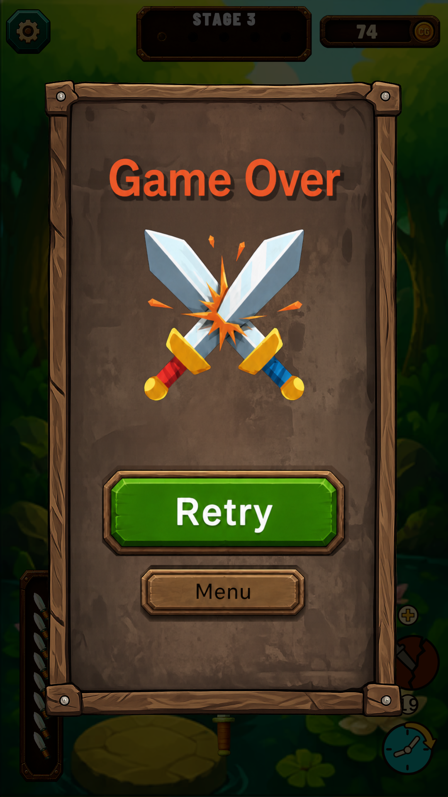

# Phase 5 Failure Popup Reference

## Approved content contract

The failure popup contains exactly these player-facing strings:

- `Game Over`
- `Retry`
- `Menu`

It contains no failure description, `Knife Collision` label, stage/level text, Continue
price, ad offer, currency offer, Start Over action, or other recovery copy. The collision
cause must already be understandable from the gameplay impact beat before the popup settles.

## Approved target-art reference

`Captures/FAIL502_GameOverTarget.png` is the product-owner-approved visual target. It was
created on 2026-08-15 by precisely editing the supplied preferred popup image with the
built-in image-generation editor. The edit removed the stage/level line, `Knife Collision`,
the explanatory sentence, and Start Over; it retained the approved composition, crossed
knives, Retry treatment, Menu treatment, frame, HUD context, palette, and rendering style.

The target preserves the project's established visual language:

- Tall carved-wood/parchment failure shell over interrupted gameplay.
- Large orange `Game Over` heading with a dark offset shadow.
- Crossed-knives collision illustration with the orange impact burst.
- Large framed green Retry button.
- Smaller framed brown Menu button directly below Retry.

This is the visual source of truth, not a license to approximate the style. Production uses
the existing project popup frame plus direct pixel extractions from this approved target for
the title, knives/impact, Retry, and Menu art. Behavior remains in the popup binding/controller
and the two actions retain their shared prefab owner.

## Implemented Unity result

The approved popup was implemented in `Assets/Scenes/StagePlay.unity` on 2026-08-15.
The settled hierarchy contains exactly `Game Over`, `Retry`, and `Menu`. The existing project
popup frame remains in use. `Assets/Art/UI/Failure/FailurePopupAtlas.png` contains four
transparent sprites extracted directly from the approved target pixels: `GameOverTitle`,
`CrossedKnives`, `RetryButtonArt`, and `MenuButtonArt`. There is no substitute runtime font,
redrawn button, recolor, or generated frame. `RetryButton` and `MenuButton` are connected nested instances of
`Assets/Prefabs/UI/Buttons/FailureActionButton.prefab`; the popup remains connected to
`Assets/Prefabs/UI/PopupTemplate.prefab`. The collection is permanently bounded to these two
actions, so runtime pooling or virtualization is not applicable.

The final atlas was produced by deterministic extraction from
`Captures/FAIL502_GameOverTarget.png`. An earlier generated atlas approximation was rejected
and is not retained as a project asset. The existing popup frame is intentionally excluded
from the atlas because the repository already owns that component.

The collision illustration now has a one-shot, sixteen-frame entrance stored at
`Assets/Art/UI/Failure/FailureKnivesAnimation.png`. Two separated knife layers provide real
independent approach and rotation before the direct approved collision art takes over. Frames
14–16 are unmodified copies of the approved source pose. The animation runs on unscaled time
after a 0.08-second delay, advances every 0.028 seconds, and then holds frame 16. The knife
element's supporting scale-in was shortened from 0.38 to 0.18 seconds so the beat reads as a
hit instead of a slow zoom.
The source coordinates, frame recipe, generation attempt, and integration contract are
recorded in `FAIL502_KnifeAnimationProduction.md`.

Runtime behavior is owned by `StageFailPopup`: Retry raises the authoritative current-level
retry channel once, and Menu uses `SceneLoaderService.LoadMainMenu()`. The obsolete Start Over,
Continue, price/ad, and failure-recovery spend presentation and serialized installer bindings
were removed. Existing currency and advertising systems outside this popup remain unchanged.

## Validation evidence

- `Captures/FAIL502_GameOverFlow.mp4` records and inspects the real Play Mode sequence from an
  intentional knife collision through transition and the settled input-ready popup.
- `Captures/FAIL502_GameOverMotion.mp4` records and inspects the final unscaled-time entrance:
  panel pop, title/impact settle, staggered Retry/Menu reveal, and restrained Retry heartbeat.
- `Captures/FAIL502_KnifeSpriteAnimation.mp4` records the sixteen-frame knife impact running in
  the real popup and settling on the approved final pose.
- A real pointer click on Retry reloaded the current level; duplicate Retry input was rejected.
- A real pointer click on Menu reached Main Menu.
- `StageFailPopupProductionTests` covers the direct-reference title/actions, sixteen ordered
  knife frames, no-substitute-typography/four-animation-owner/prefab contract, frame-order and
  final-hold behavior, and one authoritative retry for duplicate input. All three focused tests
  passed on 2026-08-16.
- `Tools/Toss Madness/UI/Validate Approved Failure Popup` passed the scene reference, exact-copy,
  two-button, nested-prefab, and popup-template checks.
- Unity compiled cleanly, the scene was saved/not dirty, and the final Console had no errors.

This closes FAIL-502 and FAIL-503. FAIL-501 remains separate: it owns the broader production
collision-feedback pass, not the already-approved popup content or recovery behavior.
