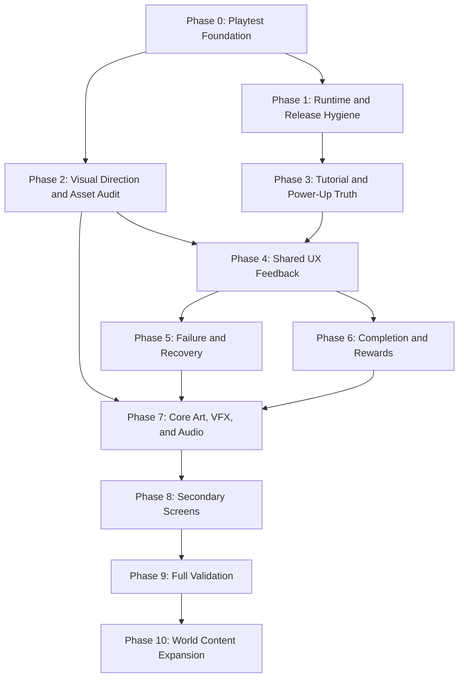

# Toss Madness Core Gameplay Refinement Phases

Last updated: 2026-08-08

Live execution status: [Core Gameplay Refinement Tracker](CORE_GAMEPLAY_REFINEMENT_TRACKER.md)

## Objective

Build a coherent, satisfying, and technically reliable core vertical slice before scaling
campaign content. The sequence protects the fast arcade loop while improving everything
that communicates, rewards, and presents it.

This roadmap complements rather than replaces:

- [Game Design Document](GAME_DESIGN_DOCUMENT.md)
- [First 10 Minutes Design Pass](FIRST_10_MINUTES_DESIGN_PASS.md)
- [Phase 1 Opening Flow Execution](PHASE_1_OPENING_FLOW_EXECUTION.md)
- [Stage Collection Theming Setup](Assets/_Docs/StageCollectionTheming-Setup.md)

## Planning Principles

1. **Preserve immediacy.** Feedback may enrich the loop but should not turn every target
   into a modal interruption.
2. **Prove mechanics and player journeys separately.** Cheats are appropriate for mechanic
   QA; clean-save acquisition remains a distinct product test.
3. **Fix systems before multiplying content.** Shared feedback and art standards should be
   stable before they are copied across worlds and screens.
4. **Art direction comes before art volume.** Audit and approve a visual target early;
   produce only the core vertical slice until it is coherent.
5. **Gameplay readability outranks decoration.** Target, knife, collision hazards, and
   collectibles must remain legible above background, UI, and VFX.
6. **No invisible release debt.** Test symbols, debug UI, duplicate runtime systems, mock
   services, and placeholder content require explicit gates.
7. **Evidence closes phases.** Every phase ends with real-input validation and recorded
   results, not only an implementation claim.

## Dependency Flow

## Phase 0 - Repeatable Playtest Foundation

### Goal

Make gameplay observable and repeatable through the connected Unity Editor while preserving
the real input, collision, UI, progression, and persistence paths.

### Scope

- Unity MCP connection.
- Editor-only gameplay telemetry.
- Real UI clicks and gameplay taps through Unity's Input System.
- Live target/knife timing calculation for successful throws and intentional failure.
- Save-state capture and restoration discipline.
- Document the foreground/framerate constraint for timing validation.

### Non-goals

- Automated gameplay callbacks.
- Editing runtime values to manufacture success or failure.
- Replacing real-device testing.

### Deliverables

- `GameplayPlaytestHarness`.
- Harness usage documentation.
- Successful Stage 1 playthrough, intentional failure, and restart evidence.

### Exit Criteria

- Safe throws and an intentional collision can be produced through real input.
- Failure and restart use the visible UI.
- Telemetry explains when and why the input was scheduled.
- Compilation is clean.
- Test save mutations are restored.

## Phase 1 - Runtime Transition and Release Hygiene

### Goal

Remove technical noise and release-risk artifacts before presentation work makes transition
problems harder to diagnose.

### Scope

- Map persistent versus scene-owned cameras, EventSystems, input modules, and AudioListeners.
- Choose one EventSystem ownership model.
- Fix preload/reveal/unload order so duplicate systems never become active together.
- Verify hidden gameplay scenes cannot consume pointer input.
- Define development, QA, and production build profiles.
- Exclude SRDebugger, cheats, mock services, diagnostic overlays, and test symbols from
  production builds.
- Add an automated forbidden-content validation for release builds.

### Implemented Technical Direction

Scene-local ownership remains because most navigation uses clean single-scene loads and the
Store overlay intentionally reuses MainMenu authority. The exceptional additive StagePlay
preload now disables incoming authorities before normal enable order, suspends MainMenu
before reveal, restores StagePlay, and rolls MainMenu back if handoff fails. The same
contract applies to EventSystems, input modules, cameras, AudioListeners, canvases, and
raycasters.

### Deliverables

- Runtime ownership map.
- Transition fix and regression matrix.
- Build-profile policy.
- Release validator.

### Exit Criteria

- Main Menu -> Gameplay -> Failure -> Restart -> Gameplay -> next Stage -> Main Menu is clean.
- Store, Missions, and Stages transitions are also clean.
- Exactly one EventSystem and one intended AudioListener are active at all times.
- No hidden scene receives gameplay input.
- A production build cannot be created with forbidden debug/test content.

### Implementation Evidence - 2026-08-08

- Runtime ownership map and rollback-safe additive handoff implemented.
- MainMenu -> preloaded StagePlay -> revealed StagePlay has one EventSystem, camera, and
  AudioListener at each observed state.
- Store open/close and StagesMenu round trips each passed ten real-input cycles.
- A real gameplay failure returned to MainMenu through the visible Return button.
- The full transition soak produced zero Unity warnings and zero errors.
- Android and iOS Development, QA, and Production profiles are configured.
- A deliberate non-test compilation passes with mock ad/analytics code excluded and safe
  fallback providers active.
- The existing Unity EditMode suite passes all 42 tests with zero failures or skips.
- A non-development Android Production APK built successfully with zero errors. Its IL2CPP
  metadata, native symbols, and serialized data contain none of the forbidden debug/mock
  patterns, and its manifest is not debuggable.
- iOS artifact validation, Android application-identity confirmation, and Android build
  warning triage remain before closing the final release portion of this phase.

## Phase 2 - Visual Direction Lock and Asset Audit

### Goal

Turn the current mixture of strong art, placeholders, broad asset packs, and missing content
into one deliberate visual plan before producing replacements.

### Why This Phase Is Early

The art concern is real. The project currently contains a visually appealing forest core,
wooden casual UI, varied generic flat icons, several VFX packs, multiple audio packs, and a
partially populated nine-world folder structure. Some pieces work individually but do not
yet read as one authored product. Later-world folders being empty is expected content debt;
unrelated visible elements inside the core loop are a current vertical-slice problem.

### Scope

- Capture a contact sheet of every player-facing screen and state.
- Resolve which source asset is actually used by every visible element.
- Classify visible assets as Keep, Refine, Replace, or Remove.
- Distinguish unused imported libraries from actual visual inconsistency.
- Approve one core visual target covering:
  - emotional tone;
  - palette and contrast;
  - shape and silhouette language;
  - line/outline treatment;
  - material and texture treatment;
  - typography;
  - icon construction;
  - UI panel/button construction;
  - VFX shape, timing, and color;
  - target and knife readability.
- Record source, license, and provenance for retained assets.
- Set mobile sprite, atlas, filtering, compression, and memory standards.

### Art Buckets

| Bucket | Current treatment |
|---|---|
| Core gameplay readability | Refine now. |
| Main menu, HUD, failure, and completion | Refine as the vertical slice. |
| Reusable buttons, panels, icons, VFX, and feedback states | Build once, then reuse. |
| Store, missions, and stage-selection surfaces | Refine after the core kit is approved. |
| World names, backgrounds, targets, and world-specific props | Concept later; bulk production deferred. |
| Unused third-party libraries | Audit and quarantine; do not delete during this phase. |

### Deliverables

- Current-state visual contact sheet.
- Referenced-asset inventory with provenance.
- Keep/Refine/Replace/Remove matrix.
- Approved visual target or mood board.
- Lightweight art bible and reusable UI/VFX tokens.
- Gameplay readability checklist.

### Exit Criteria

- The team can explain what makes a Toss Madness asset belong in the game.
- Every currently visible asset has a disposition.
- Core UI and VFX work can proceed without inventing style independently per screen.
- Later-world production remains explicitly out of scope.

## Phase 3 - Tutorial and Power-Up Truth

### Goal

Make power-ups mechanically testable and make every player-facing tutorial prompt truthful
for the current inventory and progression state.

### Test Lanes

#### Mechanic QA Lane

- Use the existing cheat system to grant Super Knife and Slow Time inventory.
- Invoke cheats through supported UI or Editor tooling, not save-file surgery.
- Test activation, cancellation where applicable, throw behavior, collision behavior,
  duration, consumption, counts, VFX, audio events, and recovery.

#### Clean-Save Player Lane

- Start from normal inventory and currency.
- Observe when each tutorial appears.
- Use the store or intended grant path to acquire inventory.
- Verify the player understands availability, cost, acquisition, use, and result.

### Product Decision

For an empty inventory when a tutorial wants to teach a power-up, choose exactly one:

1. grant one tutorial unit;
2. route the player clearly through acquisition;
3. substitute an explanation that does not demand activation; or
4. suppress the hint until inventory becomes available.

Do not point at an unusable action and leave the player to infer why it failed.

### Scope

- Document cheat invocation.
- Validate Super Knife and Slow Time end to end.
- Fix Slow Time's stale selected state after immediate consumption.
- Decide the first taught power-up and empty-inventory behavior.
- Make tutorial completion flags reflect actual successful actions.
- Preserve levels as beatable without paid or stocked power-ups unless explicitly designed
  otherwise.

### Deliverables

- Power-up QA matrix.
- Cheat workflow documentation.
- Clean-save acquisition findings.
- Corrected HUD state behavior.
- Approved onboarding rule and implementation.

### Exit Criteria

- Both power-ups pass mechanic QA with real gameplay input.
- Empty-inventory behavior is intentional and understandable.
- A used world effect cannot remain falsely selected.
- Clean-save players are never trapped by a tutorial requirement.

## Phase 4 - Shared UX Feedback Foundation

### Goal

Create one feedback system that makes actions and outcomes legible across gameplay and all
menus.

### Feedback Vocabulary

The system must distinguish at least:

- press accepted;
- action unavailable;
- insufficient currency;
- purchase processing, success, and failure;
- item owned and equipped;
- reward earned and claimed;
- currency gained and spent;
- power-up activated, consumed, unavailable, and expired;
- navigation accepted or blocked;
- gameplay hit, collision failure, level completion, and stage completion.

### Architecture

- Domain systems emit typed outcome events.
- UI, VFX, audio, and haptics subscribe through presentation adapters.
- A toast/callout presenter queues, prioritizes, and deduplicates messages.
- Button visuals share pressed, disabled, loading, selected, unavailable, and success states.
- Currency motion has one reusable gain/spend presentation.
- Debug tooling can preview all states without mutating economy data.

### Art and Accessibility Contract

- Phase 2 supplies colors, typography, iconography, motion, and effect tokens.
- Meaning cannot rely only on color, sound, or camera shake.
- Reduced-motion, mute, and haptic settings have defined fallbacks.
- Feedback should be readable without obscuring the target or collision lane.

### Deliverables

- Feedback event catalog.
- Reusable button-state component.
- Toast/callout presenter.
- Currency gain/spend presenter.
- VFX/audio/haptic adapter hooks.
- Feedback preview/debug surface.

### Exit Criteria

- A blocked action always explains why.
- A successful action visibly confirms what changed.
- Feedback style is consistent across at least gameplay, failure, and store prototypes.
- Duplicate events do not create message or sound spam.
- Reduced-motion and muted variants preserve meaning.

## Phase 5 - Failure, Retry, and Continue Polish

### Goal

Make failure immediate, fair, and recoverable while maintaining arcade pacing.

### Scope

- Strengthen knife-on-knife collision feedback.
- Clarify the cause of failure before presenting choices.
- Make Retry the dominant action.
- Give Start Over a real button affordance while keeping it secondary.
- Replace `Continue 0` with meaningful free-continue language.
- Decide free/ad/currency Continue rules and attempt limits.
- Handle ad unavailability, ad failure, insufficient currency, and cancellation through the
  shared feedback layer.
- Tune the time from collision to input-ready failure UI.

### Deliverables

- Failure sequence timeline.
- Revised popup hierarchy and copy.
- Continue rule table.
- Complete recovery-path regression suite.

### Exit Criteria

- A first-time player understands why they failed.
- Retry can be chosen immediately and is unmistakably primary.
- Continue conditions and cost are clear before commitment.
- Every recovery path returns to a valid state without reward, inventory, or input errors.
- The dramatic beat does not feel sluggish after repeated failures.

## Phase 6 - Continuous Completion and Reward Accumulation

### Goal

Preserve immediate automatic progression while making the final hit and accumulated rewards
feel meaningful.

### Recommended Sequence Prototype

1. Final hit lands.
2. Apply a very short hit-stop or slow-motion accent.
3. Play an upgraded crack/shatter effect and completion sting.
4. Pulse the completed level/stage progress marker.
5. Move earned currency or collectibles into a persistent run accumulator.
6. Bring in the next target while the feedback resolves.

Initial total target: 0.6-1.0 seconds, tuned through repeated real-input play rather than
treated as a fixed specification.

### Reward Accumulator Questions

- Does it represent currency earned this run, this stage, or both?
- Are rewards persisted immediately and only presented as accumulated? Recommended: yes.
- Where is the total summarized: HUD, return-to-menu transition, stage-map return, or more
  than one of these?
- How do mission progress and stage rewards join the presentation without producing popup
  chains?
- What happens when the application pauses or closes during the completion beat?

### Scope

- Approve completion timing and reward semantics.
- Orchestrate VFX, audio, animation, HUD progress, and target transition.
- Add a persistent visible accumulator if approved.
- Guarantee reward idempotency and interruption safety.
- Keep stage auto-advance as the default.

### Deliverables

- Completion storyboard/timeline.
- Reward accumulator specification.
- Implementation and interruption tests.
- Before/after capture from the final Stage 1 hit into Stage 2.

### Exit Criteria

- Players perceive level/stage completion without a modal screen.
- Automatic progression still feels fast.
- The reward and next goal are understandable.
- Rewards cannot be lost or duplicated by pause, quit, reload, or transition timing.

## Phase 7 - Core Vertical-Slice Art, VFX, and Audio Refinement

### Goal

Bring the reusable core experience to one coherent presentation standard before applying it
to secondary screens or new worlds.

### Core Surfaces

- Main menu.
- Gameplay target, knives, collectibles, background, and HUD.
- Tutorial gestures and power-up states.
- Failure and recovery.
- Final-hit completion and reward accumulation.

### Art Refinement Priorities

1. **Readability:** target boundary, stuck knives, incoming knife, and collision lane.
2. **Cohesion:** common palette, outline, lighting, texture density, icon construction, and
   panel/button materials.
3. **State completeness:** normal, pressed, disabled, selected, unavailable, owned, success,
   failure, and reward states.
4. **Effect hierarchy:** normal hit < crack milestone < final shatter; collectible and
   power-up effects remain distinct without overpowering failure or completion.
5. **Motion language:** shared easing, anticipation, impact, and settle timing.
6. **Audio family:** throw, stick, collision, crack, shatter, reward, power-up, and UI cues
   should feel authored together and sit in a controlled mix.

### Replace Versus Refine Rule

- Keep a third-party asset when it supports the approved target and its provenance is clear.
- Refine it when silhouette/style fit but palette, material, or timing does not.
- Replace it when it visibly belongs to another product or cannot meet readability needs.
- Remove it from production-facing content when it has no approved use; do not purge source
  libraries until references and licenses are verified.

### Technical Art Scope

- Sprite import and pixels-per-unit consistency.
- Atlasing, compression, mip/filter settings, and memory budgets.
- Canvas scaling and safe-area behavior.
- VFX pooling, overdraw, lifetime, and sorting.
- Effect variants for reduced motion and low-spec devices.
- Audio mixer routing, loudness hierarchy, and one-shot concurrency.

### Deliverables

- Approved core UI kit.
- Refined gameplay art and missing state assets.
- Coherent core VFX set.
- Coherent core audio cue set and mix pass.
- Mobile technical-art settings and budgets.
- Core vertical-slice before/after presentation capture.

### Exit Criteria

- Main menu, gameplay, failure, and completion clearly belong to the same game.
- No visible core element remains merely because it came with an imported pack.
- Gameplay hazards stay readable on each retained background and target combination.
- Effects communicate hierarchy and do not obscure timing.
- Core presentation meets performance budgets on representative devices.

## Phase 8 - Secondary Screens and Meta UX Consistency

### Goal

Apply the proven feedback and art systems to the store, missions, stage selection, rewards,
settings, and supporting popups.

### Scope

- Store insufficient-funds, purchase, ownership, equip, ad-currency, and scrolling feedback.
- Mission progress, claimability, claim animation, and reward clarity.
- Stage-selection locked, unlocked, selected, completed, reward-available, and claimed states.
- Mark temporary world content as development-only without producing replacement worlds yet.
- Normalize navigation, close/back behavior, copy, spacing, hierarchy, and safe areas.
- Ensure mock/test flows remain clearly diagnostic and cannot appear in production.

### Deliverables

- Refined store, mission, stage-selection, and reward surfaces.
- Complete secondary-screen UI-state matrix.
- Copy and navigation audit.

### Exit Criteria

- Unavailable actions explain why.
- Purchases and claims clearly show what changed.
- Every screen uses the core UI kit and feedback vocabulary.
- Placeholder and test content cannot be mistaken for final production content.

## Phase 9 - Full Journey, Device, and Release Validation

### Goal

Prove that the complete core vertical slice works as a player journey and as a production
mobile build.

### Test Profiles

- Fresh save.
- Progressed save.
- Empty and stocked power-up inventory.
- Low and high currency.
- Ads available, unavailable, failed, and cancelled.
- Offline start and resume.
- App interruption during failure, reward, purchase, and transition.
- Representative low-, mid-, and high-tier Android devices plus the target iPhone class.

### Measurements

- Time and taps to first throw.
- First failure and recovery comprehension.
- Stage 1 completion time and completion-beat duration.
- Power-up acquisition and first successful use.
- Store and mission action comprehension.
- Input latency and missed/double input.
- Frame pacing, thermals, memory, and load times.
- Audio balance, haptics, safe areas, and readability in real viewing conditions.
- Console errors/warnings, analytics events, save integrity, and forbidden release content.

### Deliverables

- First-ten-minutes playtest report.
- Progressed-player regression report.
- Device/performance matrix.
- Production-build validation report.
- Final capture set and prioritized known-issues list.

### Exit Criteria

- The first throw, first failure, first completion, first reward, and first power-up are all
  understandable without developer explanation.
- No critical runtime, transition, persistence, economy, or release-configuration defect
  remains.
- Core art, VFX, audio, UI, and gameplay read as one product.
- Representative devices meet approved performance and usability targets.
- The team explicitly approves opening Phase 10 bulk world production.

## Phase 10 - World Identity and Content Expansion

### Goal

Scale the approved core art and gameplay language into a campaign where worlds differ in
mechanics, emotion, and visuals—not merely in background images.

### Entry Gate

Do not begin bulk production until Phase 9 validates the core vertical slice. Concept work,
naming, and low-cost prototypes may occur earlier if they do not create integration debt.

### Scope

- Finalize world names and order.
- Define mechanical, visual, emotional, target, collectible, VFX, and audio identity per
  world.
- Produce missing content for Moss Sanctum through Void Gate.
- Replace duplicate composite references with approved collections.
- Validate every new target/background against gameplay readability and mobile budgets.
- Record asset provenance and approval status during production.

### Deliverables

- Campaign spine and world matrix.
- Per-world art briefs and asset lists.
- Approved stage collection assets and addressable configuration.
- Content validation captures and performance results.

### Exit Criteria

- Every shipped world has a distinct mechanical and presentation identity.
- No duplicate or placeholder collection appears in the release catalog.
- All content follows the approved core kit and technical budgets.
- The next world feels like progression, not a recolor.

## Recommended Execution Order

1. Close and retain Phase 0 evidence.
2. Execute Phase 1 runtime/release hygiene.
3. Execute Phase 2 visual direction and asset audit.
4. Execute Phase 3 tutorial and power-up truth.
5. Build Phase 4 shared feedback.
6. Refine Phase 5 failure and Phase 6 completion; these may overlap after Phase 4 stabilizes.
7. Produce Phase 7 core vertical-slice art, VFX, and audio.
8. Apply the system to Phase 8 secondary screens.
9. Complete Phase 9 validation.
10. Open Phase 10 bulk world production only after explicit approval.

## Phase Change Rule

Do not quietly expand a phase. If playtesting reveals a new issue, add it to the tracker,
assign a priority and dependency, and decide whether it blocks the current exit gate. This
keeps art refinement, UX polish, and technical cleanup from becoming an unbounded “polish”
phase.
