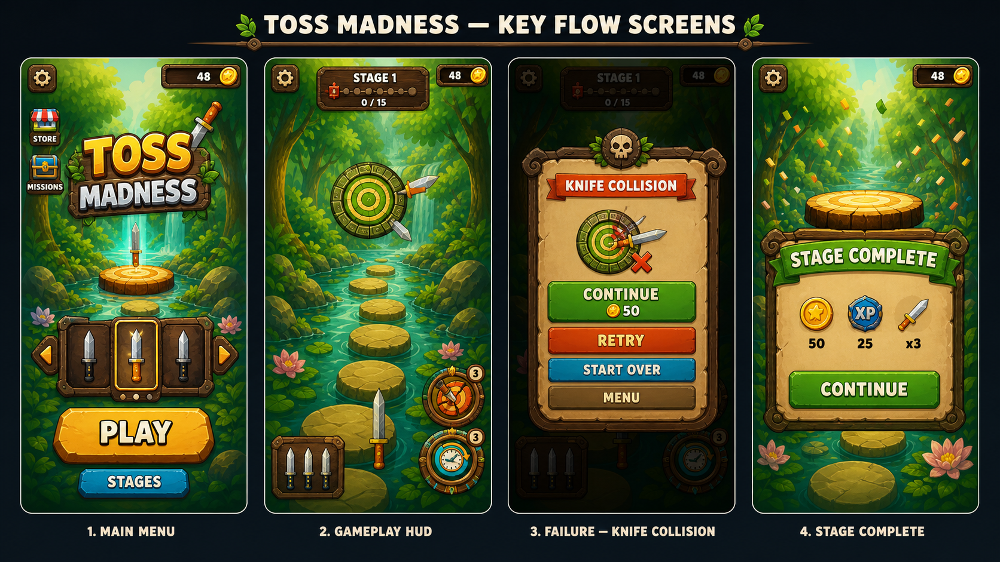
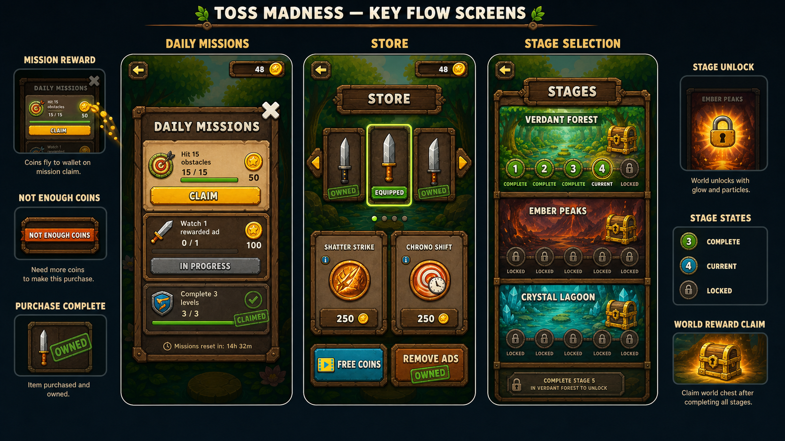
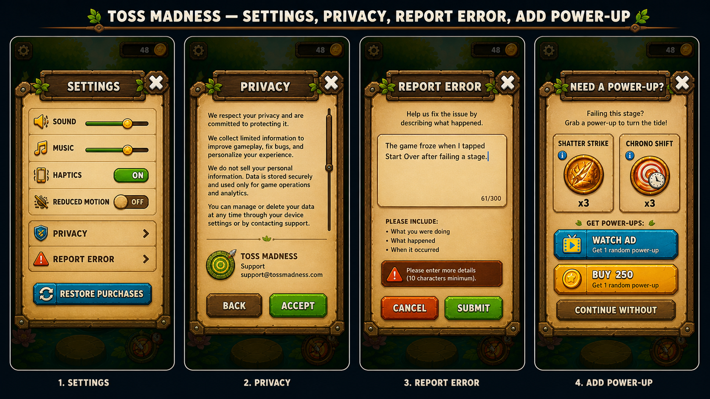
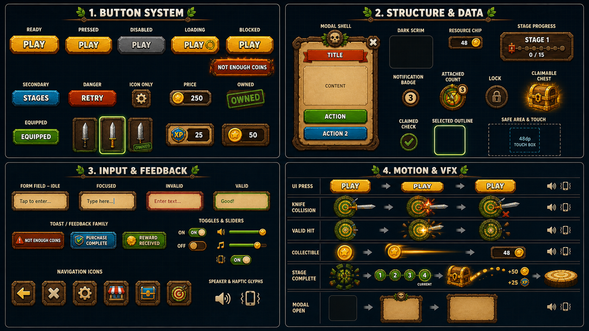

# Toss Madness Game-Wide UX/UI Audit and Build Plan

Date: 2026-08-09

Status: planning only; no implementation tracker status is changed by this document.

## Executive conclusion

The game has a playable core, but the current presentation does not yet read as one
finished product. The main problem is not a lack of isolated VFX hooks. It is the
combination of broken interaction paths, unmanaged UI layering, placeholder/default UI,
inconsistent typography and icon families, weak failure/completion communication, and
secondary screens that use different visual and interaction rules.

Do not start UX-405 as a standalone infrastructure task. First repair the interaction and
layering defects, then build the shared Hand-Carved Forest Arcade UI kit. Typed
VFX/audio/haptic adapters become useful in the core-loop feedback wave, when each cue has
an approved visual, timing, sound, and accessibility contract.

## Target art reference set

Status: the **Core Loop board is an approved production target as of 2026-08-09**. The
Meta/Progression, Modal/Form, and Reusable UI/Feedback boards remain candidate references
pending separate product-owner approval. The Hand-Carved Forest Arcade direction and existing
Phase 2 palette are the foundation; these boards turn that direction into a coherent screen
and component target before implementation begins.

The boards are planning references, not runtime assets. They live outside `Assets` so Unity
does not import them or include documentation textures in project workflows. Implementation
must recreate the approved language with shared Unity prefabs, tokens, layouts, presenters,
and authored production sprites. Do not slice or ship the boards themselves.

### 1. Core loop and primary hierarchy

Covers Main Menu, Gameplay HUD, knife-collision Failure, and Stage Complete. It establishes
one dominant action per surface, an unobstructed throw lane, attached power-up counts,
modal-over-guidance layering, explicit failure cause, and a clean completion/reward handoff.

### 2. Meta and progression screens

Covers Daily Missions, Store, and Stage Selection, including claimable/in-progress/claimed,
owned/equipped, purchase success/blocked, complete/current/locked, world unlock, and world
reward states. Scroll discovery and state truth must come from layout and controls, not
clipped content or repeated dead affordances.

### 3. Modals, settings, legal, and forms

Covers Settings, Privacy, Report Error, and Add Power-Up. All four use the same modal shell,
scrim, title/close contract, content spacing, and action hierarchy. Legal copy, support
identity, validation copy, acquisition rules, and settings availability remain product and
engineering decisions; the board governs presentation structure only.

### 4. Reusable UI and feedback kit

Covers action-button states and variants, modal structure, resource/progress/badge/lock/
claim elements, input and toast states, navigation icon language, safe-area/touch targets,
and motion/VFX storyboards for press, collision, valid hit, collectible, completion, and
modal entry. Timing, audio, haptic, reduced-motion, and mute behavior remain governed by the
feedback cue map and implementation contracts below.

### Coverage and authority

| Production surface or element | Target board | What the board governs |
|---|---|---|
| Main Menu and navigation hierarchy | 1 | Action hierarchy, selector scale, safe placement, shared icon family |
| Gameplay HUD and tutorial guidance | 1 | Throw-lane clearance, progress/resource hierarchy, guidance placement |
| Failure and Continue/Retry/Start Over/Menu | 1 | Cause communication, modal hierarchy, layering, action distinction |
| Completion and next-target handoff | 1 and 4 | Clean temporal separation, reward focus, VFX sequence |
| Daily Missions | 2 | Row hierarchy and claimable/in-progress/claimed truth |
| Store and Remove Ads | 2 | Carousel discovery and purchase/owned/equipped/blocked truth |
| Stage Selection and world rewards | 2 | World differentiation and complete/current/locked/claimable truth |
| Settings, Privacy, Report Error, Add Power-Up | 3 | One modal/form system, readable copy, validation, action rows |
| Buttons, resources, badges, icons, forms, toasts | 4 | Shared materials, silhouettes, states, contrast, spacing |
| Press/hit/collision/collectible/completion/modal feedback | 4 | Visual beats and ordering; detailed timing comes from the cue map |

Authority rules:

- Existing domain, gameplay, economy, store, power-up, progression, and navigation contracts
  remain authoritative. These boards do not authorize any outcome or rule change.
- All prices, rewards, XP, item quantities, mission objectives, world names, email addresses,
  legal copy, and Continue conditions visible in generated art are illustrative placeholders.
  Never implement them without a separately approved product contract.
- Short semantic labels and state distinctions are directional, but final copy must match the
  actual action and localization contract.
- The current Shatter Strike and Chrono Shift button identities remain acceptable. The boards
  only normalize their placement, attached counts, unavailable/selected truth, and feedback.
- The reusable component board governs visual consistency; `ActionButtonPresenter` and the
  existing typed feedback events remain the behavioral foundation for button state semantics.
- Meaning must survive grayscale and muted/reduced-motion/haptic-off modes. Never communicate
  a required state through color, motion, sound, or vibration alone.
- `PVPPlay`, `PowerUpsMenu`, and `Loading` are deliberately absent. They remain deferred,
  unreachable prototype content and must not receive partial production polish in these waves.

The exact generation prompts and provenance record are stored in
[`docs/GameWideUxArtReference/PROMPT_RECORD.md`](docs/GameWideUxArtReference/PROMPT_RECORD.md).
The element inventory, stable task breakdown, dependencies, phase gates, per-screen acceptance
criteria, and implementation evidence requirements are in
[`GAME_WIDE_UX_UI_PRODUCTION_BACKLOG.md`](GAME_WIDE_UX_UI_PRODUCTION_BACKLOG.md).

## Audit method and coverage

The audit combined repository and scene inspection with live Unity Play Mode journeys,
real Input System gameplay through `GameplayPlaytestHarness`, Console review, hierarchy
and missing-reference checks, and short frame recordings encoded to H.264 MOV files and
decoded again for inspection.

Player-facing paths exercised:

- Main Menu idle, opening gesture, Play, Stages, Shop, Daily Missions, Remove Ads, knife
  selector state, currency chip, and Settings entry.
- Store entry/exit, horizontal knife offers, power-up offers, rewarded-ad CTA, insufficient
  funds, purchase submission, and Remove Ads completion.
- Stage Selection entry/exit, vertical world list, locked/unlocked stages, stage selection,
  stage reward controls, and world chest controls.
- Gameplay entry, real throws, valid impacts, collectibles, crack progression, intentional
  knife collision, failure, Continue, Start Over, return to menu, level completion, automatic
  next-level handoff, power-up controls, and tutorial gesture states.
- Settings, Privacy, Report Error, and Add Power-Up presentation were opened directly after
  the normal Settings entry was proven broken.
- `PVPPlay`, `PowerUpsMenu`, and `Loading` were inspected separately because they are not
  reachable from the current Main Menu and are not production build scenes.

Save mutations caused by progression and mock purchase testing were restored byte-for-byte
after Play Mode.

## What is working

- The core throw, target-hit, stuck-knife, collision failure, retry, stage restart, and
  return-to-menu flows execute.
- Store and Stages transitions complete without warnings or errors in the reachable flow.
- Valid Store rejection uses the typed `Not enough coins` feedback.
- Button loading prevents duplicate submissions, and Retry returns to input-ready gameplay
  quickly.
- The strongest wood frames, painted backgrounds, logo, target silhouette, knife
  silhouette, and current power-up controls provide usable foundations.
- Production-flow Play Mode produced no Unity errors or warnings. C# compilation reported
  zero errors/warnings.

## Confirmed defects and UX gaps

### P0 — broken or misleading interaction

1. **Settings is unreachable.** Both the wrapper and child objects carry
   `SettingsButtonView`, and both subscribe to the same `Button`. A tap toggles Settings
   open and immediately closed. On Main Menu, the only Settings popup also belongs to the
   hidden preloaded `StagePlay` canvas, so it could not render there even with one
   subscription.
2. **World chest CLAIM buttons are dead affordances.** Five visible, interactable chest
   buttons are present in Stage Selection, but `UiWorldStageRow` does not bind them. Tapping
   one produces no action or feedback. Off-screen chest buttons also remain interactable.
3. **Modal and tutorial layers do not have a single ownership contract.** Gesture hints and
   power-up guidance render over Missions, Settings, Privacy, Report Error, Add Power-Up,
   and Failure. Background HUD controls remain active while modals are shown. The visual
   focus, input focus, and sorting order disagree.
4. **StagePlay contains ten missing TMP font/material references** in Failure text and
   actions. Runtime fallback rendering hides the missing references while producing
   visibly inconsistent typography.
5. **There is no safe-area implementation.** All production canvases target 1080×1920,
   but no runtime code applies `Screen.safeArea`. Back, Settings, currency, and progress
   controls sit close to physical-screen edges.

### P1 — core-loop communication

1. **Failure cause is not readable.** The collision-to-modal transition is nearly
   immediate. The modal says Stage/Level but never says what happened. Crossed swords do
   not clearly distinguish a knife collision from other failure causes.
2. **Failure actions have the wrong hierarchy.** Free Continue is shown as `0` currency on
   a generic green button. Start Over is plain text without a reliable secondary-button
   affordance. Retry/Continue rules are not explained.
3. **Completion is visually tangled and too abrupt.** The decoded completion video shows
   old target slices overlapping a fully formed next target. Progress advances immediately,
   with no readable success beat, reward travel, or clear level handoff.
4. **HUD progress is too small and cryptic.** Stage/level shields and dots do not explain
   current level, remaining targets, or completion. Power-up counts float separately from
   their controls.
5. **Tutorial guidance obscures the UI.** The large gesture graphic has no supporting copy,
   can sit over the throw lane or actions, and is not suppressed while a modal is open.
6. **Scene changes feel like hard cuts.** Menu-to-Store, Menu-to-Stages,
   Stages-to-Gameplay, and Failure-to-Menu are functionally fast but have no consistent
   transition language or destination confirmation.

### P1 — screen cohesion and clarity

1. **Main Menu:** strong logo/background foundation, but unrelated icon styles, mixed font
   treatments, oversized disabled knife arrows, an unclear stage sign, unlabeled secondary
   actions, and the gesture graphic compete with Play.
2. **Store:** useful wood/card foundation, but clipped third offers are the only horizontal
   scroll cue, purchase/owned/equipped states are weak, success has no confirmation, and
   the rewarded-ad CTA does not explain whether it grants currency or buys an item.
3. **Daily Missions:** readable structure but generic disabled green claim buttons, weak
   progress hierarchy, no claim animation, and foreground icons can overlap the modal.
4. **Stage Selection:** repeated placeholder title `Woods Something`, duplicated world
   art, an inconsistent `Stage 3` world title, weak locked/current/completed distinction,
   and many tiny persistent CLAIM controls.
5. **Settings:** no title, no close affordance, a default checkbox, tiny unlabeled controls,
   excessive empty space, and no consistent row layout.
6. **Privacy:** literal placeholder product/developer/support fields, dense small copy, weak
   contrast, unclear scrolling, and a generic `Approve` action.
7. **Report Error:** default gray form field, no title/instructions/validation state, generic
   Submit/Cancel buttons, and no keyboard/safe-area treatment.
8. **Add Power-Up:** no title or reason for appearing, ambiguous ad/currency CTA, plain-text
   Continue action, and no clear acquisition hierarchy.
9. **Remove Ads:** the mock purchase completed, then the icon simply became unavailable;
   there was no success confirmation or durable owned label.

### P1 — feedback coverage

Existing coverage:

- Throw, target hit, knife collision, collectible, win, and lose audio clips are wired.
- Valid target hits spawn one particle family and play target shake/tint/crack feedback.
- Target spawn and shatter animations exist.
- Currency gain/spend presentation hooks exist.

Missing or incomplete coverage:

- `ButtonClickClip` and `KnifeLoadClip` are configured but unused.
- No runtime haptic call exists despite the haptic package being installed.
- No ambient loop or music direction is implemented.
- Knife collision has no dedicated hazard particle burst; it relies on a very brief screen
  flash and audio before the modal appears.
- The configured collectible particle entry is not registered or consumed.
- Purchase, equip, ownership, reward claim, mission completion, stage unlock, blocked
  power-up use, modal open/close, and navigation do not have coherent cue families.
- Completion cues are not orchestrated; shatter, new target spawn, progress, reward, and
  tutorial guidance compete in the same moment.

### P2 — dormant/prototype content

- `PVPPlay` is outside build settings and has no Main Menu button reference. Direct Play
  Mode shows placeholder status text, one upside-down label, and two NullReferenceExceptions
  from `PVPInstaller`/`PVPFlowController`.
- `PowerUpsMenu` is outside build settings and has no Main Menu button reference. It is an
  obvious prototype with a clipped default button, tiny rows, no title, and the old blue
  loading background.
- `Loading` is outside build settings. It is a generic blurred blue plate with plain
  `Loading` text and no logo, progress, failure, offline, or retry state.

These scenes must remain explicitly unreachable and excluded until a product decision
funds them. They should not receive partial polish during the core vertical-slice rebuild.

## One-product presentation contract

Keep the approved **Hand-Carved Forest Arcade** direction and turn it into reusable
production prefabs rather than one-off screen fixes.

### Required UI layers

1. `World`: background, target, knives, collectibles, world VFX.
2. `HUD`: progress, currency, settings, magazine, power-ups.
3. `Guidance`: tutorial hints; automatically suppressed by any modal or transition.
4. `ModalScrim`: one input blocker owned by a modal stack.
5. `Modal`: Settings, Missions, Failure, Privacy, Report, acquisition, rewards.
6. `Toast`: typed non-modal feedback above ordinary UI but below critical failure flash.
7. `CriticalFeedback`: short collision flash and accessibility-safe urgent feedback.

Only the top modal receives input. Hidden/preloaded canvases must not own player-facing
controls. Guidance never renders above a modal.

### Required reusable visual kit

- Primary, secondary, danger, icon-only, price, owned/equipped, disabled, loading, and
  blocked button prefabs using the existing shared state presenter.
- Wood/parchment primary panel and modal shell with title, content, action row, scrim, and
  close/back slots.
- Canonical resource chip, progress indicator, badge, lock, claim, check, and notification
  icons.
- Lilita One heading/action styles and Liberation Sans body/legal/form styles with explicit
  TMP assets and fallbacks.
- Parchment form field with focus, validation, success, and keyboard-safe layout.
- Safe-area root, 8 dp grid, 48 dp minimum touch targets, and layouts validated at 16:9,
  19.5:9, 20:9, and a representative tablet aspect.

The current power-up button art does not need a broad redesign. Keep its Shatter/Chrono
identity and only correct concrete issues: guidance overlap, badge/count attachment,
selected/unavailable truth, and HUD alignment.

## Feedback cue map

| Moment | Motion/VFX | SFX | Haptic |
|---|---|---|---|
| UI press | Existing short scale response | Soft carved-wood click | Light selection, optional |
| Navigation | 150–250 ms panel/leaf transition | Short wood/leaf whoosh | None |
| Knife throw/load | Preserve silhouette; short trail only when useful | Existing throw + distinct load | Light throw tap |
| Valid target hit | SunGold/white core, small wood chips, crack pulse | Related impact family | Light impact |
| Knife collision | Ember/Failure opposing sparks, 40–80 ms flash, tiny hit-stop/nudge | Sharp metal clash + low failure accent | Heavy/rigid impact |
| Collectible | Gold/lagoon pickup and travel to resource chip | Short pickup/coin family | Light success |
| Target/level complete | 0.6–0.9 s material-aware shatter, progress pulse, reward travel, clean next-target entrance | Compact win flourish | Medium success |
| Power-up activate | Retain control art; Ember/SunGold or Lagoon world cue | Power-up-specific family | Medium contextual |
| Purchase/claim success | Spend pulse, stamp/check, owned/equip or reward travel | Buy/claim confirmation | Medium success |
| Blocked/unaffordable | Existing typed toast + short blocked motion | Soft denied cue | Warning pulse |
| Modal open/close | Small wood-panel settle/fade | Soft knock/open-close | None |

Every cue needs mute, reduced-motion, and haptic-disabled behavior. Meaning may not depend
only on color, shake, audio, or vibration.

## Build sequence

### Pre-build gate — target-reference approval

1. Keep the Core Loop board locked as approved; review the other three boards at full size
   and record approve/revise notes by board and screen.
2. Approve the shared material, typography, icon-weight, spacing, and action-hierarchy
   language before any screen-specific production art is commissioned.
3. Resolve the product decisions that materially affect Failure, Completion, acquisition,
   Settings, legal, and reward layouts; replace every illustrative value before prefab work.
4. Convert approved visual specimens into a finite asset/prefab inventory with ownership,
   source/provenance, target size, nine-slice, animation, audio, and accessibility needs.

Exit gate: every reachable production screen and shared component is approved or carries an
explicit revision note; no generated placeholder copy/value is mistaken for a product rule.

### Wave 0 — interaction and layer repair

1. Give Settings one owner and one click subscription; make a valid Settings host available
   from both Main Menu and gameplay.
2. Introduce the modal-stack/layer contract and suppress Guidance while any modal is open.
3. Hide or properly bind world chest CLAIM controls; no visible action may be a no-op.
4. Restore explicit TMP font/material references in StagePlay and define project fallbacks.
5. Add a reusable safe-area root and minimum-touch-target validation.
6. Add a release test proving PVP/PowerUpsMenu/Loading remain unreachable while deferred.

Exit gate: Settings, every modal back/close route, Stage chest controls, and all four build
scenes pass with zero dead taps, zero interaction leaks, zero missing references, and zero
Console warnings/errors.

### Wave 1 — shared visual kit and screen shell

1. Build the reusable panel/modal/button/resource/form/navigation prefabs from the approved
   tokens.
2. Lock typography, icon silhouettes, shadows, outline weights, spacing, and safe-area
   behavior.
3. Create a small UI gallery scene or Editor preview that shows every state without
   changing saves or economy.
4. Replace default green rectangles, white/gray form controls, and unrelated purple panels
   at the prefab level.

Exit gate: all required UI states are previewable, readable at phone size and grayscale,
and reusable without per-screen styling code.

### Wave 2 — core play loop

1. Redesign the gameplay HUD hierarchy and progress communication without changing game
   rules.
2. Rebuild Failure: explicit cause, Retry/Continue primary hierarchy, Start Over secondary,
   meaningful free/ad/currency labels, and clear return.
3. Approve and implement the non-blocking completion timeline so shatter, progress, reward,
   next target, and tutorial guidance never overlap incoherently.
4. Add typed VFX/audio/haptic presentation adapters as part of these approved cue contracts.
   This is when UX-405 should begin.
5. Preserve the current power-up mechanics and base button art; refine only authoritative
   states, attachment, and feedback.

Exit gate: real-input videos demonstrate valid hit, collision failure, Continue, Start
Over, return, target completion, next-level handoff, both power-ups, mute, reduced motion,
and haptic-off fallbacks.

### Wave 3 — Main Menu and secondary screens

1. Normalize Main Menu hierarchy, icons, knife selector, stage indicator, and onboarding
   gesture against the shared kit.
2. Rebuild Settings, Privacy, Report Error, and Add Power-Up with the modal/form system.
3. Refine Store scrolling discovery, selected/owned/equipped states, purchase success,
   insufficient funds, ad CTA meaning, and Remove Ads ownership feedback.
4. Refine Missions progress/claimability/claim reward and notification behavior.
5. Refine Stage Selection naming, placeholder labeling, locked/current/completed/claimed
   states, reward controls, scroll position, and back navigation.
6. Apply one short transition language to Main Menu, Store, Stages, gameplay entry, and
   return.

Exit gate: fresh and progressed saves can traverse every reachable screen without dead
controls, placeholder copy, default UI, unclear back behavior, or accidental save/economy
changes.

### Wave 4 — sound, mix, accessibility, and device proof

1. Curate one related sound family for UI, throw/load, impact, collision, shatter,
   collectible, reward, purchase, and power-up cues; remove unused/duplicate pack choices
   from production configuration.
2. Decide music/ambient direction and mix hierarchy. Do not add a loop merely to fill
   silence.
3. Define haptic intensity mapping and a haptic-off setting.
4. Implement mute and reduced-motion contracts across every presenter.
5. Validate touch ergonomics, safe areas, audio balance, vibration, frame pacing, thermals,
   and readability on representative Android phones and the target iPhone.

Exit gate: device recordings and logs prove consistent presentation, acceptable mix and
performance, and no accessibility mode loses required meaning.

## Recommended first implementation batch

Start with a narrow foundation batch before any screen redesign:

1. Settings ownership/subscription fix.
2. Modal stack plus guidance suppression.
3. Dead Stage chest control removal/binding.
4. StagePlay TMP reference repair.
5. Safe-area root and touch-target checks.

This batch removes concrete broken behavior and establishes the layer contract every later
screen will use. After it passes, build the shared visual kit, then tackle Failure and
Completion as the first high-impact polished vertical slice.

## Product decisions required before relevant waves

- Continue rules and copy: free, ad, currency, unavailable, and repeat-attempt behavior.
- Completion reward accumulator semantics and where the player sees the total.
- Final tutorial sequence, first taught power-up, and empty-inventory behavior.
- Whether PVP, PowerUpsMenu, and Loading should be rebuilt later or removed from the active
  product roadmap.
- Marketplace/legacy art provenance and replacement decisions.
- Music direction, reduced-motion policy, and haptic intensity/default policy.

## Validation matrix for implementation

- Fresh save: launch, onboarding gesture, Play, first throw, first failure, Continue,
  Start Over, completion, power-up teaching, return.
- Progressed save: Main Menu, knife selector, Missions, Store success/failure/ad, Stages,
  stage reward, power-ups, Settings/Privacy/Report/Restore, Remove Ads ownership.
- Transitions: Main↔Store, Main↔Stages, Main→Gameplay, Failure→retry/start-over/menu,
  completion→next level/stage.
- State: ready, pressed, disabled, loading, blocked, success, owned/equipped, locked,
  claimable, claimed, muted, reduced motion, haptics off.
- Resolutions/devices: 16:9, 19.5:9, 20:9, tablet; low/mid/high Android and target iPhone.
- Evidence: focused tests, full relevant EditMode/PlayMode suites, Console zero
  errors/warnings, missing-reference scan, short encoded video inspected after every
  multi-frame change, and save restoration after economy/progression validation.

## Current risks

- Audio, haptics, safe areas, thermals, and touch latency still need physical-device proof.
- PVP throws runtime exceptions when opened directly and must remain unreachable.
- Existing asset-pack and legacy-art provenance is not fully resolved.
- The current 1080×1920-only review cannot prove notch, cutout, tablet, or small-device
  readability.
- Completion reward semantics and Continue monetization rules can materially change final
  layouts and should be decided before those screens are approved.
