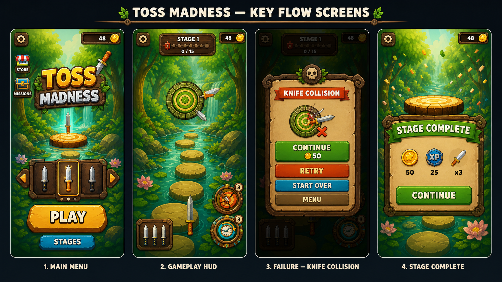
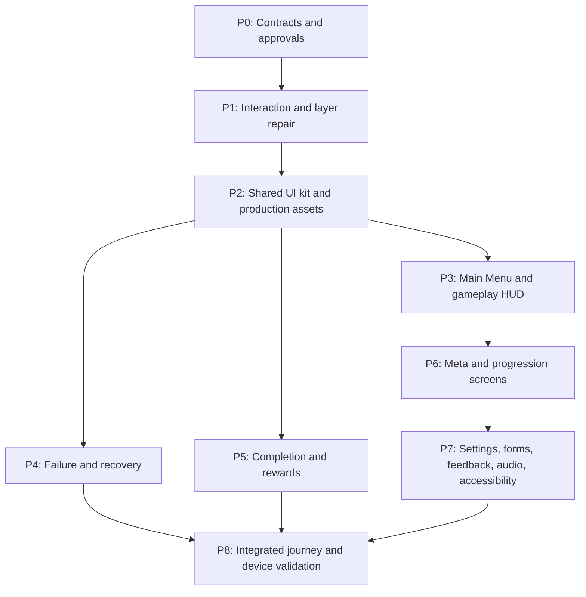

# Toss Madness Game-Wide UX/UI Production Backlog

Date: 2026-08-10

Status: P0 decisions are recorded and the P1 interaction/layer foundation is implemented
and validated. The Meta/Progression, Modal/Form, and Reusable UI/Feedback boards remain
candidate references until separately approved; P2 and later phases remain planned work.

Companion documents:

- [Game-Wide UX/UI Audit and Build Plan](GAME_WIDE_UX_UI_AUDIT_AND_BUILD_PLAN.md)
- [Core Gameplay Refinement Tracker](CORE_GAMEPLAY_REFINEMENT_TRACKER.md)
- [Core Gameplay Refinement Phases](CORE_GAMEPLAY_REFINEMENT_PHASES.md)
- [Target-art prompt and provenance record](docs/GameWideUxArtReference/PROMPT_RECORD.md)

Approved target:

Candidate supporting references:

- [Meta and progression](docs/GameWideUxArtReference/02_Meta_Progression_Target.png)
- [Modals and forms](docs/GameWideUxArtReference/03_Modals_Forms_Target.png)
- [Reusable UI and feedback](docs/GameWideUxArtReference/04_Reusable_UI_Feedback_Target.png)

## How to use this backlog

This document breaks the visual target into production elements, screen work packages,
implementation tasks, dependencies, and evidence gates. It does not replace the tracker.
When implementation finishes, update the matching existing tracker item with evidence; do
not silently mark work complete here.

Authority order:

1. Existing gameplay, economy, store, progression, navigation, and power-up behavior.
2. Approved product decisions and the live tracker.
3. This production backlog and its acceptance criteria.
4. Target boards for visual hierarchy and art direction.

Generated prices, rewards, quantities, XP, world names, support addresses, legal text, and
Continue conditions are never authoritative. The boards are not sprite sheets and must not
be sliced into runtime assets.

## Scope boundaries

In scope:

- Main Menu, gameplay HUD, Failure, Completion, Daily Missions, Store, Stage Selection,
  Settings, Privacy, Report Error, Add Power-Up, shared UI,
  transitions, VFX, SFX, haptics, and accessibility fallbacks.
- Reusable prefabs, tokens, typed presentation adapters, production sprites, focused tests,
  screen recordings, Console review, and device validation.

Out of scope:

- Gameplay outcomes, prices, rewards, inventory quantities, power-up mechanics, balance,
  stage rules, navigation rules, release identities, Firebase, build profiles, or project
  settings unless a separate task explicitly authorizes them.
- Tutorial, onboarding, gesture-prompt, spotlight, and forced-focus flows. These are
  intentionally excluded from the product unless a later explicit product decision reverses it.
- PVP, the dormant PowerUpsMenu, and Loading prototypes.
- Bulk world-content production or redesign of the current Shatter Strike and Chrono Shift
  button identities.

## Dependency flow

P4 and P5 may proceed in parallel after P2, but both must use the same modal, feedback,
motion, audio, and accessibility contracts.

## Production element inventory

### Shared visual and layout elements

| ID | Element | Action | Production deliverable | Required states/variants | Used by |
|---|---|---|---|---|---|
| EL-001 | Safe-area root | New | Reusable prefab/component with device inset application | Portrait phone, tablet, Editor preview | Every screen |
| EL-002 | Spacing and sizing tokens | Formalize | 8 dp grid, standard margins, gaps, radii, outline and shadow weights | Compact, regular, spacious where approved | Every screen |
| EL-003 | Typography tokens | Refine | Explicit TMP heading, action, body, legal, value and caption styles with fallbacks | Normal, emphasized, disabled, error, link | Every screen |
| EL-004 | Color/material tokens | Formalize | Ink, WoodDark, WoodMid, Parchment, SunGold, Ember, Lagoon, Leaf, Failure and ivory tokens | Normal, dimmed, selected, blocked, success | Every screen |
| EL-005 | Modal layer stack | New | World/HUD/Scrim/Modal/Toast/CriticalFeedback ownership | No modal, one modal, nested route, teardown | Gameplay and popups |
| EL-006 | Modal scrim | New | Full-safe-area input blocker with controlled fade | Enter, active, exit, reduced motion | All modal surfaces |
| EL-007 | Wood/parchment modal shell | New | Nine-sliced frame with title, close, content and action slots | Standard, compact, scrollable, danger | Failure, Completion, Missions, Settings, forms |
| EL-008 | Panel/card frame family | Refine/New | Shared nine-sliced world card, offer card, mission row, selector slot | Ready, selected, locked, complete, owned | Menu, Store, Missions, Stages |
| EL-009 | Navigation icon family | Replace/Refine | Back, close, settings, Store, Missions and stage/map icons | Ready, pressed, disabled, notification | All navigation |
| EL-010 | Resource chip | Refine | Coin icon, value, optional plus/action slot | Stable, gain, spend, insufficient, loading | Menu, HUD, Store |
| EL-011 | Progress component | New | Stage label, target/level markers and clear current/completed states | Current, completed, upcoming, stage complete | HUD, Stages |
| EL-012 | Badge family | Refine | Inventory count, notification, lock, claimed, owned and equipped marks | Available, zero, locked, claimable, claimed | Menu, HUD, Store, Missions, Stages |
| EL-013 | Knife selector | Refine | Three-card carousel/selector with arrows and selection highlight | Previous, current, next, owned, locked | Main Menu, Store |
| EL-014 | Knife magazine | Refine | Compact remaining-knife dock with clear silhouettes | Full, partial, final knife, empty | Gameplay HUD |
| EL-016 | Form field | New | Parchment input field with label, prompt, count and error line | Idle, focused, invalid, valid, disabled | Report Error |
| EL-017 | Toggle/slider family | New | Carved setting rows and controls | On, off, muted, disabled, focused | Settings |
| EL-018 | Scroll affordance | New | Page dots, next-card arrow, scroll bar or continuation treatment | Start, middle, end | Store, Stages, Privacy |

### Button and state elements

`ActionButtonPresenter` remains the shared behavior owner. Screen code supplies action truth;
the presenter supplies presentation and duplicate-submit prevention.

| ID | Variant/state | Visual target | Behavioral contract |
|---|---|---|---|
| BTN-001 | Primary | SunGold carved face, ivory/Ink readable label, strong depth | One dominant action per surface |
| BTN-002 | Secondary | Blue/Lagoon or restrained wood face | Clearly actionable but below primary |
| BTN-003 | Danger/recovery | Ember/Failure face and explicit copy | Used only when destructive or urgent meaning is real |
| BTN-004 | Icon-only | Square carved socket, authored icon, 48 dp minimum | Accessible name and deterministic pressed state |
| BTN-005 | Price | Action label plus resource icon/value | Value comes from existing economy presenter; never baked into art |
| BTN-006 | Owned/equipped | Stamp/check/selection outline | Cannot submit a purchase when action is not valid |
| BTN-007 | Pressed | Short compression and reduced shadow | Only while pointer is actively held; returns cleanly on cancel/disable |
| BTN-008 | Disabled | Desaturated/dimmed but legible | Preserves existing interactability rules; no submission |
| BTN-009 | Loading | Label context plus small spinner/progress cue | Blocks duplicate submission until completion/cancel/teardown |
| BTN-010 | Blocked | Brief Ember denial pulse plus typed feedback | Transient response to rejected attempt; not a persistent disabled state |

State precedence remains `Blocked > Loading > Disabled > Pressed > Ready`. Owned, equipped,
selected, locked, claimable and claimed are domain-driven semantic variants layered through
screen-specific presenters; they do not replace the shared action-state precedence.

### Feedback, VFX, SFX, and haptic elements

| ID | Moment | VFX/motion deliverable | Audio deliverable | Haptic/accessibility deliverable |
|---|---|---|---|---|
| FB-001 | UI press | Compression/release and short shadow change | Soft carved-wood click | Optional light selection; static contrast fallback |
| FB-002 | Navigation | 150–250 ms shared transition language | Short wood/leaf whoosh | No required haptic; instant reduced-motion fallback |
| FB-003 | Valid target hit | Gold-white core, small chips, crack pulse | Related impact family | Light impact; no shake-only meaning |
| FB-004 | Knife collision | Opposing sparks, 40–80 ms warm-red flash, tiny nudge/hit stop | Metal clash plus restrained failure accent | Heavy/rigid pulse; icon/cause copy persists |
| FB-005 | Collectible | Lagoon/Gold pickup and resource travel | Pickup/coin family | Optional light success; direct value update persists |
| FB-006 | Completion | Clean shatter, progress pulse, reward travel, delayed next-target entrance | Compact win flourish | Medium success; sequential non-motion fallback |
| FB-007 | Purchase/claim | Spend pulse, check/stamp, ownership/reward travel | Buy/claim confirmation | Medium success; status text persists |
| FB-008 | Blocked action | Existing typed toast plus short denial motion | Soft denied cue | Warning pulse; text/icon remains authoritative |
| FB-009 | Modal open/close | Scrim fade and short panel settle | Soft knock/open-close | Instant reduced-motion state change |
| FB-010 | Power-up activate | Retain current control art; add contextual world cue | Distinct Shatter and Chrono families | Medium contextual; timer/value remains readable |

## Screen work packages

### Main Menu — approved target

Elements:

- Safe-area Settings and currency/resource chip.
- Store and Missions as a matched secondary-navigation family with notification support.
- Existing logo retained as the main brand anchor.
- Central knife/target hero area that remains quieter than Play.
- Three-card knife selector with restrained arrows and authoritative ownership/selection.
- One dominant Play action and subordinate Stages action.
- Consistent enter/return transition.

Behavior to preserve:

- Existing Play, Stages, Store, Missions, Settings, selection, and currency outcomes.
- Existing unlock, ownership, and navigation rules.

Acceptance:

- Play is recognized first at phone size and in grayscale.
- No decorative or disabled control looks more actionable than Play.
- All controls meet safe-area and touch-target requirements.
- Fresh and progressed saves show truthful selector, notification, and currency state.

### Gameplay HUD — approved target

Elements:

- Compact Stage/level/target progress at the top center.
- Settings and resource chip aligned to safe-area corners.
- Knife magazine at lower left.
- Existing Shatter Strike and Chrono Shift controls retained at lower right with counts
  attached to their controls.
- Open central throw lane with no persistent decorative overlay.

Behavior to preserve:

- Throw, target, power-up, inventory, progress and currency rules.
- Current power-up availability, activation, consumption, countdown and cleanup truth.

Acceptance:

- Target, stuck knives and incoming knife remain readable over every retained background.
- HUD never intercepts valid gameplay input outside visible controls.
- Counts, progress and selection update from authoritative runtime state.

### Failure and recovery — approved target structure

Elements:

- Collision flash/VFX beat before the modal settles.
- Full input-blocking scrim and shared modal shell.
- Explicit cause banner/icon and short cause copy.
- Truthful Continue action with cost/ad/free/unavailable presentation supplied at runtime.
- Retry as the dominant recovery action once product hierarchy is confirmed.
- Start Over and Menu as real secondary actions, never bare ambiguous text.

Behavior to preserve:

- Current retry, start-over, Continue and return outcomes until FAIL-504 approves changes.
- Existing currency/ad availability and save behavior.

Acceptance:

- Player can identify the collision cause before choosing an action.
- Every recovery option is visibly distinct and truthfully labeled.
- Loading blocks duplicate submission and all exit/teardown paths restore valid input.
- HUD controls never render or receive input above the modal.

### Completion and handoff — approved visual direction, product values unresolved

Elements:

- Clean cleared-target state with no old slice/new-target overlap.
- Short celebration using wood chips, leaves and SunGold accents.
- Progress pulse and reward travel before the next target enters.
- Optional shared completion shell/summary only where the approved flow calls for it.
- One clear continuation/handoff signal.

Behavior to preserve:

- Existing progression and reward writes remain authoritative.
- No XP, knife rewards, quantities or modal stop are implied by the generated board.
- Automatic progression remains the default hypothesis until COMP-601 is approved.

Acceptance:

- Final hit, completion, reward update and next goal read as separate ordered beats.
- Total presentation target begins at 0.6–1.0 seconds and is tuned through repeated play.
- Pause, quit, reload or scene transition cannot duplicate or lose a reward.
- Reduced motion preserves ordering through static state changes.

### Daily Missions — candidate target

Elements:

- Shared modal shell, close control and scroll/content region.
- Mission rows with icon, concise objective, numeric progress, progress bar and reward chip.
- Claimable, in-progress and claimed action/state variants.
- Reward travel into the authoritative resource chip.

Acceptance:

- Claimable state is obvious without color alone.
- Claim cannot duplicate and claimed state persists after reopening.
- Foreground HUD never overlaps the modal.

### Store — candidate target

Elements:

- Safe-area back, title and resource chip.
- Knife carousel with arrows/page dots and owned/equipped/price truth.
- Current power-up identities in a consistent offer-card shell.
- Clearly labeled rewarded-ad CTA.
- Durable Remove Ads owned state and typed success/failure feedback.

Acceptance:

- All offers are discoverable without relying only on clipping.
- Purchase loading prevents duplicates; success, rejection, owned and equipped are distinct.
- No board value changes actual prices, grants or entitlements.

### Stage Selection — candidate target

Elements:

- Safe-area back/title and stable vertical scroll position.
- Distinct world cards using real approved world identities or explicit development labels.
- Complete/current/locked stage nodes.
- One properly bound world-reward/chest affordance when a real claim exists.
- Unlock and claim feedback using shared typed events.

Acceptance:

- No visible control is a no-op.
- Off-screen controls cannot receive input.
- Locked/current/completed/claimable/claimed remain readable in grayscale.

### Settings, Privacy, Report Error, Add Power-Up — candidate targets

Shared elements:

- One modal host, scrim, title, close/back, content and action-row contract.
- Safe-area, scrolling, keyboard avoidance and top-modal-only input.
- Lilita One heading/action and Liberation Sans body/legal/form typography.

Screen details:

- Settings: sound and approved accessibility rows; Privacy, Report and Restore navigation.
- Privacy: real approved legal copy, readable measure, visible scroll progress and explicit
  acceptance/back behavior.
- Report Error: instructions, parchment input, focus/validation/count, Submit and Cancel.
- Add Power-Up: clear reason, current power-up identities, truthful ad/currency acquisition,
  and Continue Without.

Acceptance:

- Settings opens from Main Menu and gameplay through one owner/subscription per button.
- No placeholder identity, legal text, support address or default Unity widget ships.
- Form state, keyboard, cancellation, submission loading and failure cleanup are tested.
- Add Power-Up cannot imply an unavailable acquisition path.

## Detailed production phases

### P0 — contract lock and production inventory

Goal: prevent generated presentation details from becoming accidental product rules.

| Task | Tracker mapping | Status | Deliverable and acceptance |
|---|---|---|---|
| P0-001 Record core-loop visual approval | ART-204/ART-701 | Done | Attached Core Loop board is the approved hierarchy/material target. |
| P0-002 Review remaining three boards | ART-701/UX-801 | Needs approval | Each board receives approve/revise notes; candidate status remains explicit until then. |
| P0-003 Approve Continue matrix | FAIL-504 | Needs decision | Free/ad/currency/unavailable/repeat-attempt rules and exact copy. |
| P0-004 Approve completion contract | COMP-601/COMP-602 | Needs decision | Timeline, automatic progression, reward persistence and summary placement. |
| P0-005 Approve settings/accessibility policy | UX-406 | Needs decision | Sound/music/mute, reduced motion and haptic availability/defaults. |
| P0-006 Approve legal/support content | UX-801 | Needs decision | Product name, developer, support route, privacy text and acceptance semantics. |
| P0-007 Build production asset register | ART-207/ART-703 | Ready | Every keep/refine/replace/new element has owner, source, provenance, target resolution, nine-slice/import settings and consuming prefabs. |
| P0-008 Lock validation baselines | QA-001/ART-201 | Ready | Fresh/progressed saves, current screenshots/video, resolutions and performance baseline recorded. |

Exit gate: the attached core board is locked, other boards are explicitly approved or marked
candidate, and no unresolved product value blocks the first affected screen.

### P1 — interaction, ownership, layering, typography and safe areas

Goal: repair concrete functional defects before replacing visuals.

| Task | Priority | Dependency | Status | Deliverable and acceptance |
|---|---:|---|---|---|
| P1-001 Fix Settings ownership/subscription | P0 | None | Done | One click opens one visible Settings modal from Main Menu and gameplay. |
| P1-002 Introduce modal-stack ownership | P0 | P1-001 | Done | One scrim/input blocker; only top modal receives input; deterministic teardown. |
| P1-003 Remove tutorial guidance | P0 | P1-002 | Done | No tutorial UI, state, persistence, scene wiring, or input interception remains. |
| P1-004 Resolve dead Stage chest controls | P0 | None | Done | Bind only to a real action or hide/remove the affordance; off-screen input disabled. |
| P1-005 Repair StagePlay TMP references | P0 | None | Done | Zero missing font/material references and explicit fallback configuration. |
| P1-006 Add reusable safe-area root | P0 | None | Done | Verified at 16:9, 19.5:9, 20:9 and tablet previews. |
| P1-007 Add touch-target validation | P1 | P1-006 | Done | Player actions meet 48 dp minimum or documented exception. |
| P1-008 Protect deferred scenes | P1 | None | Done | Automated/release check proves PVP, PowerUpsMenu and Loading remain unreachable. |
| P1-009 Add focused foundation tests | P0 | P1-001..008 | Done | Ownership, stacking, input blocking, cleanup, safe-area and dead-control tests pass. |

#### P1 implementation evidence — 2026-08-10

- Main Menu and StagePlay each resolve one Settings button owner and one scene-local
  Settings/Privacy/Report modal host; the gameplay controller no longer owns Settings UI.
- The scene-scoped modal coordinator gives the newest remaining modal top ownership,
  aggregates blocking/suppression authority across overlapping fades, and releases that
  authority deterministically on hide, disable, destroy, or coordinator disposal.
- Tutorial guidance was removed by product direction: no hand, spotlight/dimmer, gesture
  popup, onboarding persistence, scene reference, stage controller, or tutorial-only modal
  authority remains.
- The unbound world-row chest and coin-plus affordances are inactive and non-interactive;
  the real per-stage reward Claim path remains intact.
- StagePlay has no unresolved TMP font/material references and TMP Settings names an
  explicit project fallback font.
- Reusable safe-area roots are installed in Main Menu, StagePlay, Stages Menu, and Store;
  EditMode profile tests cover 16:9, 19.5:9, 20:9, and tablet insets. Physical-device
  notch, gesture-bar, and navigation-bar validation remains part of P8-006.
- Reusable 48 dp hit padding and runtime validation cover reachable static and dynamically
  instantiated actions, including stage selectors and reward Claim buttons, without
  changing visual layout or power-up identities.
- Asset-integrity tests prove the Android profiles exclude Loading, PVP, and PowerUpsMenu,
  the Main Menu has no references to those routes, and no Loading route is callable.
- Focused tutorial-removal integrity coverage passed 1/1; the complete EditMode suite
  passed 135/135. Unity
  Play validation covered Main Menu, gameplay, Stages, and Store with zero
  Console errors or warnings. The modal sequence and clean Play-to-gameplay route were
  captured and inspected, with no tutorial object or input interception present.

Exit gate: passed in Editor and automated coverage with zero dead taps, input leaks,
missing references, or preview-profile safe-area failures across reachable scenes; clean
Console and no behavior/economy changes. Physical-device coverage remains assigned to P8.

### P2 — shared UI kit and production art

Goal: create reusable production elements before rebuilding screens.

| Task | Priority | Dependency | Deliverable and acceptance |
|---|---:|---|---|
| P2-001 Create semantic UI token assets | P0 | P0-007 | Palette, type, spacing, outline, shadow, motion and layer tokens are centralized. |
| P2-002 Produce button sprite family | P0 | P2-001 | Primary, secondary, danger, icon, price, owned/equipped art supports nine-slice and gameplay-size readability. |
| P2-003 Skin shared button presenter | P0 | P2-002 | UX-402 semantics remain deterministic; no per-screen state copies. |
| P2-004 Produce modal/panel/card family | P0 | P2-001 | Shared modal shell, rows, cards, scrim and scroll variants. |
| P2-005 Produce navigation/icon family | P0 | P2-001 | Back/close/settings/Store/Missions/map plus badge/lock/check family. |
| P2-006 Produce resource/progress components | P0 | P2-001 | Coin chip, stage progress, markers, reward chips and magazine dock. |
| P2-007 Produce form/toggle components | P1 | P2-001 | Field, validation, toggle, slider and keyboard-safe layout. |
| P2-008 Integrate current power-up art | P0 | UX-408 | Keep Shatter/Chrono identity; attach counts and authoritative state overlays. |
| P2-009 Build UI gallery/debug scene | P1 | P2-003..008 | Preview every visual/state variant without save/economy mutation. |
| P2-010 Validate imports and budgets | P0 | P2-002..008 | Provenance, PPU, compression, atlas, mip/filter, memory and grayscale checks pass. |

Exit gate: every shared element is previewable at phone size, uses one state model and token
set, and has production source/provenance. No generated board pixels ship.

### P3 — Main Menu and gameplay HUD vertical slice

Goal: establish the approved hierarchy on the two continuously visible core surfaces.

| Task | Priority | Dependency | Deliverable and acceptance |
|---|---:|---|---|
| P3-001 Recompose Main Menu hierarchy | P0 | P2 | Safe top controls, retained logo, quieter hero area, selector, dominant Play and secondary Stages. |
| P3-002 Normalize Main Menu navigation | P0 | P1/P2 | Store/Missions/Settings use one icon/action language and truthful notifications. |
| P3-003 Refine knife selector | P1 | P2 | Clear current/owned/locked states; arrows do not dominate or imply invalid input. |
| P3-004 Recompose HUD hierarchy | P0 | P2 | Progress/resource/magazine/power-up layout leaves the throw lane clear. |
| P3-005 Attach power-up count/state | P0 | P2-008 | Counts and selection/unavailable/timer truth remain attached and readable. |
| P3-007 Add menu/gameplay transition | P1 | FB-002 contract | Shared short language without navigation-rule change. |
| P3-008 Validate core surfaces | P0 | P3-001..005/P3-007 | Fresh/progressed real-input captures, grayscale, safe-area and Console evidence. |

Exit gate: Main Menu and gameplay read as one product, Play and throw remain immediate, and
no HUD/control overlap or state lie remains.

### P4 — Failure and recovery

Goal: make collision cause, recovery choices and return-to-input pacing unmistakable.

| Task | Tracker mapping | Dependency | Deliverable and acceptance |
|---|---|---|---|
| P4-001 Add typed presentation adapters | UX-405 | P2 | VFX/audio/haptic subscribers remain presentation-only; domain services stay independent. |
| P4-002 Build collision feedback beat | FAIL-501/ART-704 | P4-001 | Sparks/flash/audio/haptic/copy identify collision before modal choices. |
| P4-003 Rebuild Failure modal | FAIL-502/FAIL-503 | P0-003/P2 | Explicit cause, approved Retry hierarchy, truthful Continue, Start Over and Menu buttons. |
| P4-004 Implement Continue variants | FAIL-504/FAIL-506 | P0-003 | Free/ad/currency/unavailable/cancel/failure states match existing approved outcomes. |
| P4-005 Tune failure pacing | FAIL-505 | P4-002..004 | Collision-to-readable-choice and choice-to-input-ready feel responsive repeatedly. |
| P4-006 Add recovery regression tests | FAIL-506 | P4-003..005 | Retry, Continue, Start Over, Menu, rejection, duplicate input and teardown pass. |
| P4-007 Record and inspect videos | FAIL-501..506 | P4-006 | Encoded collision, modal, every recovery path and reduced-motion result inspected. |

Exit gate: the failure cause and every recovery option are understood without explanation;
all paths restore valid state without duplicate spend, reward or input.

### P5 — Completion, reward and next-target handoff

Goal: make completion satisfying without sacrificing automatic arcade pacing.

| Task | Tracker mapping | Dependency | Deliverable and acceptance |
|---|---|---|---|
| P5-001 Approve timing storyboard | COMP-601 | P0-004 | Ordered final hit, accent, shatter, progress, reward and next-target beats. |
| P5-002 Approve reward presentation model | COMP-602 | P0-004 | Presentation accumulator cannot delay or become the source of reward truth. |
| P5-003 Orchestrate completion cues | COMP-603/ART-704 | P4-001/P5-001 | No old slices/new target overlap; cue priority and cleanup deterministic. |
| P5-004 Add progress/reward presentation | COMP-604/COMP-605 | P5-002/P2 | Player sees what completed, what changed and what comes next. |
| P5-005 Add interruption/idempotency tests | COMP-606 | P5-003..004 | Pause, quit, reload, scene change and duplicate event cannot lose/duplicate rewards. |
| P5-006 Record and inspect videos | COMP-601..606 | P5-005 | Normal/reduced-motion completion and next-target handoff encoded and inspected. |

Exit gate: completion reads as ordered, coherent and fast; rewards remain authoritative and
interruption-safe.

### P6 — meta and progression screens

Goal: apply the proven kit to action-heavy secondary screens.

| Task | Tracker mapping | Dependency | Deliverable and acceptance |
|---|---|---|---|
| P6-001 Refine Store layout and discovery | STORE-803/UX-801 | Candidate-board approval/P2 | Carousel, next affordance, safe area, back/title/resource hierarchy. |
| P6-002 Implement Store state truth | STORE-801/STORE-802 | P4-001/P2 | Price/loading/blocked/success/owned/equipped/Remove Ads states. |
| P6-003 Refine Missions | MISSION-801 | Candidate-board approval/P2 | Progress, claimable, in-progress, claimed and reward travel. |
| P6-004 Refine Stage Selection | STAGE-801/STAGE-802 | Candidate-board approval/P1/P2 | World labels, nodes, locks, real chest action, scrolling and back. |
| P6-005 Normalize screen transitions | UX-801 | P3-007 | Main↔Store, Main↔Stages and return use one language. |
| P6-006 Add meta regression tests | Phase 8 | P6-001..005 | Fresh/progressed, low/high currency, owned/equipped, claims, locks and no-op scan. |
| P6-007 Record and inspect videos | Phase 8 | P6-006 | Purchase, rejection, equip, claim, unlock, scroll and navigation evidence. |

Exit gate: every visible action has an outcome or explanation; state survives reopen and
no economy/progression rule changed.

### P7 — settings, forms, accessibility, audio and full feedback

Goal: finish the shared product shell and sensory language.

| Task | Tracker mapping | Dependency | Deliverable and acceptance |
|---|---|---|---|
| P7-001 Rebuild Settings | UX-406/UX-801 | Candidate-board approval/P0-005/P2 | Approved controls only; one owner; clear close/navigation/restore. |
| P7-002 Rebuild Privacy | UX-801 | P0-006/P2 | Approved copy/identity, readable scroll, back/accept contract. |
| P7-003 Rebuild Report Error | UX-801 | P0-006/P2 | Focus/validation/count/loading/cancel/success/failure and keyboard-safe layout. |
| P7-004 Rebuild Add Power-Up | UX-408/UX-801 | Approved acquisition contract/P2 | Truthful reason/options/current power-up art/Continue Without. |
| P7-005 Complete cue library | UX-405/AUDIO-701/ART-704 | P4/P5/P6 | Related UI, hit, collision, collectible, reward, purchase and power-up families. |
| P7-006 Implement accessibility fallbacks | UX-406 | P0-005/P7-005 | Independent mute/reduced-motion/haptic-off; no lost meaning. |
| P7-007 Build feedback sandbox | UX-407 | P2/P7-005 | Every typed cue/state previewable without economy mutation. |
| P7-008 Validate mix/concurrency/pooling | AUDIO-701/ART-704 | P7-005 | Mixer routing, one-shot concurrency, particle lifetime, sorting and low-spec budgets. |

Exit gate: every reachable modal uses one shell/ownership model, all required feedback has
accessible fallback, and default/placeholder UI is gone.

### P8 — full journey and release evidence

Goal: prove the polished product across paths, states and representative hardware.

| Task | Tracker mapping | Dependency | Deliverable and acceptance |
|---|---|---|---|
| P8-003 Run fresh-save journey | QA-901 | P3..P7 | First ten minutes through throw, fail, recover, complete, reward and power-up. |
| P8-004 Run progressed-save regression | QA-902 | P6/P7 | Menu, Store, Missions, Stages, Settings, forms, power-ups and return paths. |
| P8-005 Run interruption matrix | QA-906 | P4..P7 | Offline/ad failure/cancel/pause/resume/quit during action and transition. |
| P8-006 Run resolution and device matrix | QA-903/QA-904 | P8-003..005 | Android low/mid/high and target iPhone; safe areas, touch, latency, mix, haptics, thermals and frame pacing. |
| P8-007 Run production safety checks | QA-905 | P8-003..006 | Forbidden-content scan; deferred scenes remain unreachable; build/release configuration untouched except separately authorized tasks. |
| P8-008 Assemble final evidence | QA-907 | P8-007 | Tests, Console, screenshots, inspected encoded videos, telemetry, save restoration and known issues. |

Exit gate: the complete reachable journey reads as one product, passes real input and device
validation, and has no critical presentation, interaction, persistence or release defect.

## First implementation batch

Do not begin screen art replacement first. The initial implementation batch is:

1. P1-001 Settings ownership/subscription.
2. P1-002 modal-stack ownership.
3. P1-003 tutorial guidance removal.
4. P1-004 dead Stage chest resolution.
5. P1-005 StagePlay TMP reference repair.
6. P1-006 safe-area root.
7. P1-007 touch-target validation.
8. P1-009 focused foundation tests and full relevant EditMode validation.

After that batch passes, produce P2 shared elements. UX-405 begins only when P4 starts and
there are approved collision/failure cue contracts to consume it.

## Per-task implementation template

Every implementation task must record:

- Scope and explicit non-goals.
- Existing component/prefab/event owner.
- Product decisions and unresolved assumptions.
- Assets to keep, refine, replace, remove or create.
- State model, precedence and lifecycle cleanup.
- Input ownership and duplicate-submit behavior.
- Typed feedback/VFX/audio/haptic events consumed or emitted.
- Reduced-motion, mute and haptic-off behavior.
- Focused EditMode/PlayMode tests.
- Real-input Unity path exercised.
- Screenshot plus encoded video for multi-frame behavior.
- Console/compilation result and save restoration.
- Final diff safety check for gameplay, economy, store, power-ups, navigation, scenes,
  project settings, build, Firebase and release configuration.

## Global definition of done

A phase or screen is not complete until:

- Every visible action works or explains why it cannot.
- Input, visual focus and sorting order agree.
- States are truthful before, during and after asynchronous actions.
- No duplicate submission, listener leak or stale state survives disable/destroy/scene change.
- Safe areas, touch targets, localization expansion and keyboard behavior are covered where
  applicable.
- Meaning remains available in grayscale, mute, reduced motion and haptic-off modes.
- Focused tests and the complete relevant suite pass.
- Unity compilation and Console are clean except explicitly investigated external warnings.
- Multi-frame work has an encoded screen video that was decoded/inspected.
- Fresh/progressed saves and affected interruption paths pass without mutation errors.
- No accidental gameplay, economy, balance, power-up, navigation, scene, build, Firebase,
  project-setting or release change appears in the final diff.
- `Assets/_Recovery` remains untouched and no work is staged or committed without explicit
  authorization.

## Remaining risks

- The three candidate boards may require revision before P6/P7 work begins.
- Continue and reward semantics can materially change Failure/Completion layouts.
- Generated target art is visually strong but cannot prove localization, actual content
  density, device safe areas, animation timing or low-spec performance.
- Audio, haptics, touch latency, thermals and safe areas require physical-device proof.
- Marketplace and legacy-art provenance remains incomplete for some retained assets.
- PVP still throws exceptions when opened directly and must remain unreachable while
  deferred.
